# INVENTORY CONTROL TOOL — OPERATIONAL SPECIFICATION & PROCESS FLOWS
**Pizza 4P's India Operations (Multi-Unit Rollout)**  
**Author:** Design Lead | **Owner:** Financial Controller  
**Scope:** 5 to 6 Stores · Central Storage Rooms (Ground-Floor Cold Room & Dry Store)  
**Document Version:** 1.6 (Updated per Owner Round 4 Directives & Single Source of Truth Synchronization)  
**Date:** November 2026  

---

## 0. PURPOSE, SCOPE & PLATFORM ARCHITECTURE

### 0.1 Purpose
The purpose of the Inventory Control Tool is to establish an uncompromised, platform-neutral back-of-house inventory control engine for Pizza 4P's India across 5 to 6 operating restaurants. The app acts as the sole operational ledger for all stock movements entering, dwelling within, and exiting the central storage facilities. It enforces strict individual custody, standardizes section requisitions (Kitchen, Bar, Cheese), automates daily variance reconciliation, and flags reorder needs and expiry risks.

### 0.2 Operational Scope & System Boundaries
1. **Target Scale:** 5 to 6 restaurant outlets, >30 concurrent users.
2. **Physical Facilities Under Scope:**
   - Central Store Rooms only: Ground-Floor Cold Room (`WH-01`) and Ground-Floor Dry Store (`WH-02`).
   - Scalability: Any additional store or warehouse requires formal Financial Controller approval via Flow H.
   - **Exclusion confirmed by Owner (Q9):** Walk-in Freezers are strictly excluded from core Stage 1 scope.
3. **Out of Scope:**
   - Kitchen line stock, cold inserts, prep table holdings, and bar speed rails.
   - Recipe BOM yield conversions (raw material to prep item batch processing).
   - Point of Sale (POS) guest billing and ordering.
4. **Version 1 Data Constraint:**
   - **Quantities ONLY:** Version 1 strictly records, tracks, and derives physical stock quantities (kg and pieces). It stores **NO cost, NO purchase price, and NO valuation data**. All financial inventory valuations remain in SAP / ERP.
   - **Absolute Price Concealment:** Staff in Kitchen, Bar, and Cheese sections have zero access to cost or price data at all layers.

### 0.3 Platform Requirements & Split Architecture (Owner Decisions 2 to 5)
The application architecture is explicitly partitioned to protect kitchen operations from cloud latency or cold starts:
1. **Direct Mobile-to-Database Path for Daily Actions (Decision 3):**
   - High-frequency daily frontline actions (**Request, Issue, Confirm, Count, Balance**) go directly from the mobile phone (PWA) to the managed database (e.g., Supabase / PostgREST / Firebase) over HTTPS / WebSocket.
   - The database engine evaluates Row-Level Security (RLS) policies for **every single read and write**, enforcing Role + Scope (Store ID, Warehouse ID, Section ID).
   - These actions **do not route through the Node server**, guaranteeing that kitchen picking is never blocked if the application server is sleeping, rebooting, or under heavy background load.
2. **Node Application Server Responsibilities:**
   - The Node server is reserved strictly for non-critical, compute-intensive, or background administrative operations:
     - Dispatching user email invitations and password reset links via transactional email.
     - Parsing and validating client-uploaded SAP GRPO export files (detecting header rows, mapping columns, isolating bad lines into quarantine staging).
     - Executing scheduled cron jobs and automated database backup exports.
   - *Cold Start Defense:* If the Node server is waking up from idle on a free/shared plan, the UI displays a clear wait notice (`"Server waking up, please wait a moment..."`) rather than failing silently.
3. **Offline Resilience & Failure Handling (Decision 4):**
   - Frontline transactions are staged in mobile browser `IndexedDB` when network signal in underground storage rooms drops.
   - When connection restores, actions are dispatched once.
   - **Strict Anti-Looping Rule:** Never auto-retry failed actions in an infinite background loop. Log the error once to `t_security_logs`; display a persistent manual retry button for staff.
4. **Automated Scheduled Backups & Free-Tier Monitoring (Decision 5):**
   - Because free-tier managed databases do not provide automated backup snapshots, a daily scheduled cron job exports all primary database tables to company-owned cloud storage (frequency: [Owner to set]).
   - **Platform Readiness Checklist Item:** Free-tier database projects automatically pause after approximately one week of low activity. Operations must enable an automated keep-alive ping or upgrade prior to store launch.
5. **Append-Only Immutable Ledger (Decision 6):**
   - Stock balances must **never be directly edited or updated**. Current inventory is always derived dynamically from `t_stock_movements`.

---

## 1. ROLES, SCOPE & ACCESS CONTROL MATRIX

### 1.1 Role Definitions & Permission Boundaries
Access control operates on a **Permission = Role + Scope** model. A user's scope restricts them to a specific `store_id`, `warehouse_id`, and `section_id`.

| Preset Role | Primary Responsibilities | Scope Restrictions | Price Visibility |
| :--- | :--- | :--- | :---: |
| **System Admin** | - Invites new users by email; initiates password resets.<br>- Manages user activation lifecycle, permissions, and deactivations.<br>- Monitors scheduled database backup jobs and system logs. | Global System Scope. | No (V1 has no prices) |
| **Admin** *(Warehouse Keeper / Storekeeper)* | - Manages warehouse intake, physical QC, and put-away.<br>- Imports SAP GRPO export files into App.<br>- Configures Issue Windows.<br>- Picks and issues stock against authorized requests.<br>- Conducts daily benchmark counts and initiates handovers. | Scoped to assigned Store and Warehouses. | No |
| **Restaurant Manager (RM)** | - Operational oversight of store inventory.<br>- Reviews daily balance sheets, unconfirmed issue alerts, and urgent requisition logs.<br>- Acts as designated Evening Key Holder (pending Flow C-2 owner decision). | Scoped to assigned Store. | No |
| **Room Custodian & Backup** | - Permanent named keeper assigned to a specific storeroom in Master Data.<br>- Responsible for physical room security and supervising issue windows. | Scoped to assigned Room. | No |
| **Section Requester** *(Kitchen / Bar / Cheese)* | - Designated staff member who creates stock requisitions for their section.<br>- Specifies items, quantities, and needed time. May amend/cancel before picking. | Scoped to Store + Section. | **STRICTLY HIDDEN** |
| **Kitchen Runner** | - Physical runner who collects goods at the storeroom door, inspects items against issued quantities, and signs digital confirmation. (May be same person as Requester per Decision Q8). | Scoped to Store + Section. | **STRICTLY HIDDEN** |
| **SCM Lead** | - Investigates dock delivery issues, missing POs, and supplier invoice price variances reported by Admin on receiving dock. | Global or Multi-Store Scope. | Yes (in SAP) |
| **Store Accountant** | - Conducts weekly cycle counts and month-end freeze counts alongside keeper.<br>- Submits count reconciliation vouchers and post-cutoff adjustment requests. | Scoped to Store. | No |
| **Approver (Financial Controller)** | - Formally approves new Stores and Warehouses (Flow H).<br>- Approves post-cutoff inventory count adjustments (Flow F).<br>- Approves waste disposal claims and inter-store transfer variances (Flow G).<br>- Audits weekly urgent requisition logs and persistent daily variances. | Global / Multi-Store Scope. | Full Executive Access |
| **Viewer** *(Internal Audit, GM)* | - Read-only access to ledger balances, movement history, and audit trails. | Global or Store Scoped. | No |

### 1.2 Governance & Segregation of Duties Rules
1. **User Creation Authority (Rule 1.2.1):** Only the `System Admin` role may create user profiles, assign initial roles and scopes, and trigger email invitation links. No storekeeper, kitchen staff, or Approver may create user accounts.
2. **Dual Approval for Approver Accounts (Rule 1.2.2):** Any account assigned the `Approver` role (Financial Controller or executive authorizer) requires a mandatory second approval by an independent executive (General Manager or secondary central controller) before the activation link is issued or activated.
3. **Strict Segregation of Logging vs Approval (Rule 1.2.3):** The same person cannot log and approve the same transaction. Specifically:
   - *Waste & Returns:* Restaurant Managers (RM) cannot log waste disposal claims; logging is performed exclusively by the Warehouse Keeper or Section Staff. RM approves minor claims below threshold [Owner to set]; Financial Controller approves major claims.
   - *Inventory Count Adjustments:* The staff who count inventory (Warehouse Keeper / Accountant) cannot approve book adjustments (strictly reserved for Financial Controller).
   - *Inter-Store Transfer Variances:* The dispatch keeper cannot approve transit variances (strictly reserved for Financial Controller).

### 1.3 Role-by-Action Matrix

| Operational Action | Sys Admin | Admin (Keeper) | RM | Section Req | Runner | Custodian | SCM | Accountant | Approver (FC) | Viewer |
| :--- | :---: | :---: | :---: | :---: | :---: | :---: | :---: | :---: | :---: | :---: |
| **Invite Users & Reset Password** | **YES** | No | No | No | No | No | No | No | No | No |
| **Configure Store Issue Windows** | No | **YES** | No | No | No | No | No | No | **YES** | No |
| **Define Expiry Tracking Groups** | No | **YES** | No | No | No | No | No | No | **YES** | No |
| **Import SAP GRPO Export File** | No | **YES** | No | No | No | No | No | No | No | No |
| **Create Section Stock Request** | No | No | No | **YES** | No | No | No | No | No | No |
| **Amend / Cancel Pending Request** | No | No | No | **YES** | No | No | No | No | No | No |
| **Pick & Stage Stock from Storeroom** | No | **YES** | No | No | No | **YES** | No | No | No | No |
| **Confirm Receipt at Storeroom Door** | No | No | No | No | **YES\*** | No | No | No | No | No |
| **Perform Daily Benchmark Count** | No | **YES** | No | No | No | **YES** | No | No | No | No |
| **Sign Shift Handover (Key/Log)** | No | **YES** | **YES** | No | No | **YES** | No | No | No | No |
| **Conduct Periodic Stock Count** | No | **YES** | No | No | No | **YES** | No | **YES** | No | No |
| **Submit Post-Cutoff Adjustment** | No | No | No | No | No | No | No | **YES** | No | No |
| **Approve Stock Adjustment Voucher** | No | No | No | No | No | No | No | No | **YES** | No |
| **Log Waste Disposal Movement** | No | **YES** | No | **YES** | No | **YES** | No | No | No | No |
| **Approve Waste Disposal Claim** | No | No | **YES** | No | No | No | No | No | **YES** | No |
| **Dispatch / Receive Store Transfer**| No | **YES** | No | No | No | **YES** | No | No | No | No |
| **Approve Transfer Discrepancy** | No | No | No | No | No | No | No | No | **YES** | No |
| **Request New Store or Warehouse** | No | **YES** | **YES** | No | No | No | No | No | No | No |
| **Approve New Store or Warehouse** | No | No | No | No | No | No | No | No | **YES** | No |

*Per Decision Q8, the Section Requester and Kitchen Runner may be the same person on quiet shifts, provided the signing runner belongs to the requesting section.*

---

## 2. MASTER DATA REQUIREMENTS

In strict compliance with owner directives, all threshold parameters, par levels, tolerances, and time windows are designated as **[Owner to set]** and are never fabricated.

### 2.1 Store & Warehouse Master
- `m_stores`: `store_id` (PK, e.g. `IND-DEL-01`), `store_name`, `city`, `status` (`ACTIVE`, `INACTIVE`).
- `m_warehouses`: `warehouse_id` (PK, e.g. `WH-DEL01-COLD`), `store_id` (FK), `warehouse_name`, `floor_level`, `storage_type` (`COLD_ROOM`, `DRY_STORE`), `status` (`ACTIVE`, `FROZEN_FOR_COUNT`, `INACTIVE`), `approval_id` (FK).

### 2.2 Go-Live Assignment Checklist (`m_go_live_assignments`)
*Mandatory baseline operational parameters assigned per store before go-live:*
- `store_id`: Store reference.
- `cold_room_custodian_id`: Primary user ID [Owner to set].
- `cold_room_backup_id`: Secondary user ID [Owner to set].
- `dry_store_custodian_id`: Primary user ID [Owner to set].
- `dry_store_backup_id`: Secondary user ID [Owner to set].
- `kitchen_runner_id`: Designated runner user ID [Owner to set].
- `evening_key_holder_id`: Named evening holder [Owner to set].
- `morning_receiving_window`: Start/End time [Owner to set].
- `afternoon_receiving_window`: Start/End time [Owner to set].
- `morning_issue_window`: Start/End time configured by Admin [Owner to set].
- `afternoon_issue_window`: Start/End time configured by Admin [Owner to set].

### 2.3 User, Auth & Scope Master (`m_users`, `m_user_invitations`, `m_user_permissions`)
- `m_users`: `user_id` (PK), `email` (VARCHAR, UNIQUE - primary login ID), `full_name` (VARCHAR), `password_hash` (VARCHAR), `failed_login_count` (INTEGER), `lockout_until` (TIMESTAMP, nullable; lockout limit: [Owner to set]), `is_active` (BOOLEAN).
- `m_user_invitations`: `invitation_id` (PK), `email` (VARCHAR), `role` (VARCHAR), `store_id` (VARCHAR), `activation_token` (VARCHAR, UNIQUE), `expires_at` (TIMESTAMP; expiry duration: [Owner to set]), `status` (`PENDING`, `ACTIVATED`, `EXPIRED`).
- `m_user_permissions`: `permission_id` (PK), `user_id` (FK), `role` (`SYSTEM_ADMIN`, `ADMIN`, `RM`, `KITCHEN_REQ`, `BAR_REQ`, `CHEESE_REQ`, `RUNNER`, `CUSTODIAN`, `SCM`, `ACCOUNTANT`, `APPROVER`, `VIEWER`), `store_id` (FK), `warehouse_id` (FK, nullable), `section_id` (`KITCHEN`, `BAR`, `CHEESE`, `ALL`).

### 2.4 Item Master & Expiry Tracking Config (`m_items`, `m_expiry_tracking_config`)
- `m_items`: `item_code` (PK), `item_name`, `category_group` (Dairy, Meat, Seafood, Produce, Dry Grocery, Packaging, Chemicals), `base_uom` (`KG` or `PIECE`), `is_active`.
- `m_expiry_tracking_config`: `config_id` (PK), `category_group`, `requires_lot_expiry_tracking` (BOOLEAN, configured by Owner or Admin; **no default groups**), `expiry_warning_days` [Owner to set].

### 2.5 User-Defined Reorder Rules (`m_reorder_rules`)
*Note: Configured per item by each user/owner. No automated defaults.*
- `rule_id` (PK), `store_id` (FK), `warehouse_id` (FK), `item_code` (FK).
- `par_level`: Maximum target inventory [Owner to set].
- `reorder_point`: Replenishment trigger level [Owner to set].
- `min_order_qty`: Minimum purchase batch [Owner to set].

### 2.6 UOM & Conversions (`m_uom_conversions`)
- `item_code` (FK), `base_uom` (`KG` or `PIECE`), `secondary_uom` (Box, Wheel, Tin), `conversion_factor` [Owner to set].
- `dual_uom_required`: Mandatory `TRUE` for Inter-Store Transfers (Flow G) requiring both weight (kg) and pieces to eliminate cutting shrinkage.

---

## 3. OPERATIONAL PROCESS FLOWS (FLOWS 0 TO H)

Every flowchart adheres strictly to the single source of truth standards:
- Source of truth: `flows/*.mmd`
- Green circular Start node: `((Start))`
- Red circular End node: `((End))`
- Rectangular Action boxes with sequential step IDs (e.g. A1, A2, A3...)
- Rhombus Decision diamonds with exactly one `Yes` and one `No` edge
- Maximum 12 boxes per chart (Flow A split into A-1 and A-2; Flow C split into C-1 and C-2)
- Database persistence markers: `[App: ...]`
- Every box reachable from Start; every path terminates at End
- Explicit "What this chart does" summary line, step execution table, decision points with both Yes/No targets, controls, and exceptions block per flow

```
Flowchart Index:
- Flow 0: Users, Roles, Access & Lifecycle -> flows/flow_0_access_control.svg | .png
- Flow A-1: Physical Receiving & QC -> flows/flow_a1_physical_receiving.svg | .png
- Flow A-2: SAP GRPO Entry, File Export & Import -> flows/flow_a2_sap_import.svg | .png
- Flow B: Keep (Custodian & Issue Windows) -> flows/flow_b_keep.svg | .png
- Flow C-1: Section Stock Request -> flows/flow_c1_request.svg | .png
- Flow C-2: Stock Issue and Confirmation -> flows/flow_c2_issue_confirm.svg | .png
- Flow D: Balance (Daily Close Reconciliation) -> flows/flow_d_balance.svg | .png
- Flow E: Handover (Custodian Shift Handover) -> flows/flow_e_handover.svg | .png
- Flow F: Count & Reconciliation -> flows/flow_f_count.svg | .png
- Flow G: Other Movements (Waste, Return, Transfer) -> flows/flow_g_other_movements.svg | .png
- Flow H: Add a New Store or Warehouse -> flows/flow_h_add_store_warehouse.svg | .png
```

---

### FLOW 0: USERS, ROLES, ACCESS & LIFECYCLE
*What this chart does: Complete operational workflow and system logic for flow 0: users, roles, access & lifecycle.*

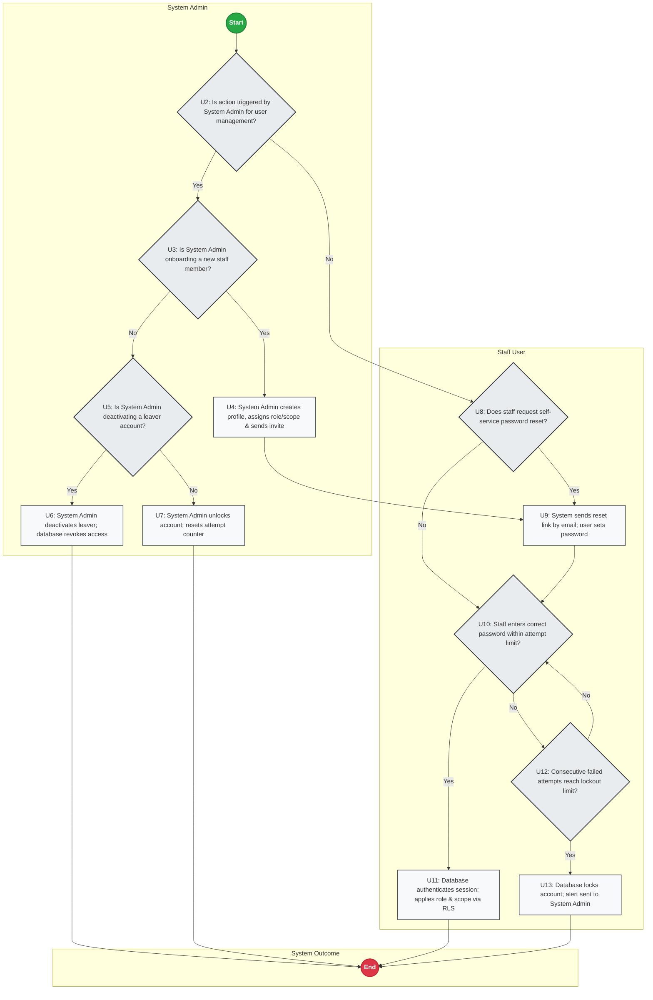

#### Step Execution Table (14 Steps)
| Step ID | Role | Action Description | Next Step / Transition |
| :--- | :--- | :--- | :--- |
| `U1` | **System Admin** | (Start) | Next: `U2` |
| `U2` | **System Admin** | U2: Is action triggered by System Admin for user management? | Yes -> `U3`; No -> `U8` |
| `U3` | **System Admin** | U3: Is System Admin onboarding a new staff member? | Yes -> `U4`; No -> `U5` |
| `U4` | **System Admin** | U4: System Admin creates profile, assigns role/scope & sends invite | Next: `U9` |
| `U5` | **System Admin** | U5: Is System Admin deactivating a leaver account? | Yes -> `U6`; No -> `U7` |
| `U6` | **System Admin** | U6: System Admin deactivates leaver; database revokes access | Next: `U14` |
| `U7` | **System Admin** | U7: System Admin unlocks account; resets attempt counter | Next: `U14` |
| `U8` | **Staff User** | U8: Does staff request self-service password reset? | Yes -> `U9`; No -> `U10` |
| `U9` | **Staff User** | U9: System sends reset link by email; user sets password | Next: `U10` |
| `U10` | **Staff User** | U10: Staff enters correct password within attempt limit? | Yes -> `U11`; No -> `U12` |
| `U12` | **Staff User** | U12: Consecutive failed attempts reach lockout limit? | Yes -> `U13`; No -> `U10` |
| `U13` | **Staff User** | U13: Database locks account; alert sent to System Admin | Next: `U14` |
| `U11` | **Staff User** | U11: Database authenticates session; applies role & scope via RLS | Next: `U14` |
| `U14` | **System Outcome** | (End) | Process End |

#### Decision Points & Branch Analysis
- **`U2` (U2: Is action triggered by System Admin for user management?):** Yes -> `U3`: U3: Is System Admin onboarding a new staff member?; No -> `U8`: U8: Does staff request self-service password reset?.
- **`U3` (U3: Is System Admin onboarding a new staff member?):** Yes -> `U4`: U4: System Admin creates profile, assigns role/scope & sends invite; No -> `U5`: U5: Is System Admin deactivating a leaver account?.
- **`U5` (U5: Is System Admin deactivating a leaver account?):** Yes -> `U6`: U6: System Admin deactivates leaver; database revokes access; No -> `U7`: U7: System Admin unlocks account; resets attempt counter.
- **`U8` (U8: Does staff request self-service password reset?):** Yes -> `U9`: U9: System sends reset link by email; user sets password; No -> `U10`: U10: Staff enters correct password within attempt limit?.
- **`U10` (U10: Staff enters correct password within attempt limit?):** Yes -> `U11`: U11: Database authenticates session; applies role & scope via RLS; No -> `U12`: U12: Consecutive failed attempts reach lockout limit?.
- **`U12` (U12: Consecutive failed attempts reach lockout limit?):** Yes -> `U13`: U13: Database locks account; alert sent to System Admin; No -> `U10`: U10: Staff enters correct password within attempt limit?.

#### Core Operational Controls
- **Segregation of Duties:** Actions are strictly scoped to authenticated roles and locations.
- **Append-Only Immutability:** No existing ledger row is ever updated or overwritten.
- **Physical Verification:** Stock release and receipt require dual-party digital confirmation.

#### Exceptions and what the app does
- **Network Signal Loss:** Actions are queued in mobile client `IndexedDB` and dispatched once upon reconnection.
- **Disputed / Rejected Actions:** Reversals or void logs are recorded; physical inventory remains in secure storage.

---

### FLOW A-1: PHYSICAL RECEIVING & QC
*What this chart does: Complete operational workflow and system logic for flow a-1: physical receiving & qc.*

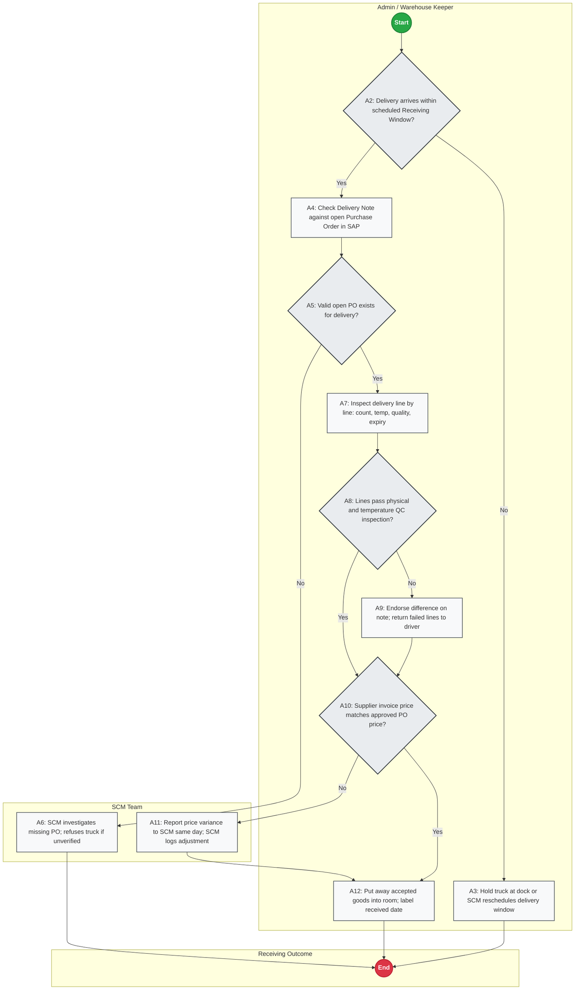

#### Step Execution Table (13 Steps)
| Step ID | Role | Action Description | Next Step / Transition |
| :--- | :--- | :--- | :--- |
| `A1` | **Admin / Warehouse Keeper** | (Start) | Next: `A2` |
| `A2` | **Admin / Warehouse Keeper** | A2: Delivery arrives within scheduled Receiving Window? | Yes -> `A4`; No -> `A3` |
| `A3` | **Admin / Warehouse Keeper** | A3: Hold truck at dock or SCM reschedules delivery window | Next: `A13` |
| `A4` | **Admin / Warehouse Keeper** | A4: Check Delivery Note against open Purchase Order in SAP | Next: `A5` |
| `A5` | **Admin / Warehouse Keeper** | A5: Valid open PO exists for delivery? | Yes -> `A7`; No -> `A6` |
| `A7` | **Admin / Warehouse Keeper** | A7: Inspect delivery line by line: count, temp, quality, expiry | Next: `A8` |
| `A8` | **Admin / Warehouse Keeper** | A8: Lines pass physical and temperature QC inspection? | Yes -> `A10`; No -> `A9` |
| `A9` | **Admin / Warehouse Keeper** | A9: Endorse difference on note; return failed lines to driver | Next: `A10` |
| `A10` | **Admin / Warehouse Keeper** | A10: Supplier invoice price matches approved PO price? | Yes -> `A12`; No -> `A11` |
| `A12` | **Admin / Warehouse Keeper** | A12: Put away accepted goods into room; label received date | Next: `A13` |
| `A6` | **SCM Team** | A6: SCM investigates missing PO; refuses truck if unverified | Next: `A13` |
| `A11` | **SCM Team** | A11: Report price variance to SCM same day; SCM logs adjustment | Next: `A12` |
| `A13` | **Receiving Outcome** | (End) | Process End |

#### Decision Points & Branch Analysis
- **`A2` (A2: Delivery arrives within scheduled Receiving Window?):** Yes -> `A4`: A4: Check Delivery Note against open Purchase Order in SAP; No -> `A3`: A3: Hold truck at dock or SCM reschedules delivery window.
- **`A5` (A5: Valid open PO exists for delivery?):** Yes -> `A7`: A7: Inspect delivery line by line: count, temp, quality, expiry; No -> `A6`: A6: SCM investigates missing PO; refuses truck if unverified.
- **`A8` (A8: Lines pass physical and temperature QC inspection?):** Yes -> `A10`: A10: Supplier invoice price matches approved PO price?; No -> `A9`: A9: Endorse difference on note; return failed lines to driver.
- **`A10` (A10: Supplier invoice price matches approved PO price?):** Yes -> `A12`: A12: Put away accepted goods into room; label received date; No -> `A11`: A11: Report price variance to SCM same day; SCM logs adjustment.

#### Core Operational Controls
- **Segregation of Duties:** Actions are strictly scoped to authenticated roles and locations.
- **Append-Only Immutability:** No existing ledger row is ever updated or overwritten.
- **Physical Verification:** Stock release and receipt require dual-party digital confirmation.

#### Exceptions and what the app does
- **Network Signal Loss:** Actions are queued in mobile client `IndexedDB` and dispatched once upon reconnection.
- **Disputed / Rejected Actions:** Reversals or void logs are recorded; physical inventory remains in secure storage.

---

### FLOW A-2: SAP GRPO ENTRY, FILE EXPORT & IMPORT
*What this chart does: Complete operational workflow and system logic for flow a-2: sap grpo entry, file export & import.*

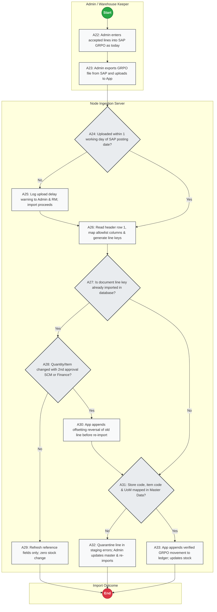

#### Step Execution Table (14 Steps)
| Step ID | Role | Action Description | Next Step / Transition |
| :--- | :--- | :--- | :--- |
| `A21` | **Admin / Warehouse Keeper** | (Start) | Next: `A22` |
| `A22` | **Admin / Warehouse Keeper** | A22: Admin enters accepted lines into SAP GRPO as today | Next: `A23` |
| `A23` | **Admin / Warehouse Keeper** | A23: Admin exports GRPO file from SAP and uploads to App | Next: `A24` |
| `A24` | **Node Ingestion Server** | A24: Uploaded within 1 working day of SAP posting date? | Yes -> `A26`; No -> `A25` |
| `A25` | **Node Ingestion Server** | A25: Log upload delay warning to Admin & RM; import proceeds | Next: `A26` |
| `A26` | **Node Ingestion Server** | A26: Read header row 1, map allowlist columns & generate line keys | Next: `A27` |
| `A27` | **Node Ingestion Server** | A27: Is document line key already imported in database? | Yes -> `A28`; No -> `A31` |
| `A28` | **Node Ingestion Server** | A28: Quantity/Item changed with 2nd approval SCM or Finance? | Yes -> `A30`; No -> `A29` |
| `A29` | **Node Ingestion Server** | A29: Refresh reference fields only; zero stock change | Next: `A34` |
| `A30` | **Node Ingestion Server** | A30: App appends offsetting reversal of old line before re-import | Next: `A31` |
| `A31` | **Node Ingestion Server** | A31: Store code, item code & UoM mapped in Master Data? | Yes -> `A33`; No -> `A32` |
| `A32` | **Node Ingestion Server** | A32: Quarantine line in staging errors; Admin updates master & re-imports | Next: `A34` |
| `A33` | **Node Ingestion Server** | A33: App appends verified GRPO movement to ledger; updates stock | Next: `A34` |
| `A34` | **Import Outcome** | (End) | Process End |

#### Decision Points & Branch Analysis
- **`A24` (A24: Uploaded within 1 working day of SAP posting date?):** Yes -> `A26`: A26: Read header row 1, map allowlist columns & generate line keys; No -> `A25`: A25: Log upload delay warning to Admin & RM; import proceeds.
- **`A27` (A27: Is document line key already imported in database?):** Yes -> `A28`: A28: Quantity/Item changed with 2nd approval SCM or Finance?; No -> `A31`: A31: Store code, item code & UoM mapped in Master Data?.
- **`A28` (A28: Quantity/Item changed with 2nd approval SCM or Finance?):** Yes -> `A30`: A30: App appends offsetting reversal of old line before re-import; No -> `A29`: A29: Refresh reference fields only; zero stock change.
- **`A31` (A31: Store code, item code & UoM mapped in Master Data?):** Yes -> `A33`: A33: App appends verified GRPO movement to ledger; updates stock; No -> `A32`: A32: Quarantine line in staging errors; Admin updates master & re-imports.

#### Core Operational Controls
- **Segregation of Duties:** Actions are strictly scoped to authenticated roles and locations.
- **Append-Only Immutability:** No existing ledger row is ever updated or overwritten.
- **Physical Verification:** Stock release and receipt require dual-party digital confirmation.

#### Exceptions and what the app does
- **Network Signal Loss:** Actions are queued in mobile client `IndexedDB` and dispatched once upon reconnection.
- **Disputed / Rejected Actions:** Reversals or void logs are recorded; physical inventory remains in secure storage.

---

### FLOW B: KEEP (CUSTODIAN & ADMIN-CONFIGURED ISSUE WINDOWS)
*What this chart does: Complete operational workflow and system logic for flow b: keep (custodian & admin-configured issue windows).*

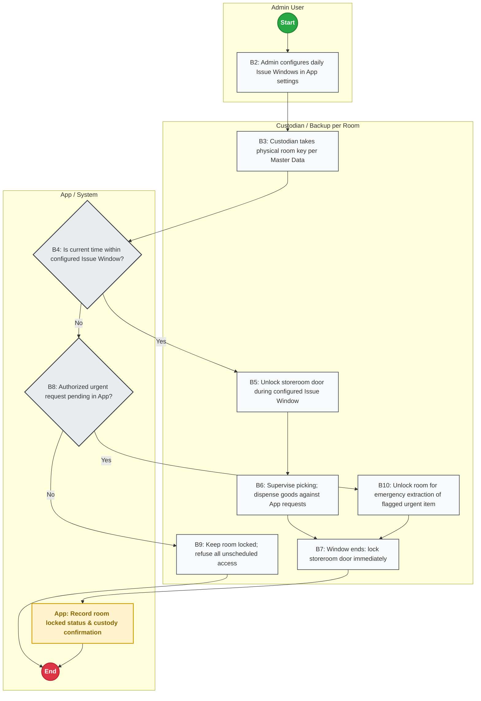

#### Step Execution Table (12 Steps)
| Step ID | Role | Action Description | Next Step / Transition |
| :--- | :--- | :--- | :--- |
| `B1` | **Admin User** | (Start) | Next: `B2` |
| `B2` | **Admin User** | B2: Admin configures daily Issue Windows in App settings | Next: `B3` |
| `B3` | **Custodian / Backup per Room** | B3: Custodian takes physical room key per Master Data | Next: `B4` |
| `B5` | **Custodian / Backup per Room** | B5: Unlock storeroom door during configured Issue Window | Next: `B6` |
| `B6` | **Custodian / Backup per Room** | B6: Supervise picking; dispense goods against App requests | Next: `B7` |
| `B7` | **Custodian / Backup per Room** | B7: Window ends: lock storeroom door immediately | Next: `B11` |
| `B9` | **Custodian / Backup per Room** | B9: Keep room locked; refuse all unscheduled access | Next: `B12` |
| `B10` | **Custodian / Backup per Room** | B10: Unlock room for emergency extraction of flagged urgent item | Next: `B7` |
| `B4` | **App / System** | B4: Is current time within configured Issue Window? | Yes -> `B5`; No -> `B8` |
| `B8` | **App / System** | B8: Authorized urgent request pending in App? | Yes -> `B10`; No -> `B9` |
| `B11` | **App / System** | App: Record room locked status & custody confirmation | Next: `B12` |
| `B12` | **App / System** | (End) | Process End |

#### Decision Points & Branch Analysis
- **`B4` (B4: Is current time within configured Issue Window?):** Yes -> `B5`: B5: Unlock storeroom door during configured Issue Window; No -> `B8`: B8: Authorized urgent request pending in App?.
- **`B8` (B8: Authorized urgent request pending in App?):** Yes -> `B10`: B10: Unlock room for emergency extraction of flagged urgent item; No -> `B9`: B9: Keep room locked; refuse all unscheduled access.

#### Core Operational Controls
- **Segregation of Duties:** Actions are strictly scoped to authenticated roles and locations.
- **Append-Only Immutability:** No existing ledger row is ever updated or overwritten.
- **Physical Verification:** Stock release and receipt require dual-party digital confirmation.

#### Exceptions and what the app does
- **Network Signal Loss:** Actions are queued in mobile client `IndexedDB` and dispatched once upon reconnection.
- **Disputed / Rejected Actions:** Reversals or void logs are recorded; physical inventory remains in secure storage.

---

### FLOW C-1: SECTION STOCK REQUEST
*What this chart does: Complete operational workflow and system logic for flow c-1: section stock request.*

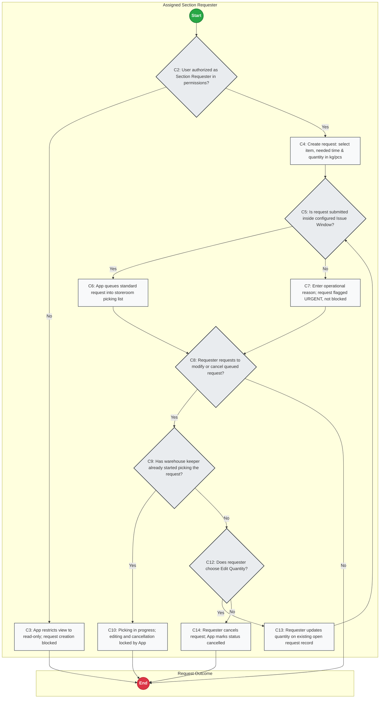

#### Step Execution Table (14 Steps)
| Step ID | Role | Action Description | Next Step / Transition |
| :--- | :--- | :--- | :--- |
| `C1` | **Assigned Section Requester** | (Start) | Next: `C2` |
| `C2` | **Assigned Section Requester** | C2: User authorized as Section Requester in permissions? | Yes -> `C4`; No -> `C3` |
| `C3` | **Assigned Section Requester** | C3: App restricts view to read-only; request creation blocked | Next: `C11` |
| `C4` | **Assigned Section Requester** | C4: Create request: select item, needed time & quantity in kg/pcs | Next: `C5` |
| `C5` | **Assigned Section Requester** | C5: Is request submitted inside configured Issue Window? | Yes -> `C6`; No -> `C7` |
| `C6` | **Assigned Section Requester** | C6: App queues standard request into storeroom picking list | Next: `C8` |
| `C7` | **Assigned Section Requester** | C7: Enter operational reason; request flagged URGENT, not blocked | Next: `C8` |
| `C8` | **Assigned Section Requester** | C8: Requester requests to modify or cancel queued request? | Yes -> `C9`; No -> `C11` |
| `C9` | **Assigned Section Requester** | C9: Has warehouse keeper already started picking the request? | Yes -> `C10`; No -> `C12` |
| `C10` | **Assigned Section Requester** | C10: Picking in progress; editing and cancellation locked by App | Next: `C11` |
| `C12` | **Assigned Section Requester** | C12: Does requester choose Edit Quantity? | Yes -> `C13`; No -> `C14` |
| `C13` | **Assigned Section Requester** | C13: Requester updates quantity on existing open request record | Next: `C5` |
| `C14` | **Assigned Section Requester** | C14: Requester cancels request; App marks status cancelled | Next: `C11` |
| `C11` | **Request Outcome** | (End) | Process End |

#### Decision Points & Branch Analysis
- **`C2` (C2: User authorized as Section Requester in permissions?):** Yes -> `C4`: C4: Create request: select item, needed time & quantity in kg/pcs; No -> `C3`: C3: App restricts view to read-only; request creation blocked.
- **`C5` (C5: Is request submitted inside configured Issue Window?):** Yes -> `C6`: C6: App queues standard request into storeroom picking list; No -> `C7`: C7: Enter operational reason; request flagged URGENT, not blocked.
- **`C8` (C8: Requester requests to modify or cancel queued request?):** Yes -> `C9`: C9: Has warehouse keeper already started picking the request?; No -> `C11`: (End).
- **`C9` (C9: Has warehouse keeper already started picking the request?):** Yes -> `C10`: C10: Picking in progress; editing and cancellation locked by App; No -> `C12`: C12: Does requester choose Edit Quantity?.
- **`C12` (C12: Does requester choose Edit Quantity?):** Yes -> `C13`: C13: Requester updates quantity on existing open request record; No -> `C14`: C14: Requester cancels request; App marks status cancelled.

#### Core Operational Controls
- **Segregation of Duties:** Actions are strictly scoped to authenticated roles and locations.
- **Append-Only Immutability:** No existing ledger row is ever updated or overwritten.
- **Physical Verification:** Stock release and receipt require dual-party digital confirmation.

#### Exceptions and what the app does
- **Network Signal Loss:** Actions are queued in mobile client `IndexedDB` and dispatched once upon reconnection.
- **Disputed / Rejected Actions:** Reversals or void logs are recorded; physical inventory remains in secure storage.

---

### FLOW C-2: STOCK ISSUE AND CONFIRMATION
*What this chart does: Complete operational workflow and system logic for flow c-2: stock issue and confirmation.*

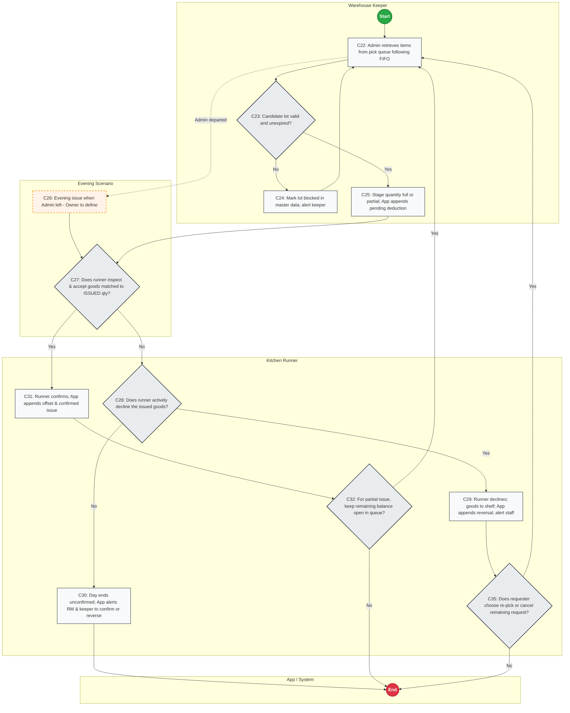

#### Step Execution Table (14 Steps)
| Step ID | Role | Action Description | Next Step / Transition |
| :--- | :--- | :--- | :--- |
| `C21` | **Warehouse Keeper** | (Start) | Next: `C22` |
| `C22` | **Warehouse Keeper** | C22: Admin retrieves items from pick queue following FIFO | Next: `C23`, `C26` |
| `C23` | **Warehouse Keeper** | C23: Candidate lot valid and unexpired? | Yes -> `C25`; No -> `C24` |
| `C24` | **Warehouse Keeper** | C24: Mark lot blocked in master data; alert keeper | Next: `C22` |
| `C25` | **Warehouse Keeper** | C25: Stage quantity full or partial; App appends pending deduction | Next: `C27` |
| `C26` | **Evening Scenario** | C26: Evening issue when Admin left - Owner to define | Next: `C27` |
| `C27` | **Kitchen Runner** | C27: Does runner inspect & accept goods matched to ISSUED qty? | Yes -> `C31`; No -> `C28` |
| `C28` | **Kitchen Runner** | C28: Does runner actively decline the issued goods? | Yes -> `C29`; No -> `C30` |
| `C29` | **Kitchen Runner** | C29: Runner declines; goods to shelf; App appends reversal; alert staff | Next: `C35` |
| `C30` | **Kitchen Runner** | C30: Day ends unconfirmed; App alerts RM & keeper to confirm or reverse | Next: `C33` |
| `C31` | **Kitchen Runner** | C31: Runner confirms; App appends offset & confirmed issue | Next: `C32` |
| `C32` | **Kitchen Runner** | C32: For partial issue, keep remaining balance open in queue? | Yes -> `C22`; No -> `C33` |
| `C35` | **Kitchen Runner** | C35: Does requester choose re-pick or cancel remaining request? | Yes -> `C22`; No -> `C33` |
| `C33` | **App / System** | (End) | Process End |

#### Decision Points & Branch Analysis
- **`C23` (C23: Candidate lot valid and unexpired?):** Yes -> `C25`: C25: Stage quantity full or partial; App appends pending deduction; No -> `C24`: C24: Mark lot blocked in master data; alert keeper.
- **`C27` (C27: Does runner inspect & accept goods matched to ISSUED qty?):** Yes -> `C31`: C31: Runner confirms; App appends offset & confirmed issue; No -> `C28`: C28: Does runner actively decline the issued goods?.
- **`C28` (C28: Does runner actively decline the issued goods?):** Yes -> `C29`: C29: Runner declines; goods to shelf; App appends reversal; alert staff; No -> `C30`: C30: Day ends unconfirmed; App alerts RM & keeper to confirm or reverse.
- **`C32` (C32: For partial issue, keep remaining balance open in queue?):** Yes -> `C22`: C22: Admin retrieves items from pick queue following FIFO; No -> `C33`: (End).
- **`C35` (C35: Does requester choose re-pick or cancel remaining request?):** Yes -> `C22`: C22: Admin retrieves items from pick queue following FIFO; No -> `C33`: (End).

#### Core Operational Controls
- **Segregation of Duties:** Actions are strictly scoped to authenticated roles and locations.
- **Append-Only Immutability:** No existing ledger row is ever updated or overwritten.
- **Physical Verification:** Stock release and receipt require dual-party digital confirmation.

#### Exceptions and what the app does
- **Network Signal Loss:** Actions are queued in mobile client `IndexedDB` and dispatched once upon reconnection.
- **Disputed / Rejected Actions:** Reversals or void logs are recorded; physical inventory remains in secure storage.

---

### FLOW D: BALANCE (DAILY CLOSE RECONCILIATION)
*What this chart does: Complete operational workflow and system logic for flow d: balance (daily close reconciliation).*

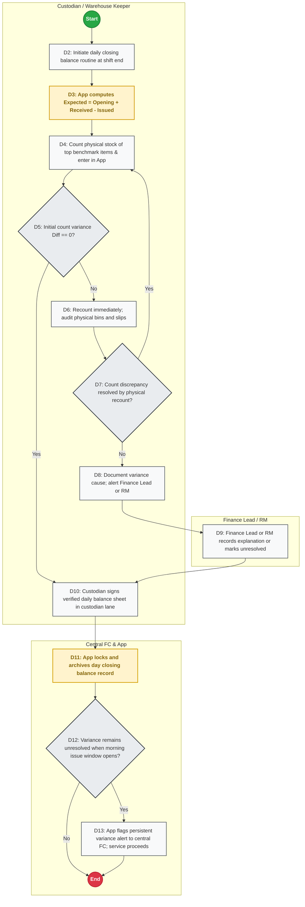

#### Step Execution Table (14 Steps)
| Step ID | Role | Action Description | Next Step / Transition |
| :--- | :--- | :--- | :--- |
| `D1` | **Custodian / Warehouse Keeper** | (Start) | Next: `D2` |
| `D2` | **Custodian / Warehouse Keeper** | D2: Initiate daily closing balance routine at shift end | Next: `D3` |
| `D3` | **Custodian / Warehouse Keeper** | D3: App computes Expected = Opening + Received - Issued | Next: `D4` |
| `D4` | **Custodian / Warehouse Keeper** | D4: Count physical stock of top benchmark items & enter in App | Next: `D5` |
| `D5` | **Custodian / Warehouse Keeper** | D5: Initial count variance Diff == 0? | Yes -> `D10`; No -> `D6` |
| `D6` | **Custodian / Warehouse Keeper** | D6: Recount immediately; audit physical bins and slips | Next: `D7` |
| `D7` | **Custodian / Warehouse Keeper** | D7: Count discrepancy resolved by physical recount? | Yes -> `D4`; No -> `D8` |
| `D8` | **Custodian / Warehouse Keeper** | D8: Document variance cause; alert Finance Lead or RM | Next: `D9` |
| `D10` | **Custodian / Warehouse Keeper** | D10: Custodian signs verified daily balance sheet in custodian lane | Next: `D11` |
| `D9` | **Finance Lead / RM** | D9: Finance Lead or RM records explanation or marks unresolved | Next: `D10` |
| `D11` | **Central FC & App** | D11: App locks and archives day closing balance record | Next: `D12` |
| `D12` | **Central FC & App** | D12: Variance remains unresolved when morning issue window opens? | Yes -> `D13`; No -> `D14` |
| `D13` | **Central FC & App** | D13: App flags persistent variance alert to central FC; service proceeds | Next: `D14` |
| `D14` | **Central FC & App** | (End) | Process End |

#### Decision Points & Branch Analysis
- **`D5` (D5: Initial count variance Diff == 0?):** Yes -> `D10`: D10: Custodian signs verified daily balance sheet in custodian lane; No -> `D6`: D6: Recount immediately; audit physical bins and slips.
- **`D7` (D7: Count discrepancy resolved by physical recount?):** Yes -> `D4`: D4: Count physical stock of top benchmark items & enter in App; No -> `D8`: D8: Document variance cause; alert Finance Lead or RM.
- **`D12` (D12: Variance remains unresolved when morning issue window opens?):** Yes -> `D13`: D13: App flags persistent variance alert to central FC; service proceeds; No -> `D14`: (End).

#### Core Operational Controls
- **Segregation of Duties:** Actions are strictly scoped to authenticated roles and locations.
- **Append-Only Immutability:** No existing ledger row is ever updated or overwritten.
- **Physical Verification:** Stock release and receipt require dual-party digital confirmation.

#### Exceptions and what the app does
- **Network Signal Loss:** Actions are queued in mobile client `IndexedDB` and dispatched once upon reconnection.
- **Disputed / Rejected Actions:** Reversals or void logs are recorded; physical inventory remains in secure storage.

---

### FLOW E: HANDOVER (CUSTODIAN SHIFT HANDOVER)
*What this chart does: Complete operational workflow and system logic for flow e: handover (custodian shift handover).*

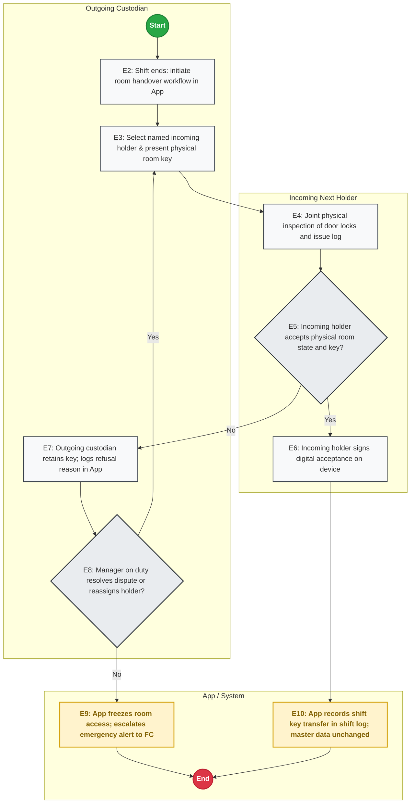

#### Step Execution Table (11 Steps)
| Step ID | Role | Action Description | Next Step / Transition |
| :--- | :--- | :--- | :--- |
| `E1` | **Outgoing Custodian** | (Start) | Next: `E2` |
| `E2` | **Outgoing Custodian** | E2: Shift ends: initiate room handover workflow in App | Next: `E3` |
| `E3` | **Outgoing Custodian** | E3: Select named incoming holder & present physical room key | Next: `E4` |
| `E7` | **Outgoing Custodian** | E7: Outgoing custodian retains key; logs refusal reason in App | Next: `E8` |
| `E8` | **Outgoing Custodian** | E8: Manager on duty resolves dispute or reassigns holder? | Yes -> `E3`; No -> `E9` |
| `E4` | **Incoming Next Holder** | E4: Joint physical inspection of door locks and issue log | Next: `E5` |
| `E5` | **Incoming Next Holder** | E5: Incoming holder accepts physical room state and key? | Yes -> `E6`; No -> `E7` |
| `E6` | **Incoming Next Holder** | E6: Incoming holder signs digital acceptance on device | Next: `E10` |
| `E10` | **App / System** | E10: App records shift key transfer in shift log; master data unchanged | Next: `E11` |
| `E9` | **App / System** | E9: App freezes room access; escalates emergency alert to FC | Next: `E11` |
| `E11` | **App / System** | (End) | Process End |

#### Decision Points & Branch Analysis
- **`E8` (E8: Manager on duty resolves dispute or reassigns holder?):** Yes -> `E3`: E3: Select named incoming holder & present physical room key; No -> `E9`: E9: App freezes room access; escalates emergency alert to FC.
- **`E5` (E5: Incoming holder accepts physical room state and key?):** Yes -> `E6`: E6: Incoming holder signs digital acceptance on device; No -> `E7`: E7: Outgoing custodian retains key; logs refusal reason in App.

#### Core Operational Controls
- **Segregation of Duties:** Actions are strictly scoped to authenticated roles and locations.
- **Append-Only Immutability:** No existing ledger row is ever updated or overwritten.
- **Physical Verification:** Stock release and receipt require dual-party digital confirmation.

#### Exceptions and what the app does
- **Network Signal Loss:** Actions are queued in mobile client `IndexedDB` and dispatched once upon reconnection.
- **Disputed / Rejected Actions:** Reversals or void logs are recorded; physical inventory remains in secure storage.

---

### FLOW F: COUNT & RECONCILIATION
*What this chart does: Complete operational workflow and system logic for flow f: count & reconciliation.*

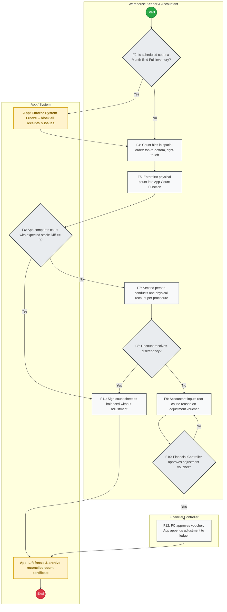

#### Step Execution Table (14 Steps)
| Step ID | Role | Action Description | Next Step / Transition |
| :--- | :--- | :--- | :--- |
| `F1` | **Warehouse Keeper & Accountant** | (Start) | Next: `F2` |
| `F2` | **Warehouse Keeper & Accountant** | F2: Is scheduled count a Month-End Full inventory? | Yes -> `F3`; No -> `F4` |
| `F4` | **Warehouse Keeper & Accountant** | F4: Count bins in spatial order: top-to-bottom, right-to-left | Next: `F5` |
| `F5` | **Warehouse Keeper & Accountant** | F5: Enter first physical count into App Count Function | Next: `F6` |
| `F7` | **Warehouse Keeper & Accountant** | F7: Second person conducts one physical recount per procedure | Next: `F8` |
| `F8` | **Warehouse Keeper & Accountant** | F8: Recount resolves discrepancy? | Yes -> `F11`; No -> `F9` |
| `F9` | **Warehouse Keeper & Accountant** | F9: Accountant inputs root-cause reason on adjustment voucher | Next: `F10` |
| `F10` | **Warehouse Keeper & Accountant** | F10: Financial Controller approves adjustment voucher? | Yes -> `F12`; No -> `F9` |
| `F11` | **Warehouse Keeper & Accountant** | F11: Sign count sheet as balanced without adjustment | Next: `F13` |
| `F12` | **Financial Controller** | F12: FC approves voucher; App appends adjustment to ledger | Next: `F13` |
| `F3` | **App / System** | App: Enforce System Freeze -- block all receipts & issues | Next: `F4` |
| `F6` | **App / System** | F6: App compares count with expected stock: Diff == 0? | Yes -> `F11`; No -> `F7` |
| `F13` | **App / System** | App: Lift freeze & archive reconciled count certificate | Next: `F14` |
| `F14` | **App / System** | (End) | Process End |

#### Decision Points & Branch Analysis
- **`F2` (F2: Is scheduled count a Month-End Full inventory?):** Yes -> `F3`: App: Enforce System Freeze -- block all receipts & issues; No -> `F4`: F4: Count bins in spatial order: top-to-bottom, right-to-left.
- **`F8` (F8: Recount resolves discrepancy?):** Yes -> `F11`: F11: Sign count sheet as balanced without adjustment; No -> `F9`: F9: Accountant inputs root-cause reason on adjustment voucher.
- **`F10` (F10: Financial Controller approves adjustment voucher?):** Yes -> `F12`: F12: FC approves voucher; App appends adjustment to ledger; No -> `F9`: F9: Accountant inputs root-cause reason on adjustment voucher.
- **`F6` (F6: App compares count with expected stock: Diff == 0?):** Yes -> `F11`: F11: Sign count sheet as balanced without adjustment; No -> `F7`: F7: Second person conducts one physical recount per procedure.

#### Core Operational Controls
- **Segregation of Duties:** Actions are strictly scoped to authenticated roles and locations.
- **Append-Only Immutability:** No existing ledger row is ever updated or overwritten.
- **Physical Verification:** Stock release and receipt require dual-party digital confirmation.

#### Exceptions and what the app does
- **Network Signal Loss:** Actions are queued in mobile client `IndexedDB` and dispatched once upon reconnection.
- **Disputed / Rejected Actions:** Reversals or void logs are recorded; physical inventory remains in secure storage.

---

### FLOW G: OTHER MOVEMENTS (WASTE, RETURNS, TRANSFERS)
*What this chart does: Complete operational workflow and system logic for flow g: other movements (waste, returns, transfers).*

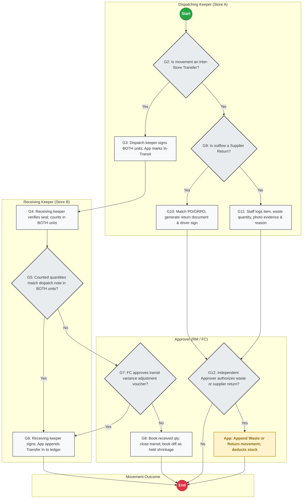

#### Step Execution Table (14 Steps)
| Step ID | Role | Action Description | Next Step / Transition |
| :--- | :--- | :--- | :--- |
| `G1` | **Dispatching Keeper (Store A)** | (Start) | Next: `G2` |
| `G2` | **Dispatching Keeper (Store A)** | G2: Is movement an Inter-Store Transfer? | Yes -> `G3`; No -> `G9` |
| `G3` | **Dispatching Keeper (Store A)** | G3: Dispatch keeper signs BOTH units; App marks In-Transit | Next: `G4` |
| `G9` | **Dispatching Keeper (Store A)** | G9: Is outflow a Supplier Return? | Yes -> `G10`; No -> `G11` |
| `G10` | **Dispatching Keeper (Store A)** | G10: Match PO/GRPO; generate return document & driver sign | Next: `G12` |
| `G11` | **Dispatching Keeper (Store A)** | G11: Staff logs item, waste quantity, photo evidence & reason | Next: `G12` |
| `G4` | **Receiving Keeper (Store B)** | G4: Receiving keeper verifies seal; counts in BOTH units | Next: `G5` |
| `G5` | **Receiving Keeper (Store B)** | G5: Counted quantities match dispatch note in BOTH units? | Yes -> `G6`; No -> `G7` |
| `G6` | **Receiving Keeper (Store B)** | G6: Receiving keeper signs; App appends Transfer In to ledger | Next: `G14` |
| `G7` | **Approver (RM / FC)** | G7: FC approves transit variance adjustment voucher? | Yes -> `G6`; No -> `G8` |
| `G8` | **Approver (RM / FC)** | G8: Book received qty; close transit; book diff as held shrinkage | Next: `G14` |
| `G12` | **Approver (RM / FC)** | G12: Independent Approver authorizes waste or supplier return? | Yes -> `G13`; No -> `G14` |
| `G13` | **Approver (RM / FC)** | App: Append Waste or Return movement; deducts stock | Next: `G14` |
| `G14` | **Movement Outcome** | (End) | Process End |

#### Decision Points & Branch Analysis
- **`G2` (G2: Is movement an Inter-Store Transfer?):** Yes -> `G3`: G3: Dispatch keeper signs BOTH units; App marks In-Transit; No -> `G9`: G9: Is outflow a Supplier Return?.
- **`G9` (G9: Is outflow a Supplier Return?):** Yes -> `G10`: G10: Match PO/GRPO; generate return document & driver sign; No -> `G11`: G11: Staff logs item, waste quantity, photo evidence & reason.
- **`G5` (G5: Counted quantities match dispatch note in BOTH units?):** Yes -> `G6`: G6: Receiving keeper signs; App appends Transfer In to ledger; No -> `G7`: G7: FC approves transit variance adjustment voucher?.
- **`G7` (G7: FC approves transit variance adjustment voucher?):** Yes -> `G6`: G6: Receiving keeper signs; App appends Transfer In to ledger; No -> `G8`: G8: Book received qty; close transit; book diff as held shrinkage.
- **`G12` (G12: Independent Approver authorizes waste or supplier return?):** Yes -> `G13`: App: Append Waste or Return movement; deducts stock; No -> `G14`: (End).

#### Core Operational Controls
- **Segregation of Duties:** Actions are strictly scoped to authenticated roles and locations.
- **Append-Only Immutability:** No existing ledger row is ever updated or overwritten.
- **Physical Verification:** Stock release and receipt require dual-party digital confirmation.

#### Exceptions and what the app does
- **Network Signal Loss:** Actions are queued in mobile client `IndexedDB` and dispatched once upon reconnection.
- **Disputed / Rejected Actions:** Reversals or void logs are recorded; physical inventory remains in secure storage.

---

### FLOW H: ADD A NEW STORE OR WAREHOUSE (APPROVAL)
*What this chart does: Complete operational workflow and system logic for flow h: add a new store or warehouse (approval).*

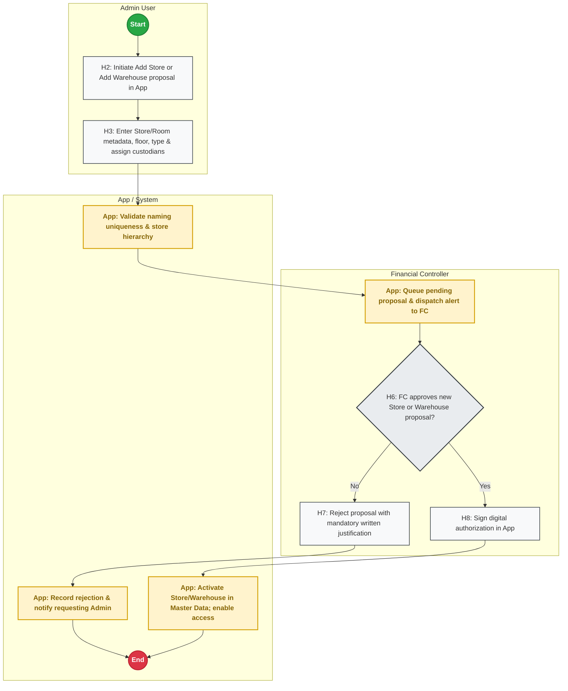

#### Step Execution Table (11 Steps)
| Step ID | Role | Action Description | Next Step / Transition |
| :--- | :--- | :--- | :--- |
| `H1` | **Admin User** | (Start) | Next: `H2` |
| `H2` | **Admin User** | H2: Initiate Add Store or Add Warehouse proposal in App | Next: `H3` |
| `H3` | **Admin User** | H3: Enter Store/Room metadata, floor, type & assign custodians | Next: `H4` |
| `H6` | **Financial Controller** | H6: FC approves new Store or Warehouse proposal? | Yes -> `H8`; No -> `H7` |
| `H7` | **Financial Controller** | H7: Reject proposal with mandatory written justification | Next: `H9` |
| `H8` | **Financial Controller** | H8: Sign digital authorization in App | Next: `H10` |
| `H4` | **App / System** | App: Validate naming uniqueness & store hierarchy | Next: `H5` |
| `H5` | **App / System** | App: Queue pending proposal & dispatch alert to FC | Next: `H6` |
| `H9` | **App / System** | App: Record rejection & notify requesting Admin | Next: `H11` |
| `H10` | **App / System** | App: Activate Store/Warehouse in Master Data; enable access | Next: `H11` |
| `H11` | **App / System** | (End) | Process End |

#### Decision Points & Branch Analysis
- **`H6` (H6: FC approves new Store or Warehouse proposal?):** Yes -> `H8`: H8: Sign digital authorization in App; No -> `H7`: H7: Reject proposal with mandatory written justification.

#### Core Operational Controls
- **Segregation of Duties:** Actions are strictly scoped to authenticated roles and locations.
- **Append-Only Immutability:** No existing ledger row is ever updated or overwritten.
- **Physical Verification:** Stock release and receipt require dual-party digital confirmation.

#### Exceptions and what the app does
- **Network Signal Loss:** Actions are queued in mobile client `IndexedDB` and dispatched once upon reconnection.
- **Disputed / Rejected Actions:** Reversals or void logs are recorded; physical inventory remains in secure storage.


---

## 4. DAILY USAGE, REORDER VIEW & STOCK DERIVATION

### 4.1 Append-Only Stock Derivation Formula & Worked Examples
Physical stock is **never an edited balance**. Current book stock for any item in any warehouse is derived dynamically from `t_stock_movements`. To eliminate any possibility of double-counting across the two-stage issue lifecycle (Decision Q7), the ledger uses an explicit append-only offsetting mechanism:

```
Current Book Stock =
    + Sum(Quantity from GRPO_IMPORT)
    - Sum(Quantity from ISSUE_PENDING)
    + Sum(Quantity from ISSUE_PENDING_OFFSET)
    - Sum(Quantity from ISSUE_CONFIRMED)
    + Sum(Quantity from ISSUE_REVERSAL)
    - Sum(Quantity from WASTE_DISPOSAL)
    - Sum(Quantity from SUPPLIER_RETURN)
    - Sum(Quantity from TRANSFER_OUT_INTRANSIT)
    + Sum(Quantity from TRANSFER_IN_RECEIVED)
    +/- Sum(Quantity from COUNT_ADJUSTMENT)
```

#### Worked Examples of the Two-Stage Issue Ledger (Initial Shelf Stock = 100 kg)

* **Example 1: Issue 5 kg, Runner Declines 5 kg**
  1. *Admin picks & issues 5 kg:* App appends `ISSUE_PENDING` with quantity `-5`. Derived stock = `100 - 5 = 95 kg` (stock immediately reserved from shelf).
  2. *Runner declines at door:* Goods physically returned to storeroom shelf. App appends `ISSUE_REVERSAL` with quantity `+5`. Derived stock = `95 + 5 = 100 kg`.
  3. *Net Ledger Impact:* Zero net change. Past rows are untouched.

* **Example 2: Issue 5 kg, Runner Confirms 5 kg**
  1. *Admin picks & issues 5 kg:* App appends `ISSUE_PENDING` with quantity `-5`. Derived stock = `100 - 5 = 95 kg`.
  2. *Runner confirms on mobile:* App appends `ISSUE_PENDING_OFFSET` with quantity `+5` (clearing pending status) and `ISSUE_CONFIRMED` with quantity `-5`. Derived stock = `95 + 5 - 5 = 95 kg`.
  3. *Net Ledger Impact:* Exactly `-5 kg` deducted from book stock. Zero double-counting.

* **Example 3: Issue 5 kg, Runner Confirms 3 kg and Declines 2 kg (Partial Acceptance)**
  1. *Admin picks & issues 5 kg:* App appends `ISSUE_PENDING` with quantity `-5`. Derived stock = `100 - 5 = 95 kg`.
  2. *Runner accepts 3 kg, declines 2 kg:* 2 kg are physically returned to shelf; 3 kg delivered to kitchen. App appends `ISSUE_PENDING_OFFSET` with quantity `+5` (clearing the 5 kg pending entry) and `ISSUE_CONFIRMED` with quantity `-3` (recording the confirmed issue).
  3. *Derived Stock:* `95 + 5 - 3 = 97 kg`.
  4. *Net Ledger Impact:* Exactly `-3 kg` deducted from storeroom stock (97 kg on shelf, 3 kg in kitchen). Zero double-counting.

### 4.2 Daily Usage Formula
```
Daily Actual Usage = Sum(ISSUE_CONFIRMED for Calendar Day) + Sum(WASTE_DISPOSAL for Calendar Day)
```

### 4.3 Average Daily Usage (ADU)
```
Average Daily Usage = Total Actual Consumption over Rolling N Days / N Days [Owner to set]
```

### 4.4 User-Defined Reorder Trigger & Quantity
*Note: Configured per item by each user or owner. No automated defaults.*
When:
```
Current Book Stock <= Reorder Point [Owner to set]
```
Then:
```
Suggested Reorder Quantity = max(0, Par Level [Owner to set] - Current Book Stock - Open PO Quantity in Transit)
```

### 4.5 Group-Configured Expiry Radar
*Note: Evaluated only for item categories explicitly flagged in `m_expiry_tracking_config`.*
```
Days to Expiry = Batch Expiry Date - Current Date
```
- **EXPIRY WARNING:** Triggered when `Days to Expiry <= Expiry Warning Days [Owner to set]`. Batch highlighted in amber, prioritized on pick list (FIFO).
- **EXPIRED LOCK:** Triggered when `Days to Expiry <= 0`. App hard-locks batch; cannot be selected for kitchen issue.

---

## 5. PLATFORM-NEUTRAL DATA MODEL (24 TABLES)

The relational schema is organized into Master Data (10 tables) and Transactional Data (13 tables):

### 5.1 Master Data Tables (10 Tables)
1. `m_stores`: `store_id` (VARCHAR, PK), `store_name` (VARCHAR), `city` (VARCHAR), `is_active` (BOOLEAN).
2. `m_warehouses`: `warehouse_id` (VARCHAR, PK), `store_id` (VARCHAR, FK), `warehouse_name` (VARCHAR), `storage_type` (VARCHAR), `is_active` (BOOLEAN).
3. `m_go_live_assignments`: `store_id` (VARCHAR, PK/FK), `cold_room_custodian_id` (VARCHAR), `cold_room_backup_id` (VARCHAR), `dry_store_custodian_id` (VARCHAR), `dry_store_backup_id` (VARCHAR), `kitchen_runner_id` (VARCHAR), `evening_key_holder_id` (VARCHAR), `morning_issue_window` (VARCHAR), `afternoon_issue_window` (VARCHAR), `morning_receiving_window` (VARCHAR), `afternoon_receiving_window` (VARCHAR).
4. `m_users`: `user_id` (VARCHAR, PK), `email` (VARCHAR, UNIQUE - primary login ID), `full_name` (VARCHAR), `password_hash` (VARCHAR), `failed_login_count` (INTEGER), `lockout_until` (TIMESTAMP, nullable), `is_active` (BOOLEAN).
5. `m_user_invitations`: `invitation_id` (VARCHAR, PK), `email` (VARCHAR), `role` (VARCHAR), `store_id` (VARCHAR), `activation_token` (VARCHAR, UNIQUE), `expires_at` (TIMESTAMP), `status` (`PENDING`, `ACTIVATED`, `EXPIRED`).
6. `m_user_permissions`: `permission_id` (VARCHAR, PK), `user_id` (VARCHAR, FK), `role` (VARCHAR), `store_id` (VARCHAR, FK), `warehouse_id` (VARCHAR, FK, NULLABLE), `section_id` (VARCHAR).
7. `m_items`: `item_code` (VARCHAR, PK), `item_name` (VARCHAR), `category_group` (VARCHAR), `base_uom` (VARCHAR), `is_active` (BOOLEAN).
8. `m_expiry_tracking_config`: `config_id` (VARCHAR, PK), `category_group` (VARCHAR, UNIQUE), `requires_lot_expiry_tracking` (BOOLEAN), `expiry_warning_days` (INTEGER).
9. `m_reorder_rules`: `rule_id` (VARCHAR, PK), `store_id` (VARCHAR, FK), `warehouse_id` (VARCHAR, FK), `item_code` (VARCHAR, FK), `par_level` (DECIMAL), `reorder_point` (DECIMAL), `min_order_qty` (DECIMAL).
10. `m_uom_conversions`: `conversion_id` (VARCHAR, PK), `item_code` (VARCHAR, FK), `base_uom` (VARCHAR), `secondary_uom` (VARCHAR), `conversion_factor` (DECIMAL), `dual_uom_required` (BOOLEAN).

### 5.2 Transactional Tables (13 Tables — Quantities Only, No Prices)
11. `t_stock_movements` (Immutable Append-Only Ledger):
    - `movement_id` (VARCHAR, PK), `store_id` (VARCHAR, FK), `warehouse_id` (VARCHAR, FK), `item_code` (VARCHAR, FK), `movement_type` (VARCHAR: `GRPO_IMPORT`, `ISSUE_PENDING`, `ISSUE_CONFIRMED`, `ISSUE_REVERSAL`, `WASTE_DISPOSAL`, `SUPPLIER_RETURN`, `TRANSFER_OUT_INTRANSIT`, `TRANSFER_IN_RECEIVED`, `COUNT_ADJUSTMENT`), `quantity` (DECIMAL, signed), `uom` (VARCHAR), `batch_number` (VARCHAR, nullable), `expiry_date` (DATE, nullable), `reference_doc_id` (VARCHAR), `created_by_user_id` (VARCHAR, FK), `created_at` (TIMESTAMP).
12. `t_transfer_intransit` (Flow G Inter-Store Transfer State):
    - `transfer_id` (VARCHAR, PK), `source_store_id` (VARCHAR, FK), `target_store_id` (VARCHAR, FK), `item_code` (VARCHAR, FK), `dispatch_qty_kg` (DECIMAL), `dispatch_qty_pcs` (DECIMAL), `vehicle_seal_no` (VARCHAR), `dispatcher_user_id` (VARCHAR, FK), `dispatched_at` (TIMESTAMP), `receive_qty_kg` (DECIMAL, nullable), `receive_qty_pcs` (DECIMAL, nullable), `receiver_user_id` (VARCHAR, FK, nullable), `received_at` (TIMESTAMP, nullable), `variance_qty` (DECIMAL, nullable), `fc_approval_id` (VARCHAR, FK, nullable), `status` (`IN_TRANSIT`, `RECEIVED_MATCH`, `RECEIVED_VARIANCE_APPROVED`, `REJECTED`).
13. `t_grpo_imports` (Flow A-2 File Upload Audit):
    - `import_id` (VARCHAR, PK), `store_id` (VARCHAR, FK), `file_name` (VARCHAR), `file_hash` (VARCHAR, UNIQUE), `detected_header_row` (INTEGER), `total_rows` (INTEGER), `imported_rows` (INTEGER), `error_count` (INTEGER), `uploaded_by_user_id` (VARCHAR, FK), `imported_at` (TIMESTAMP).
14. `t_grpo_import_items` (Flow A-2 Parsed Lines):
    - `import_item_id` (VARCHAR, PK), `import_id` (VARCHAR, FK), `po_number` (VARCHAR), `item_code` (VARCHAR, FK), `counted_qty` (DECIMAL), `batch_number` (VARCHAR), `expiry_date` (DATE), `status` (`IMPORTED`, `REJECTED_MISMATCH`).
15. `t_grpo_staging_errors` (Flow A-2 Quarantined Lines):
    - `error_id` (VARCHAR, PK), `import_id` (VARCHAR, FK), `row_number` (INTEGER), `raw_line_data` (TEXT), `error_reason` (VARCHAR: `MISSING_ITEM_CODE`, `INVALID_QTY`, `FORMAT_ERROR`), `quarantined_at` (TIMESTAMP).
16. `t_security_logs` (Flow 0 Security & Access Audit):
    - `log_id` (VARCHAR, PK), `user_id` (VARCHAR, FK), `event_type` (`INVITATION_SENT`, `PASSWORD_SET`, `LOGIN_SUCCESS`, `LOGIN_FAILED`, `ACCOUNT_LOCKED`, `PASSWORD_RESET`, `DEACTIVATION`), `ip_address` (VARCHAR), `device_info` (VARCHAR), `timestamp` (TIMESTAMP).
17. `t_custody_logs` (Flow B Room Access Logs):
    - `log_id` (VARCHAR, PK), `store_id` (VARCHAR, FK), `warehouse_id` (VARCHAR, FK), `event_type` (`WINDOW_UNLOCK`, `WINDOW_LOCK`, `URGENT_ACCESS`), `custodian_user_id` (VARCHAR, FK), `urgent_reason` (VARCHAR, nullable), `timestamp` (TIMESTAMP).
18. `t_shift_custody_logs` (Flow E Temporary Shift Key Transfer):
    - `shift_log_id` (VARCHAR, PK), `store_id` (VARCHAR, FK), `warehouse_id` (VARCHAR, FK), `outgoing_custodian_id` (VARCHAR, FK), `incoming_holder_id` (VARCHAR, FK), `shift_type` (`DAY_TO_EVENING`, `EVENING_TO_MORNING`), `signature_blob` (TEXT), `transferred_at` (TIMESTAMP).
19. `t_requests` & `t_request_items` (Flow C-1 & C-2 Section Requisitions):
    - `t_requests`: `request_id` (VARCHAR, PK), `store_id` (VARCHAR, FK), `section_id` (VARCHAR), `requester_user_id` (VARCHAR, FK), `is_urgent` (BOOLEAN), `urgent_reason` (VARCHAR), `status` (`QUEUED`, `PICKING`, `PARTIAL_ACCEPTED`, `PARTIAL_DECLINED`, `CANCELLED_BY_REQUESTER`, `URGENT_PENDING`, `CONFIRMED`), `runner_user_id` (VARCHAR, FK), `runner_confirmed_at` (TIMESTAMP).
    - `t_request_items`: `request_item_id` (VARCHAR, PK), `request_id` (VARCHAR, FK), `item_code` (VARCHAR, FK), `requested_qty` (DECIMAL), `issued_qty` (DECIMAL), `uom` (VARCHAR), `variance_reason` (VARCHAR).
20. `t_daily_balances` & `t_daily_balance_items` (Flow D Daily Balance):
    - `t_daily_balances`: `balance_id` (VARCHAR, PK), `store_id` (VARCHAR, FK), `warehouse_id` (VARCHAR, FK), `balance_date` (DATE), `custodian_user_id` (VARCHAR, FK), `status` (`BALANCED`, `VARIANCE_FLAGGED`), `finance_lead_signoff_id` (VARCHAR, FK, nullable).
    - `t_daily_balance_items`: `item_code` (VARCHAR, FK), `opening_qty` (DECIMAL), `received_qty` (DECIMAL), `issued_qty` (DECIMAL), `expected_qty` (DECIMAL), `counted_qty` (DECIMAL), `variance_qty` (DECIMAL), `variance_reason` (VARCHAR), `responsible_person` (VARCHAR).
21. `t_stock_counts` & `t_stock_count_items` (Flow F Reconciliation Counts):
    - `t_stock_counts`: `count_id` (VARCHAR, PK), `store_id` (VARCHAR, FK), `warehouse_id` (VARCHAR, FK), `count_type` (`WEEKLY_CYCLE`, `MONTH_END_FULL`), `freeze_status` (`FROZEN`, `UNFROZEN`), `keeper_user_id` (VARCHAR, FK), `accountant_user_id` (VARCHAR, FK), `status` (`IN_PROGRESS`, `RECOUNT`, `COMPLETED`).
    - `t_stock_count_items`: `item_code` (VARCHAR, FK), `book_qty` (DECIMAL), `first_count_qty` (DECIMAL), `recount_qty` (DECIMAL), `final_counted_qty` (DECIMAL), `difference_qty` (DECIMAL).
22. `t_stock_adjustments` (Flow F Approved Write-Offs):
    - `adjustment_id` (VARCHAR, PK), `count_id` (VARCHAR, FK), `item_code` (VARCHAR, FK), `adjustment_qty` (DECIMAL), `root_cause_reason` (VARCHAR), `fc_approval_id` (VARCHAR, FK), `approved_at` (TIMESTAMP).
23. `t_store_warehouse_approvals` (Flow H Store/Warehouse Proposals):
    - `approval_id` (VARCHAR, PK), `proposal_type` (`NEW_STORE`, `NEW_WAREHOUSE`), `proposed_name` (VARCHAR), `store_id` (VARCHAR, nullable), `storage_type` (VARCHAR), `nominated_custodian_id` (VARCHAR), `nominated_backup_id` (VARCHAR), `fc_decision` (`PENDING`, `APPROVED`, `REJECTED`), `fc_comment` (VARCHAR), `decided_at` (TIMESTAMP).

---

24. `t_waste_returns_log` (Waste & Supplier Return Authorization Audit):
    - `log_id` (VARCHAR, PK), `store_id` (VARCHAR, FK), `movement_id` (VARCHAR, FK), `movement_type` (`WASTE_DISPOSAL`, `SUPPLIER_RETURN`), `item_code` (VARCHAR, FK), `quantity` (DECIMAL), `uom` (VARCHAR), `po_number` (VARCHAR, nullable), `grpo_doc_no` (VARCHAR, nullable), `photo_url` (VARCHAR, nullable), `reason_code` (VARCHAR), `reason_text` (TEXT), `logged_by_user_id` (VARCHAR, FK), `approver_user_id` (VARCHAR, FK), `approver_decision` (`APPROVED`, `REJECTED`), `approver_comment` (TEXT), `driver_signature_blob` (TEXT, nullable), `authorized_at` (TIMESTAMP).

---

## 6. OPEN QUESTIONS FOR THE OWNER (ALL ASSUMPTIONS MARKED)

### Question 1: Provisioning Staff Without Company Email Addresses (Decision 1)
- **Context:** The login ID is the email address; accounts are activated via an email link. In restaurant operations, some frontline kitchen runners may not possess a company-issued email address.
- **[ASSUMPTION]:** Owner decided that every runner must have an individual account (rejecting Option C where runners confirmed on the keeper's terminal, which would break the two-person segregation of duties control).
- **Question for Owner:** How should staff without an existing company email be onboarded?
  - *Option A (Recommended):* Issue lightweight company internal email forwarding aliases (e.g., `runner.del01@pizza4ps.com`) managed by System Admin.
  - *Option B:* Permit staff to provide a verified personal email address.
- **Recommended Answer:** Option A (standardizes domain, simplifies credential revocation upon resignation, and protects employee personal email privacy).

### Question 2: Daily Variance Escalation — Store-Level Finance Lead vs. Central FC (Flow D)
- **Context:** Flow D sends an immediate alert when an evening benchmark count shows an unexplained discrepancy ($Diff 
0).
- **[ASSUMPTION]:** Across 5 to 6 stores, evening variance alerts route to the store-level Finance Lead or Restaurant Manager first; the alert escalates to the central Financial Controller only if unresolved at next morning's issue window opening (limit: [Owner to set]).
- **Question for Owner:** Confirm that evening variance alerts route to store-level Finance Lead / RM first, and only escalate to central FC if unresolved by morning opening.
- **Recommended Answer:** Confirmed (protects central FC from operational micro-alerts while guaranteeing morning oversight).

### Question 3: SAP GRPO Line Key & Lack of Line-Number Column (Real SAP Sample Facts)
- **Context (Real SAP Sample Facts):** The exported SAP report has 27 columns with header on row 1, date format `dd.mm.yyyy`, and approximately 2,835 lines / 669 GRPO documents per month.
  - Columns: `#`, `GRPO No.`, `Status`, `Object Type`, `Doc Date`, `Due Date`, `Document Date`, `Remarks`, `Journal Remarks`, `Vendor Code`, `Vendor Name`, `Vendor Address`, `Item Code`, `Item Name`, `Quantity`, `Price`, `Total Tax`, `Net Tax Amount`, `Row Total`, `Gross Total`, `Store Code`, `Store Name`, `UoM Entry`, `UoM Code`, `Target Type`, `Open Quantity`, `Base Document`.
  - **Critical Fact (7a):** There is **NO line-number column** in the SAP export. Analysis shows 121 rows share the same `GRPO No. + Item Code`.
  - **Status Refresh Fact (7b):** `Status` (O/C), `Target Type`, and `Open Quantity` change after invoicing for the same document. A re-upload where only these fields differ is NOT a corrected revision: reference fields refresh with zero stock change. Only a changed `Quantity` or `Item Code` constitutes a correction, requiring second-person approval (SCM Lead or Finance Lead).
  - **70+ UoM Codes (7e):** Over 70 distinct UoM codes exist (~65% `Kg_1000gr`, remainder in packs, bottles, cases). Unmapped UoMs quarantine to staging.
  - **Store Mapping (7f):** `Store Code` maps to App warehouse via `m_store_warehouse_mapping`.
- **Open Question for Owner (a):** Can the SAP administrator add an explicit line-number column (`LineNum`) to the export layout?
- **[ASSUMPTION] Fallback Key:** If the SAP export layout cannot be altered, the App will derive a compound key: `key = GRPO No. + Item Code + occurrence order inside document`. The App will issue a warning if the internal row order changes between two uploads of the same document.
- **Recommended Answer:** Request the SAP administrator to add `LineNum` to eliminate occurrence-order dependency.

### Question 4: Scope of GRPO Lines (Inbound Supplier Receipts vs. Internal Transfers)
- **Context (Fact 7g):** The `Remarks` column in the SAP export mixes `"Based On Purchase Order"`, `"Stock Request from Store"`, and other transaction descriptions.
- **Question for Owner (b):** Are all GRPO lines in this export inbound receipts from external vendors to the main warehouse, or do some lines represent internal store-to-store transfers?
- **Recommended Answer:** Filter the file at ingestion to include only inbound purchase orders (`Base Document` / PO matching); internal store-to-store movements must be handled via Flow G.

### Question 5: Mandatory Deadline for SAP GRPO Upload (Flow A-2)
- **Context:** If goods arrive at the dock, but Admin delays entry into SAP and export to App, the App shows zero stock during issue windows.
- **Owner Decision Applied:** Latest 1 working day after the SAP posting date. If late, the App shows a **WARNING** (not a block) to Admin and RM, and logs the delay in daily alerts.
- **Question for Owner:** Confirm whether persistent late uploads should trigger an escalation to the SCM Lead.
- **Recommended Answer:** Yes, summarize late upload frequency in weekly executive SCM reports.

### Question 6: Evening Issue Protocol when Admin has Left (Flow C-2 Step C26)
- **Context:** Step C26 is marked `[Owner to define]`. Kitchen service runs until late night, after Admin's shift ends.
- **Design Lead Proposed Options for Owner Decision:**
  - *Option A (Recommended):* Restaurant Manager (RM / Manager on Duty) holds evening key custody via Flow E Handover. Kitchen submits urgent request in App; RM dispenses and runner confirms receipt on RM device.
  - *Option B (PIN Safe Box):* Storeroom key stored in emergency PIN safe; runner accesses with emergency single-use code; App records entry.
- **Question for Owner:** Which evening access protocol do you approve for Step C26?

### Question 7: User Scope Boundaries across 5–6 Stores (Flow 0)
- **Context:** In 5–6 stores, an Area Chef or Operations Executive may oversee multiple locations.
- **Owner Decision Applied:** One login can switch stores, restricted strictly to stores granted in `m_user_permissions` via a top-bar Store Switcher dropdown.

## 7. SYSTEM CHANGE LOG

| Version | Date | Author / Role | Summary of Changes & Modified Step IDs |
| :---: | :---: | :---: | :--- |
| **v1.0** | 2026-11-01 | Design Lead | Initial baseline specification (Flows A through H) based on initial brief and PDF SOP. |
| **v1.1** | 2026-11-01 | Design Lead | Owner Review Decisions applied: SAP GRPO export/import refactor, 2 receiving windows, SCM swimlane, section requesters, evening placeholder, count reconciliation, multi-store scale (5-6 stores), append-only relational model. |
| **v1.2** | 2026-11-01 | Design Lead | Stage 1 verification & strict rule fixes: Flow F loop fix, Flow C split into C-1/C-2, Flow A window decision, Flow E dispute recovery, Flow D resolution, Flow G split lanes, Flow 0 lifecycle, formula LaTeX cleanup. |
| **v1.3** | 2026-11-01 | Design Lead | **Round 2 Directives & Architectural Partitioning Applied:**<br>1. **Auth & Lifecycle (Decision 1 & Flow 0):** Replaced temporary passwords with email invitations and activation links (`U3/U4`). Login ID standardized to email. Removed `is_temp_password`. Added Q1 for staff without emails.<br>2. **Architecture & Database Direct Path (Decisions 2 to 5):** Updated Section 0.3. Daily frontline mobile actions (request, issue, confirm, count, balance) go direct to managed database via Row-Level Security (RLS), bypassing the Node server so sleeping servers never block the kitchen. Node server handles SAP import, user invites, and scheduled backups. Added daily backup export job and free-tier database pause checklist warning.<br>3. **Flow A Split & Reconnection (Flow A-1 & A-2):** Split Flow A into **Flow A-1** (Physical Receiving & QC, 11 boxes) and **Flow A-2** (SAP GRPO Entry & Import, 9 boxes). Restored supplier invoice price vs PO check (`A10`) and SCM same-day reporting (`A11`). Dedicated SCM swimlane. In A-2, implemented file upload hash validation (`A25`), dynamic column mapping (`A24`), and error quarantine staging (`A28`).<br>4. **Flow C-1 Amendment Loop:** Moved amend/cancel check out of creation path (`C8/C9`). Editing quantity returns directly to submission step (`C4`); only cancellation ends flow (`C10`).<br>5. **Flow C-2 Ledger Deduction & Decline Reversal (Decision Q7):** Implemented immediate stock deduction upon Admin issue as `ISSUE_PENDING` (`C26/C27`). If runner declines (`C28`), physical items return to shelf and an `ISSUE_REVERSAL` movement is appended (`C30`) without editing rows. Replaced lot adjustment with quarantine routing to Flow G (`C24`). Added unconfirmed issue alert to RM at end of day (`C33`).<br>6. **Flow G Transfers & Discrepancies:** Added `TRANSFER_OUT_INTRANSIT` movement with dispatch signature (`G4`). Added FC approval/rejection diamond for transit variance (`G8`). Split supplier return from waste disposal with PO/GRPO matching (`G10`).<br>7. **Flow D Sign-Off Order & Finance Lead Alert:** Re-sequenced Flow D: custodian signs day closing record at close (`D7`); morning check is a separate step (`D11`) flagging FC and RM without blocking operations (Decision Q10). Added explicit alert to Finance Lead (`D10`) and open Question 2.<br>8. **Flow E Shift Custody vs Master Data:** Replaced master data overwrite with temporary shift key holder recording in `t_shift_custody_logs` (`E10`), keeping permanent master data stable.<br>9. **Role Matrix & Data Model Expansion:** Removed user administration from Warehouse Keeper; added `System Admin` role. Expanded Data Model to 23 tables (10 Master, 13 Transactional). Defined movement types to eliminate double-counting in Section 4.1. |

---

## 8. ARCHITECTURAL SAFEGUARDS & TECHNICAL PITFALLS

1. **Client-Side Secret Concealment (Strict Rule):**  
   The database service key / master admin secret must **never** be bundled into or accessible by mobile client applications. Mobile devices only receive the public anonymous client key. All authorization and access boundaries are strictly enforced via database Row-Level Security (RLS) policies evaluated on the database server.
2. **Exhaustive Role-by-Action Policy Testing:**  
   Before store deployment, automated test suites must verify every role against every database table to ensure kitchen/runner tokens cannot alter master data, approve adjustments, or read financial columns.
3. **Resilient Network Queueing & Anti-Looping (Strict Rule):**  
   Never auto-retry a failed queued action in an automated loop. Frontline actions are staged in mobile `IndexedDB` and dispatched once upon reconnection. If a request fails, log the failure once to `t_security_logs` and display a prominent manual retry button for staff.
4. **Sleeping Server Protection & Cold-Start Defense:**  
   Because application servers on free/shared hosting tiers may experience cold starts (wake time not published, owner to measure), all time-critical storeroom operations (requisitioning, picking, confirming, counting, daily balancing) connect directly from the mobile PWA to the database over HTTPS/WSS via Row-Level Security. If a background server operation is required (SAP file ingestion), the UI displays a clear waking notification.
5. **Zero-Price Enforcement:**  
   Version 1 stores physical quantities only. The server data model contains no price or cost columns, guaranteeing that kitchen staff cannot intercept financial costs via browser inspection.