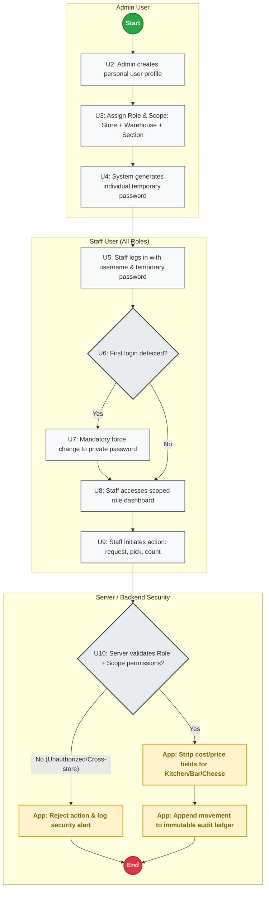
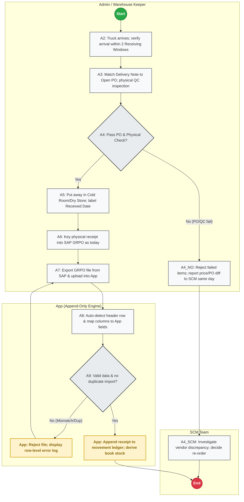
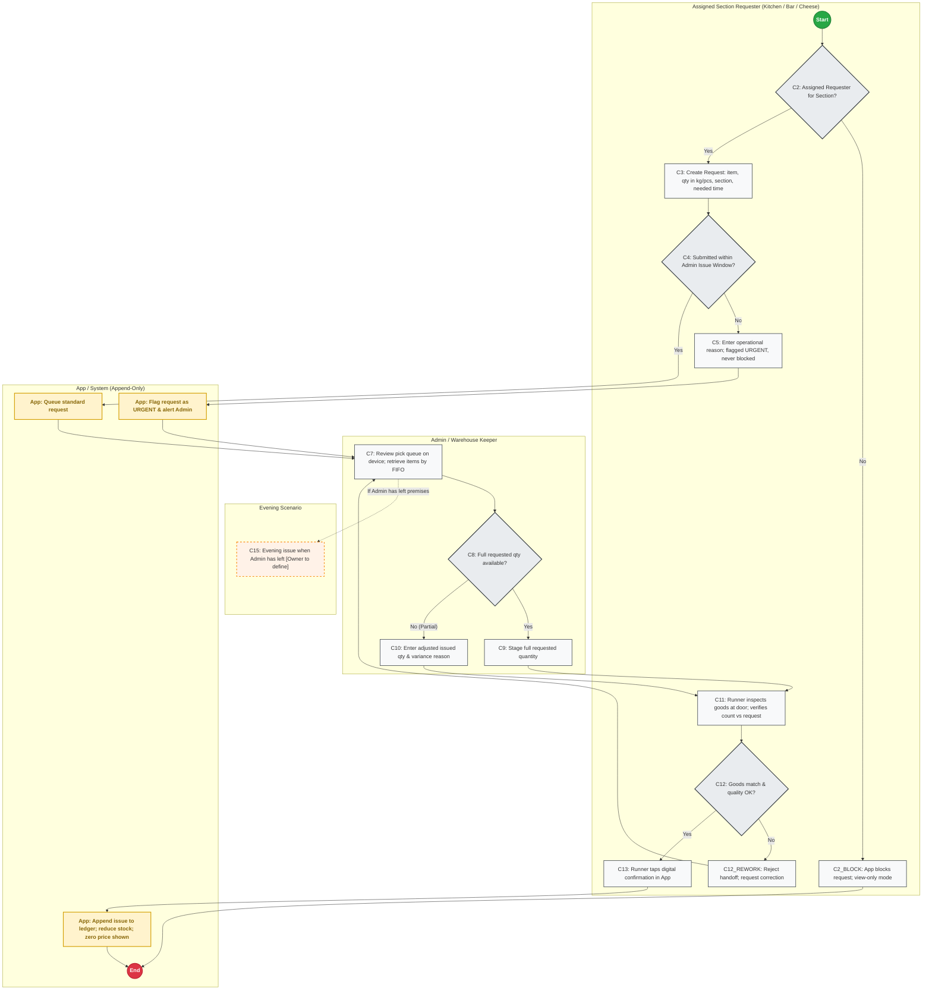
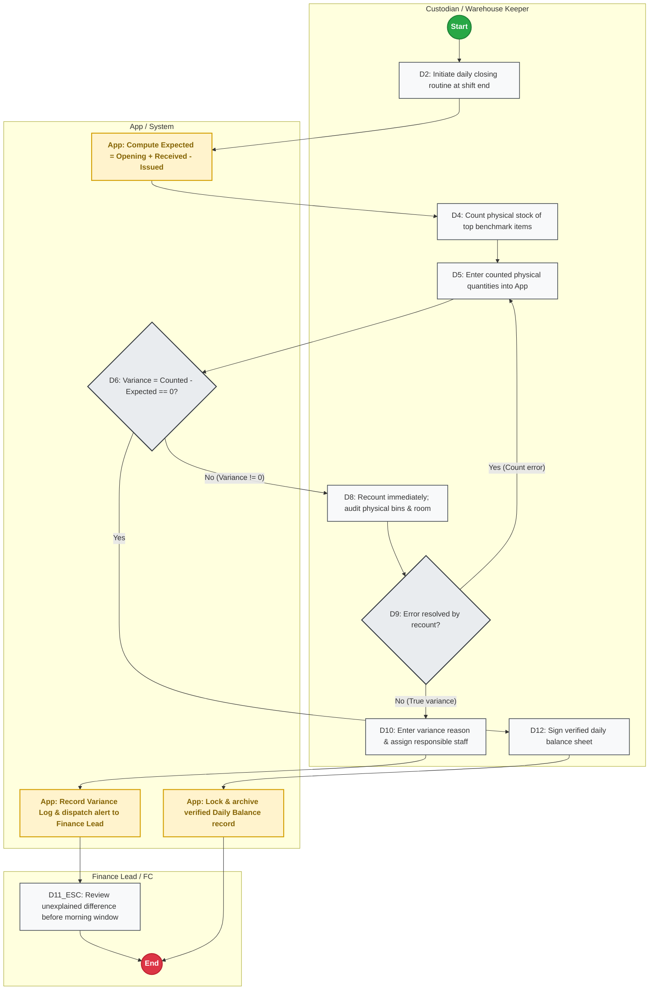
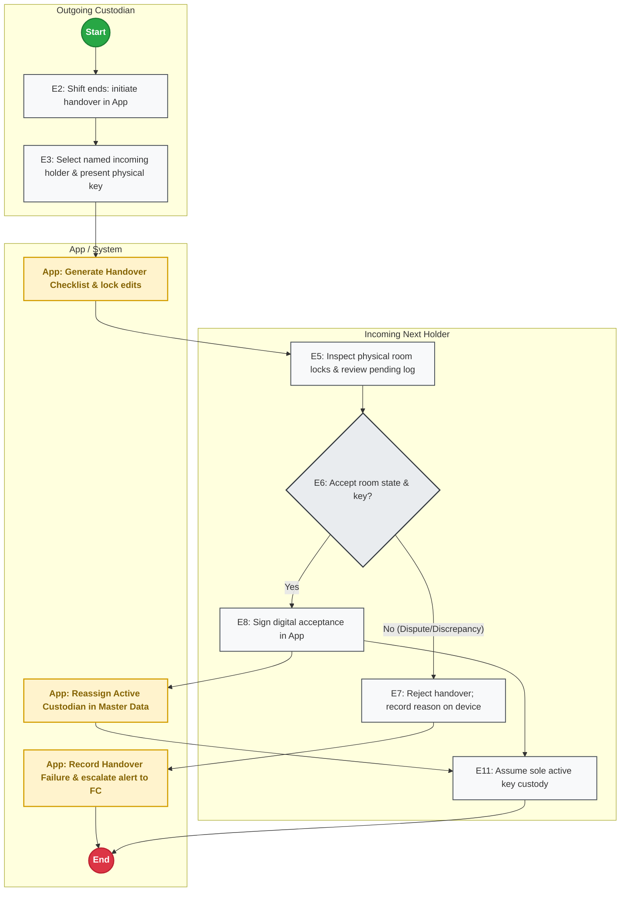
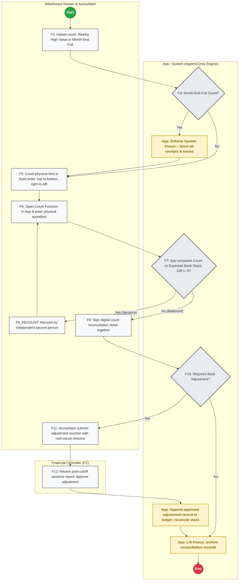
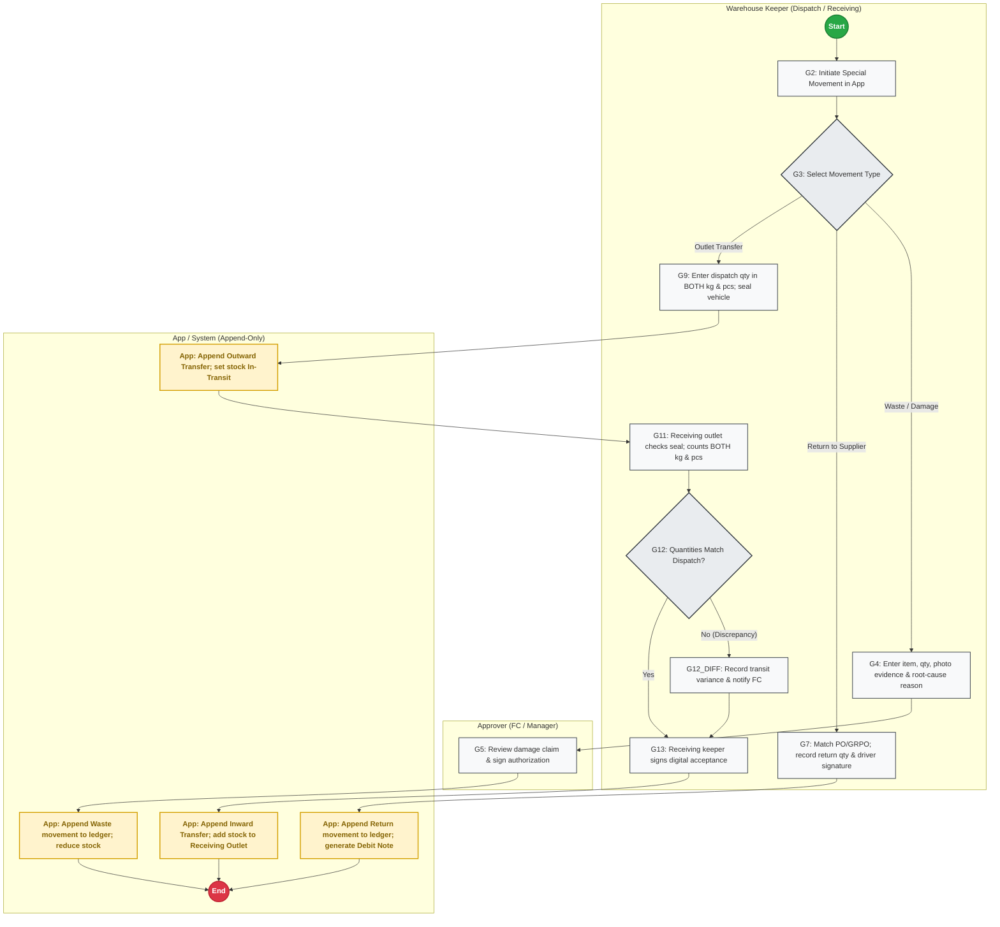
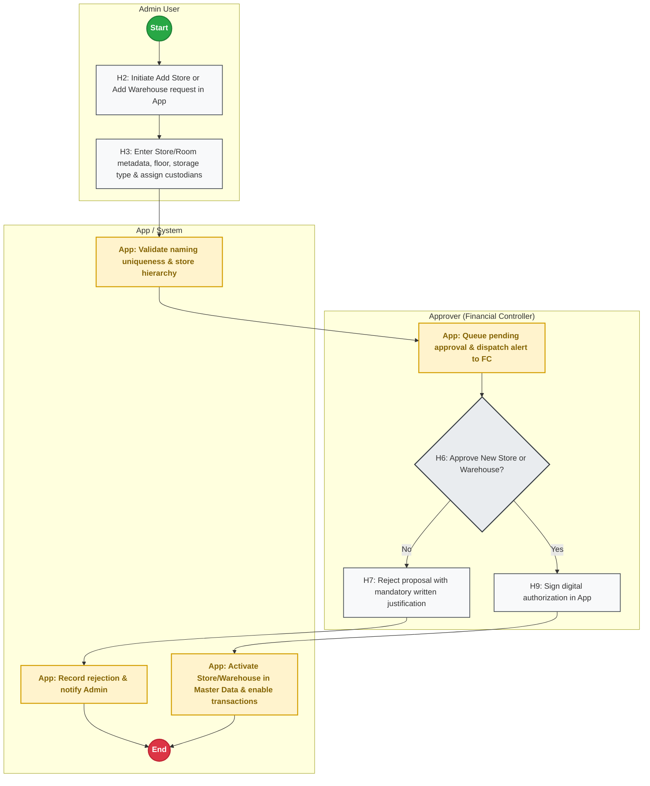

# INVENTORY CONTROL TOOL — OPERATIONAL SPECIFICATION & PROCESS FLOWS
**Pizza 4P's India Operations (Multi-Unit Rollout)**  
**Author:** Design Lead | **Owner:** Financial Controller  
**Scope:** 5 to 6 Stores · Central Storage Warehouses (Cold Rooms, Dry Stores, Freezers)  
**Document Version:** 1.1 (Updated per Owner Stage 1 Review Decisions)  
**Date:** November 2026  

---

## 0. PURPOSE, SCOPE & PLATFORM REQUIREMENTS

### 0.1 Purpose
The purpose of the Inventory Control Tool is to establish an uncompromised, platform-neutral back-of-house inventory control engine for Pizza 4P's India across 5 to 6 operating restaurants. The app acts as the sole operational ledger for all stock movements entering, dwelling within, and exiting the central storage facilities. It enforces strict individual custody, standardizes kitchen/bar/cheese section requisitions, automates daily variance reconciliation, and flags reorder needs and expiry risks.

### 0.2 Operational Scope & System Boundaries
1. **Target Scale:** 5 to 6 restaurant outlets, >30 concurrent users.
2. **Physical Facilities Under Scope:**
   - Central Store Warehouses only: Ground-Floor Cold Rooms, Dry Stores, and Walk-in Freezers.
   - Scalability: Any additional store or warehouse requires formal Financial Controller approval via Flow H.
3. **Out of Scope:**
   - Kitchen line stock, cold inserts, prep table holdings, and bar speed rails.
   - Recipe BOM yield conversions (raw material to prep item processing).
   - Point of Sale (POS) guest billing and ordering.
4. **Version 1 Data Constraint:**
   - **Quantities ONLY:** Version 1 strictly records, tracks, and derives physical stock quantities (kg and pieces). It stores **NO cost, NO purchase price, and NO valuation data**. All financial inventory valuations remain in SAP / ERP.
   - **Absolute Price Concealment:** Staff in Kitchen, Bar, and Cheese sections have zero access to cost or price data at all layers.

### 0.3 Platform Requirements (Platform-Neutral Architecture)
The application logic and data model are strictly platform-neutral (compatible with Google Apps Script + Sheets/Cloud SQL, Firebase, Supabase, Node.js + PostgreSQL, or Retool). Whichever platform is chosen must provide:
1. **Append-Only Immutable Transaction Ledger:** Physical stock balances must **never be directly edited**. Current stock must be derived dynamically from an append-only transaction table (`t_stock_movements`).
2. **Strict Server-Side Session & Role Validation:** Every single read, write, and query must validate user identity, assigned role, and location scope (Store ID + Warehouse ID + Section ID) on the server.
3. **Concurrent Multi-User Transaction Handling:** Robust row-level concurrency locking or atomic appending to prevent race conditions during peak requisition windows across 30+ users.
4. **Tabular File Parsing Engine:** Ability to ingest client-uploaded CSV/Excel exports from SAP GRPO, auto-detect the header row, map dynamic columns to target fields, and log row-level parsing errors.
5. **Offline Capability & IndexedDB Staging:** Client-side queueing for low-connectivity environments (underground cold rooms) with automatic background sync upon reconnection.
6. **Binary Attachment Storage:** Secure blob storage for delivery notes, waste photos, and count sheets with CDN access control.

---

## 1. ROLES, SCOPE & ACCESS CONTROL MATRIX

### 1.1 Preset Roles and Definitions
Access control operates on a **Permission = Role + Scope** model. A user's scope restricts them to a specific `store_id`, `warehouse_id`, and `section_id`.

| Preset Role | Primary Responsibilities | Scope Restrictions | Price Visibility |
| :--- | :--- | :--- | :---: |
| **Admin** *(Warehouse Keeper / Storekeeper)* | - Manages warehouse intake, physical QC, and put-away.<br>- Imports SAP GRPO export files into App.<br>- Configures Issue Windows.<br>- Picks and issues stock against authorized requests.<br>- Conducts daily benchmark counts and initiates handovers. | Scoped to assigned Store and Warehouses. | No (V1 has no prices) |
| **Restaurant Manager (RM)** | - Operational oversight of store inventory.<br>- Reviews daily balance sheets and urgent issue logs.<br>- Acts as designated Evening Key Holder (pending Flow C owner decision). | Scoped to assigned Store. | No |
| **Kitchen Requester** | - Creates stock requisitions for Kitchen section.<br>- Inspects picked goods at storeroom door and confirms receipt. | Scoped to Store + Kitchen Section. | **STRICTLY HIDDEN** |
| **Bar Requester** | - Creates stock requisitions for Bar section (beverages, fruits).<br>- Confirms receipt at storeroom door. | Scoped to Store + Bar Section. | **STRICTLY HIDDEN** |
| **Cheese Requester** | - Creates stock requisitions for in-house Cheese production section.<br>- Confirms receipt at storeroom door. | Scoped to Store + Cheese Section. | **STRICTLY HIDDEN** |
| **SCM Lead** | - Investigates vendor delivery issues, missing POs, and price/qty discrepancies reported by Admin on receiving dock. | Global or Multi-Store Scope. | Yes (in SAP) |
| **Store Accountant** | - Participates in weekly cycle counts and month-end freeze counts.<br>- Submits count reconciliation vouchers and post-cutoff adjustment requests. | Scoped to Store. | No (V1 has no prices) |
| **Approver (Financial Controller)** | - Formally approves new Stores and Warehouses (Flow H).<br>- Approves post-cutoff inventory count write-offs/adjustments (Flow F).<br>- Approves high-value waste claims (Flow G).<br>- Audits weekly urgent requisition logs and unexplained daily variances. | Global / Multi-Store Scope. | Full Executive Access |
| **Viewer** *(Internal Audit, GM)* | - Read-only access to ledger balances, movement history, and audit trails. | Global or Store Scoped. | No (V1 has no prices) |

### 1.2 Role-by-Action Matrix

| Operational Action | Admin | RM | Kitchen | Bar | Cheese | SCM | Accountant | Approver (FC) | Viewer |
| :--- | :---: | :---: | :---: | :---: | :---: | :---: | :---: | :---: | :---: |
| **Create User Accounts & Reset PWD** | **YES** | No | No | No | No | No | No | **YES** | No |
| **Configure Store Issue Windows** | **YES** | No | No | No | No | No | No | **YES** | No |
| **Define Item Expiry Tracking Groups** | **YES** | No | No | No | No | No | No | **YES** | No |
| **Import SAP GRPO Export File** | **YES** | No | No | No | No | No | No | No | No |
| **Create Section Stock Request** | No | No | **YES\*** | **YES\*** | **YES\*** | No | No | No | No |
| **Pick & Issue Stock from Storeroom** | **YES** | No | No | No | No | No | No | No | No |
| **Confirm Receipt at Storeroom Door** | No | No | **YES** | **YES** | **YES** | No | No | No | No |
| **Perform Daily Benchmark Count** | **YES** | No | No | No | No | No | No | No | No |
| **Sign Shift Handover (Key/Log)** | **YES** | **YES** | No | No | No | No | No | No | No |
| **Conduct Periodic Stock Count** | **YES** | No | No | No | No | No | **YES** | No | No |
| **Submit Post-Cutoff Adjustment** | No | No | No | No | No | No | **YES** | No | No |
| **Approve Stock Adjustment Voucher** | No | No | No | No | No | No | No | **YES** | No |
| **Log Waste / Spoilage Movement** | **YES** | **YES** | No | No | No | No | No | No | No |
| **Approve Waste Write-Off** | No | **YES** | No | No | No | No | No | **YES** | No |
| **Dispatch / Receive Outlet Transfer**| **YES** | No | No | No | No | No | No | No | No |
| **Request New Store or Warehouse** | **YES** | **YES** | No | No | No | No | No | No | No |
| **Approve New Store or Warehouse** | No | No | No | No | No | No | No | **YES** | No |

*\*Only active users explicitly flagged as `is_section_requester = TRUE` for their assigned section can submit requests.*

---

## 2. MASTER DATA REQUIREMENTS

In strict compliance with owner directives, all threshold parameters, par levels, tolerances, and time windows are designated as **[Owner to set]** and are never fabricated.

### 2.1 Store & Warehouse Master
- `m_stores`: `store_id` (PK, e.g. `IND-DEL-01`), `store_name`, `city`, `status` (`ACTIVE`, `INACTIVE`).
- `m_warehouses`: `warehouse_id` (PK, e.g. `WH-DEL01-COLD`), `store_id` (FK), `warehouse_name`, `floor_level`, `storage_type` (`COLD_ROOM`, `DRY_STORE`, `FREEZER`), `status` (`ACTIVE`, `FROZEN_FOR_COUNT`, `INACTIVE`), `approval_id` (FK).

### 2.2 Go-Live Assignment Checklist (`m_go_live_assignments`)
*Mandatory baseline operational parameters assigned per store before go-live:*
- `store_id`: Store reference.
- `cold_room_custodian_id`: Primary user ID [Owner to set].
- `cold_room_backup_id`: Secondary user ID [Owner to set].
- `dry_store_custodian_id`: Primary user ID [Owner to set].
- `dry_store_backup_id`: Secondary user ID [Owner to set].
- `kitchen_runner_id`: Designated runner user ID [Owner to set].
- `evening_key_holder_id`: Named evening holder [Owner to set].
- `morning_receiving_window`: Start/End time [Owner to set].
- `afternoon_receiving_window`: Start/End time [Owner to set].
- `morning_issue_window`: Start/End time configured by Admin [Owner to set].
- `afternoon_issue_window`: Start/End time configured by Admin [Owner to set].

### 2.3 User, Role & Scope Master (`m_users`, `m_user_permissions`)
- `m_users`: `user_id` (PK), `username`, `full_name`, `password_hash`, `is_temp_password` (BOOLEAN: forced change on first login), `is_active` (BOOLEAN).
- `m_user_permissions`: `permission_id` (PK), `user_id` (FK), `role` (`ADMIN`, `RM`, `KITCHEN`, `BAR`, `CHEESE`, `SCM`, `ACCOUNTANT`, `APPROVER`, `VIEWER`), `store_id` (FK), `warehouse_id` (FK, nullable), `section_id` (`KITCHEN`, `BAR`, `CHEESE`, `ALL`), `is_section_requester` (BOOLEAN).

### 2.4 Item Master & Expiry Tracking Config (`m_items`, `m_expiry_tracking_config`)
- `m_items`: `item_code` (PK), `item_name`, `category_group` (Dairy, Meat, Seafood, Produce, Dry Grocery, Packaging, Chemicals), `base_uom` (`KG` or `PIECE`), `is_active`.
- `m_expiry_tracking_config`: `config_id` (PK), `category_group`, `requires_lot_expiry_tracking` (BOOLEAN, configured by Owner or Admin; **no default groups**), `expiry_warning_days` [Owner to set].

### 2.5 User-Defined Reorder Rules (`m_reorder_rules`)
*Note: Configured per item by each user/owner. No automated defaults.*
- `rule_id` (PK), `store_id` (FK), `warehouse_id` (FK), `item_code` (FK).
- `par_level`: Maximum target inventory [Owner to set].
- `reorder_point`: Replenishment trigger level [Owner to set].
- `min_order_qty`: Minimum purchase batch [Owner to set].

### 2.6 UOM & Conversions (`m_uom_conversions`)
- `item_code` (FK), `base_uom` (`KG` or `PIECE`), `secondary_uom` (Box, Wheel, Tin), `conversion_factor` [Owner to set].
- `dual_uom_required`: Mandatory `TRUE` for Inter-Outlet Transfers (Flow G) requiring both weight (kg) and pieces to eliminate cutting shrinkage.

---

## 3. OPERATIONAL PROCESS FLOWS (FLOWS 0 TO H)

Every flow is mapped to an isolated visual flowchart in the `flows/` directory, following standard flowchart conventions:
- Green circular Start node: `((Start))`
- Red circular End node: `((End))`
- Clear rectangular Action steps with explicit single-action verbs
- Rhombus Decision diamonds with unambiguous `Yes` and `No` branches
- Distinctive Amber highlight cards indicating database persistence: `[App: ...]`
- Rework loops returning directly to appropriate correction steps
- Strict swimlanes delineating functional responsibility

```
Flowchart Index:
- Flow 0: Users, Roles & Access -> flows/flow_access_control.svg | .png
- Flow A: Receive (Admin, SCM & SAP Import) -> flows/flow_a_receive.svg | .png
- Flow B: Keep (Custodian & Issue Windows) -> flows/flow_b_keep.svg | .png
- Flow C: Request & Issue (Section Requisition) -> flows/flow_c_request_issue.svg | .png
- Flow D: Balance (Daily Close Reconciliation) -> flows/flow_d_balance.svg | .png
- Flow E: Handover (Custodian Shift Handover) -> flows/flow_e_handover.svg | .png
- Flow F: Count (Cycle & Month-End Reconciliation) -> flows/flow_f_count.svg | .png
- Flow G: Other Movements (Waste, Return, Transfer) -> flows/flow_g_other_movements.svg | .png
- Flow H: Add a New Store or Warehouse -> flows/flow_h_add_store_warehouse.svg | .png
```

---

### FLOW 0: USERS, ROLES AND ACCESS CONTROL
*Individual user provisioning, temporary password lifecycle, forced first-login change, and server-side role validation.*



- **Trigger:** New staff onboarding or role assignment across the 5 to 6 stores.
- **Actor:** Admin, Individual Staff User, Server Security Engine.
- **Inputs:** Staff name, phone/email, role (`Admin`, `RM`, `Kitchen`, `Bar`, `Cheese`, `SCM`, `Accountant`, `Approver`, `Viewer`), scope (`store_id`, `warehouse_id`, `section_id`).
- **Outputs:** Authenticated user session, encrypted credentials, access audit log.
- **Record Stored:** `m_users`, `m_user_permissions`, `t_security_logs`.
- **Decision Points & Branches:**
  - `U6: First login detected?`: If YES, user is forced into password change screen (`U7`). User cannot proceed to app features until a private password is created. If NO, proceed to scoped dashboard (`U8`).
  - `U10: Server validates Role + Scope?`: If user attempts an action outside their assigned store, warehouse, or section (or if an unauthorized section user attempts a request), server rejects the transaction with 403 Forbidden (`U11`). If valid, server strips all price attributes and processes the request (`U12`).
- **The Control (Stops mistakes / unauthorized access):**
  - *No Shared Accounts:* Every single user has an individual login. Group accounts (`kitchen@store1`) are strictly prohibited.
  - *Server-Side Scoping:* All permission checks happen on the server engine. Client UI tampering cannot bypass warehouse/store boundaries.

---

### FLOW A: RECEIVE (ADMIN, SCM & SAP GRPO IMPORT)
*Two receiving windows check, delivery inspection, SAP GRPO entry, file export/import, auto header detection, and ledger update.*



- **Trigger:** Supplier delivery truck arrives at restaurant receiving bay.
- **Actor:** Admin / Warehouse Keeper, SCM Team, App Ingestion Engine.
- **Inputs:** Physical delivery, supplier Delivery Note, SAP Open PO, exported SAP GRPO file (CSV/Excel).
- **Outputs:** Labeled physical stock in storage rooms, SAP GRPO record, App immutable movement ledger update.
- **Record Stored:** `t_grpo_imports`, `t_grpo_import_items`, `t_stock_movements`.
- **Decision Points & Branches:**
  - `A2: Receiving Window Check`: Receiving is strictly permitted only inside the 2 fixed daily Receiving Windows (`morning_receiving_window` and `afternoon_receiving_window` [Owner to set]). Deliveries arriving outside windows are held or rescheduled.
  - `A4: Pass PO & Physical Check?`: Check PO existence (no PO, no receipt), counted quantity, temperature (for cold goods), expiry date, and invoice price vs PO. If NO, reject failed goods to driver, note difference on delivery note, and report price/PO discrepancies to SCM the same day (`A4_NO`). SCM investigates vendor variance (`A4_SCM`). If YES, put away immediately (`A5`).
  - `A6-A7: SAP Entry & Export`: Receipts continue to be entered directly into SAP GRPO as today. The app does not replace GRPO and has no direct API connection. Admin exports the GRPO file from SAP and uploads it into the App (`A7`).
  - `A9: File Validation & Duplicate Check?`: App parses file, automatically locates header row, maps column names (`PO Number`, `Item Code`, `Counted Qty`, `Batch/Expiry`), and checks for duplicate import hashes. If duplicate file or column mismatch detected (`A10`), App rejects import and presents row error log. If clean, App appends records to immutable ledger (`A11`).
- **The Control (Stops theft / mistakes):**
  - *No PO, No Receipt:* Deliveries without an approved SAP PO are refused at the dock.
  - *Dual Verification:* Counted physical receipt verified at door, keyed into SAP, and reconciled in the App via validated batch export.
- **Assumptions & Open Questions for Owner:** See Section 6 (Questions 1, 2, and 3).

---

### FLOW B: KEEP (CUSTODIAN & ADMIN-CONFIGURED ISSUE WINDOWS)
*Admin-configured issue windows, named custodian per room, physical room locking outside windows.*

```mermaid
flowchart TD
  classDef startNode fill:#28a745,stroke:#1e7e34,stroke-width:2px,color:#fff,font-weight:bold;
  classDef endNode fill:#dc3545,stroke:#bd2130,stroke-width:2px,color:#fff,font-weight:bold;
  classDef recordNode fill:#fff3cd,stroke:#d39e00,stroke-width:2px,color:#856404,font-weight:bold;
  classDef actionNode fill:#f8f9fa,stroke:#495057,stroke-width:1.5px;
  classDef decisionNode fill:#e9ecef,stroke:#343a40,stroke-width:2px;

  subgraph Admin["Admin User"]
    B1((Start)):::startNode --> B2[B2: Admin configures 2 Issue Windows in App settings]:::actionNode
  end

  subgraph Custodian["Custodian / Backup per Room"]
    B2 --> B3[B3: Custodian takes sole physical key per Master Data]:::actionNode
    B5[B5: Unlock storeroom door during configured Issue Window]:::actionNode --> B6[B6: Supervise picking; dispense goods against App requests]:::actionNode
    B6 --> B7[B7: Window ends: lock storeroom door immediately]:::actionNode
    B10[B10: Keep room locked; refuse all unlogged entry]:::actionNode
    B11[B11: Unlock room for emergency extraction of flagged urgent item]:::actionNode --> B7
  end

  subgraph System["App / System"]
    B3 --> B4{B4: Within configured Issue Window?}:::decisionNode
    B4 -- "Yes" --> B5
    B4 -- "No" --> B8{B8: Authorized Urgent Request in App?}:::decisionNode
    B8 -- "No" --> B10
    B8 -- "Yes" --> B9[App: Log Urgent Room Access with timestamp & staff ID]:::recordNode
    B9 --> B11
    B7 --> B12[App: Record room locked & active custody confirmed]:::recordNode
    B10 --> B13((End)):::endNode
    B12 --> B13
  end
```



- **Trigger:** Start of daily operational shift.
- **Actor:** Admin, Room Custodian (or Backup).
- **Inputs:** Issue window time settings, physical brass key, master data custodian assignments.
- **Outputs:** Secure storeroom perimeter, lock/unlock timestamp audit trail.
- **Record Stored:** `t_custody_logs`.
- **Decision Points & Branches:**
  - `B2: Window Configuration`: Admin defines the two official issue windows (Morning and Afternoon) directly in app configuration.
  - `B4: Window Check`: If current time is within configured window, custodian unlocks storeroom door (`B5`) and supervises picking (`B6`). Door is locked immediately when window expires (`B7`).
  - `B8: Urgent Access`: If outside window, entry is barred unless an App requisition flagged `URGENT` exists. Custodian extracts urgent item (`B11`), App logs access timestamp and user (`B9`), and room is re-locked immediately (`B7`).
- **The Control (Stops theft / mistakes):**
  - Storerooms remain physically locked 20+ hours a day. Only the single named custodian or backup per room holds physical keys.

---

### FLOW C: REQUEST AND ISSUE (SECTION REQUISITIONS)
*Authorized section requesters (Kitchen/Bar/Cheese), Admin-configured windows, urgent flagging (never blocked), picking, evening scenario, and dual-confirmed handoff.*



- **Trigger:** Kitchen, Bar, or Cheese section requires ingredients for prep or service.
- **Actors:** Assigned Section Requester / Runner, Admin / Warehouse Keeper.
- **Inputs:** Item code, quantity (kg or pieces), section (`Kitchen`, `Bar`, `Cheese`), needed time.
- **Outputs:** Physically dispensed goods, confirmed digital consumption transaction.
- **Record Stored:** `t_requests`, `t_request_items`, `t_stock_movements`.
- **Decision Points & Branches:**
  - `C2: Section Requester Authorization`: Server checks if logged-in user is explicitly authorized as `is_section_requester = TRUE` for that section. If NO, request creation is blocked (`C2_BLOCK`).
  - `C4: Window Validation`: If submitted outside Admin-configured issue window, user must enter operational justification (`C5`). The request is **flagged URGENT and queued, NEVER blocked** (per owner decision).
  - `C8: Picking & Partial Issue`: Admin retrieves stock. If full stock is unavailable or damaged, Admin inputs adjusted issued quantity and records variance reason (`C10`).
  - `C12: Physical Inspection & Acceptance`: Runner verifies items at storeroom door. If defective/wrong item, runner rejects handoff (`C12_REWORK`), looping back to Admin pick queue (`C7`). If accepted, runner taps confirmation in App (`C13`).
  - `C14: Ledger Update & Zero Price`: App appends movement to ledger (`t_stock_movements`), reducing available stock. The kitchen runner's UI displays quantities strictly, with **no prices or costs visible**.
  - `C15: Evening Issue when Admin has left`: Step explicitly designated **[Owner to define]** per owner instruction.
- **The Control (Stops theft / mistakes):**
  - *No Request, No Goods Out:* Requisition must precede picking.
  - *Dual-Party Signoff:* Admin cannot unilaterally issue stock; physical runner must confirm receipt on device.

---

### FLOW D: BALANCE (DAILY CLOSE RECONCILIATION)
*Mathematical closing ($Opening + Received - Issued = Expected$), top benchmark count, and pre-morning Finance Lead escalation.*



- **Trigger:** End of daily warehouse operations.
- **Actors:** Custodian / Warehouse Keeper, Finance Lead / FC.
- **Inputs:** Cumulative ledger receipts, cumulative confirmed issues, physical count of top benchmark items.
- **Outputs:** Signed daily reconciliation sheet, discrepancy escalation alerts.
- **Record Stored:** `t_daily_balances`, `t_daily_balance_items`.
- **Decision Points & Branches:**
  - `D3: Expected Balance Calculation`: App calculates $	ext{Expected} = 	ext{Opening} + 	ext{Received} - 	ext{Issued}$.
  - `D6: Variance Check`: Discrepancy evaluated ($Diff = Counted - Expected$). If zero, custodian signs (`D12`), and balance is locked (`D13`).
  - `D9: Recount Loop`: If variance exists, custodian recounts bins immediately. If count error found, loop back to re-enter (`D5`). If variance is genuine, custodian documents reason and names responsible staff (`D10`); App immediately dispatches escalation alert to **Finance Lead / FC** (`D11_ESC`) to resolve before next morning's issue window.
- **The Control (Stops theft / mistakes):**
  - Daily counting of high-value items catches leakage within 12 hours. Unexplained differences must be investigated before morning opening.

---

### FLOW E: HANDOVER (CUSTODIAN SHIFT HANDOVER)
*Physical key transfer, inventory log review, and mutual digital sign-off.*



- **Trigger:** Custodian leaves premises or shift ends.
- **Actors:** Outgoing Custodian, Incoming Next Holder (Named Backup or RM/MOD).
- **Inputs:** Physical key, lock inspection, pending request queue.
- **Outputs:** Legally binding digital custody transfer.
- **Record Stored:** `t_handover_logs`.
- **Decision Points & Branches:**
  - `E6: Acceptance Check`: Incoming holder checks door locks and logs. If disputed, reject in App (`E7`) and alert FC (`E9`). If accepted, incoming holder signs digitally (`E8`), and App reassigns active keyholder in Master Data (`E10`).
- **The Control (Stops theft / mistakes):**
  - Storerooms never have an unnamed holder. Every key possession is logged to a specific individual.

---

### FLOW F: COUNT (APP RECONCILIATION COUNT FUNCTION)
*Periodic high-value and month-end counts, system freeze, App count function comparing physical vs book stock, recount, and FC adjustment approval.*



- **Trigger:** Scheduled weekly cycle count or month-end inventory close.
- **Actors:** Warehouse Keeper, Store Accountant, Financial Controller.
- **Inputs:** Physical inventory, weighing scales, App Count Function.
- **Outputs:** Reconciled book stock, audit count sheet, approved post-cutoff adjustment vouchers.
- **Record Stored:** `t_stock_counts`, `t_stock_count_items`, `t_stock_adjustments`, `t_stock_movements`.
- **Decision Points & Branches:**
  - `F3: Month-End Freeze`: Month-end counts enforce `SYSTEM_FREEZE` (`F4`), blocking all Goods Receipts and Kitchen Issues until recount completion. Weekly counts proceed without freeze.
  - `F6-F7: App Count Function & Variance`: Keeper and Accountant count in strict spatial order (top-to-bottom, right-to-left). Physical counts are entered into the App Count Function (`F6`). The App automatically calculates $	ext{Diff} = 	ext{Counted Qty} - 	ext{Expected Book Stock}$. Counts reconcile the App; they do not replace physical controls.
  - `F8: Recount`: If variance is detected, mandatory blind recount by independent second person (`F8_RECOUNT`), looping back to count entry.
  - `F10-F12: Adjustment Approval`: If book adjustments are required, Accountant submits formal voucher with root-cause reasons (`F11`). Upon Financial Controller review and approval (`F12`), App appends adjustment movement to ledger (`F13`), updating stock. Freeze is lifted (`F14`).
- **The Control (Stops theft / mistakes):**
  - Strict movement freeze halts inventory during counting. Recount done by second person. Book adjustments can only post with formal FC authorization.

---

### FLOW G: OTHER MOVEMENTS (WASTE, RETURNS, TRANSFERS)
*Waste/damage write-off, supplier returns, and dual-unit inter-outlet transfers with vehicle seals (Quantities only).*



- **Trigger:** Spoilage identified, goods rejected to supplier, or inter-store inventory transfer requested.
- **Actors:** Warehouse Keeper, Driver, Receiving Outlet Keeper, Approver (FC / RM).
- **Inputs:** Defective stock, supplier delivery note, vehicle seal number.
- **Outputs:** Waste loss record, supplier debit voucher, dual-confirmed inter-outlet transfer.
- **Record Stored:** `t_other_movements`, `t_stock_movements`.
- **Decision Points & Branches:**
  - `G3: Movement Type`:
    - *Waste / Damage (`G4`):* Keeper enters item, quantity, photo evidence, and root-cause reason. Approver inspects and signs (`G5`). App appends waste record to ledger (`G6`).
    - *Return to Supplier (`G7`):* Matched to original PO/GRPO, return quantity entered, driver signs delivery note. App appends return movement (`G8`).
    - *Inter-Outlet Transfer (`G9`):* Dispatch keeper enters quantity in **BOTH kg and pieces** (dual UOM mandatory), applies tamper-evident vehicle seal, and signs dispatch. Stock set to `IN_TRANSIT` (`G10`). Receiving keeper verifies seal and counts in **BOTH kg and pieces** (`G11`). If discrepancy detected (`G12_DIFF`), transit variance logged. Receiving keeper signs acceptance (`G13`); App appends inward movement to receiving store ledger (`G14`).
- **The Control (Stops theft / mistakes):**
  - Dual UOM (kg and pieces) prevents trimming in transit. Waste claims require photo evidence. Dual digital signatures prevent ghost transfers.

---

### FLOW H: ADD A NEW STORE OR WAREHOUSE (APPROVAL)
*Store expansion, structural validation, Financial Controller authorization, and master data activation.*



- **Trigger:** Business expansion requires a new restaurant store (scale 5 to 6 stores) or new controlled storeroom (Cold Room, Dry Store, Freezer).
- **Actors:** Admin / Operations Manager, Financial Controller (FC).
- **Inputs:** Store name, store code, room name, floor level, storage temperature type, nominated primary and backup custodians.
- **Outputs:** Activated Store / Warehouse record, generated storage bin QR codes.
- **Record Stored:** `t_store_warehouse_approvals`, `m_stores`, `m_warehouses`.
- **Decision Points & Branches:**
  - `H6: Approval Check`: Financial Controller evaluates store expansion justification and segregation of duties. If NO, request rejected with mandatory explanation (`H7`). If YES, FC signs authorization (`H9`), and App activates the store/warehouse in Master Data (`H10`).
- **The Control (Stops unmonitored storage):**
  - No local user can create unmonitored "black-box" storerooms. Every storage facility must have formal FC approval and named custodians.

---

## 4. DAILY USAGE, REORDER VIEW & STOCK DERIVATION

### 4.1 Append-Only Stock Derivation Formula
Physical stock is **never an edited balance**. Current book stock for any item in any warehouse is derived dynamically from `t_stock_movements`:

$$egin{aligned}
	ext{Current Book Stock} = &\; \sum(	ext{Quantity from Confirmed GRPO Imports}) \
&- \sum(	ext{Quantity from Confirmed Section Issues}) \
&- \sum(	ext{Quantity from Approved Waste Movements}) \
&- \sum(	ext{Quantity from Outward Outlet Transfers}) \
&+ \sum(	ext{Quantity from Inward Outlet Transfers}) \
&\pm \sum(	ext{Quantity from Approved Count Reconciliation Adjustments})
\end{aligned}$$

### 4.2 Daily Usage Formula
$$	ext{Daily Actual Usage} = \sum(	ext{Confirmed Requisitions for Calendar Day}) + \sum(	ext{Approved Waste for Calendar Day})$$

### 4.3 Average Daily Usage (ADU)
$$	ext{Average Daily Usage (ADU)} = rac{	ext{Total Actual Consumption over Rolling } N 	ext{ Days}}{N 	ext{ Days [Owner to set]}}$$

### 4.4 User-Defined Reorder Trigger & Quantity
*Note: Configured per item by each user or owner. No automated defaults.*
When:
$$	ext{Current Book Stock} \le 	ext{Reorder Point [Owner to set]}$$
Then:
$$	ext{Suggested Reorder Qty} = \max\Big(0, \;	ext{Par Level [Owner to set]} - 	ext{Current Book Stock} - 	ext{Open PO Qty}\Big)$$

### 4.5 Group-Configured Expiry Radar
*Note: Evaluated only for item categories explicitly flagged in `m_expiry_tracking_config`.*
$$	ext{Days to Expiry} = 	ext{Batch Expiry Date} - 	ext{Current Date}$$
- **`EXPIRY WARNING`:** Triggered when $	ext{Days to Expiry} \le 	ext{Expiry Warning Days [Owner to set]}$. Batch highlighted in amber, prioritized on pick list (FIFO).
- **`EXPIRED LOCK`:** Triggered when $	ext{Days to Expiry} \le 0$. App hard-locks batch; cannot be selected for kitchen issue.

---

## 5. PLATFORM-NEUTRAL DATA MODEL (TABLES AND FIELDS)

### 5.1 Master Data Tables
1. `m_stores`: `store_id` (VARCHAR, PK), `store_name` (VARCHAR), `city` (VARCHAR), `is_active` (BOOLEAN).
2. `m_warehouses`: `warehouse_id` (VARCHAR, PK), `store_id` (VARCHAR, FK), `warehouse_name` (VARCHAR), `storage_type` (VARCHAR), `is_active` (BOOLEAN).
3. `m_go_live_assignments`: `store_id` (VARCHAR, PK/FK), `cold_room_custodian_id` (VARCHAR), `cold_room_backup_id` (VARCHAR), `dry_store_custodian_id` (VARCHAR), `dry_store_backup_id` (VARCHAR), `kitchen_runner_id` (VARCHAR), `evening_key_holder_id` (VARCHAR), `morning_issue_window` (VARCHAR), `afternoon_issue_window` (VARCHAR), `morning_receiving_window` (VARCHAR), `afternoon_receiving_window` (VARCHAR).
4. `m_users`: `user_id` (VARCHAR, PK), `username` (VARCHAR, UNIQUE), `full_name` (VARCHAR), `password_hash` (VARCHAR), `is_temp_password` (BOOLEAN), `is_active` (BOOLEAN).
5. `m_user_permissions`: `permission_id` (VARCHAR, PK), `user_id` (VARCHAR, FK), `role` (VARCHAR), `store_id` (VARCHAR, FK), `warehouse_id` (VARCHAR, FK, NULLABLE), `section_id` (VARCHAR), `is_section_requester` (BOOLEAN).
6. `m_items`: `item_code` (VARCHAR, PK), `item_name` (VARCHAR), `category_group` (VARCHAR), `base_uom` (VARCHAR), `is_active` (BOOLEAN).
7. `m_expiry_tracking_config`: `config_id` (VARCHAR, PK), `category_group` (VARCHAR, UNIQUE), `requires_lot_expiry_tracking` (BOOLEAN), `expiry_warning_days` (INTEGER).
8. `m_reorder_rules`: `rule_id` (VARCHAR, PK), `store_id` (VARCHAR, FK), `warehouse_id` (VARCHAR, FK), `item_code` (VARCHAR, FK), `par_level` (DECIMAL), `reorder_point` (DECIMAL), `min_order_qty` (DECIMAL).
9. `m_uom_conversions`: `conversion_id` (VARCHAR, PK), `item_code` (VARCHAR, FK), `base_uom` (VARCHAR), `secondary_uom` (VARCHAR), `conversion_factor` (DECIMAL), `dual_uom_required` (BOOLEAN).

### 5.2 Transactional Tables (Quantities Only — No Prices)
10. `t_stock_movements` (Immutable Append-Only Ledger):
    - `movement_id` (VARCHAR, PK)
    - `store_id` (VARCHAR, FK)
    - `warehouse_id` (VARCHAR, FK)
    - `item_code` (VARCHAR, FK)
    - `movement_type` (VARCHAR: `GRPO_IMPORT`, `ISSUE_KITCHEN`, `ISSUE_BAR`, `ISSUE_CHEESE`, `WASTE_DISPOSAL`, `TRANSFER_OUT`, `TRANSFER_IN`, `COUNT_ADJUSTMENT`)
    - `quantity` (DECIMAL, signed: positive for intake, negative for issue/waste)
    - `uom` (VARCHAR)
    - `batch_number` (VARCHAR, nullable)
    - `expiry_date` (DATE, nullable)
    - `reference_doc_id` (VARCHAR)
    - `created_by_user_id` (VARCHAR, FK)
    - `created_at` (TIMESTAMP)
11. `t_grpo_imports` (Flow A File Upload Audit):
    - `import_id` (VARCHAR, PK), `store_id` (VARCHAR, FK), `file_name` (VARCHAR), `file_hash` (VARCHAR, UNIQUE to block duplicates), `detected_header_row` (INTEGER), `total_rows` (INTEGER), `imported_rows` (INTEGER), `error_count` (INTEGER), `uploaded_by_user_id` (VARCHAR, FK), `imported_at` (TIMESTAMP).
12. `t_grpo_import_items` (Flow A Parsed Lines):
    - `import_item_id` (VARCHAR, PK), `import_id` (VARCHAR, FK), `po_number` (VARCHAR), `item_code` (VARCHAR, FK), `counted_qty` (DECIMAL), `batch_number` (VARCHAR), `expiry_date` (DATE), `status` (`IMPORTED`, `REJECTED_MISMATCH`).
13. `t_custody_logs` (Flow B & E Access Logs):
    - `log_id` (VARCHAR, PK), `store_id` (VARCHAR, FK), `warehouse_id` (VARCHAR, FK), `event_type` (`WINDOW_UNLOCK`, `WINDOW_LOCK`, `URGENT_ACCESS`, `HANDOVER`), `custodian_user_id` (VARCHAR, FK), `next_holder_user_id` (VARCHAR, FK, nullable), `urgent_reason` (VARCHAR, nullable), `timestamp` (TIMESTAMP).
14. `t_requests` & `t_request_items` (Flow C Section Requisitions):
    - `t_requests`: `request_id` (VARCHAR, PK), `store_id` (VARCHAR, FK), `section_id` (VARCHAR), `requester_user_id` (VARCHAR, FK), `is_urgent` (BOOLEAN), `urgent_reason` (VARCHAR), `status` (`QUEUED`, `PICKED`, `CONFIRMED`, `REJECTED`), `runner_user_id` (VARCHAR, FK), `runner_confirmed_at` (TIMESTAMP).
    - `t_request_items`: `request_item_id` (VARCHAR, PK), `request_id` (VARCHAR, FK), `item_code` (VARCHAR, FK), `requested_qty` (DECIMAL), `issued_qty` (DECIMAL), `uom` (VARCHAR), `variance_reason` (VARCHAR).
15. `t_daily_balances` & `t_daily_balance_items` (Flow D Daily Balance):
    - `t_daily_balances`: `balance_id` (VARCHAR, PK), `store_id` (VARCHAR, FK), `warehouse_id` (VARCHAR, FK), `balance_date` (DATE), `custodian_user_id` (VARCHAR, FK), `status` (`BALANCED`, `VARIANCE_ESCALATED`), `finance_lead_signoff_id` (VARCHAR, FK, nullable).
    - `t_daily_balance_items`: `item_code` (VARCHAR, FK), `opening_qty` (DECIMAL), `received_qty` (DECIMAL), `issued_qty` (DECIMAL), `expected_qty` (DECIMAL), `counted_qty` (DECIMAL), `variance_qty` (DECIMAL), `variance_reason` (VARCHAR), `responsible_person` (VARCHAR).
16. `t_stock_counts` & `t_stock_count_items` (Flow F Reconciliation Counts):
    - `t_stock_counts`: `count_id` (VARCHAR, PK), `store_id` (VARCHAR, FK), `warehouse_id` (VARCHAR, FK), `count_type` (`WEEKLY_CYCLE`, `MONTH_END_FULL`), `freeze_status` (`FROZEN`, `UNFROZEN`), `keeper_user_id` (VARCHAR, FK), `accountant_user_id` (VARCHAR, FK), `status` (`IN_PROGRESS`, `RECOUNT`, `COMPLETED`).
    - `t_stock_count_items`: `item_code` (VARCHAR, FK), `book_qty` (DECIMAL), `first_count_qty` (DECIMAL), `recount_qty` (DECIMAL), `final_counted_qty` (DECIMAL), `difference_qty` (DECIMAL).
17. `t_stock_adjustments` (Flow F Approved Write-Offs):
    - `adjustment_id` (VARCHAR, PK), `count_id` (VARCHAR, FK), `item_code` (VARCHAR, FK), `adjustment_qty` (DECIMAL), `root_cause_reason` (VARCHAR), `fc_approval_id` (VARCHAR, FK), `approved_at` (TIMESTAMP).
18. `t_other_movements` (Flow G Waste, Returns, Transfers):
    - `movement_id` (VARCHAR, PK), `movement_type` (`WASTE`, `SUPPLIER_RETURN`, `STORE_TRANSFER`), `source_store_id` (VARCHAR, FK), `source_warehouse_id` (VARCHAR, FK), `target_store_id` (VARCHAR, nullable), `item_code` (VARCHAR, FK), `dispatch_qty_kg` (DECIMAL), `dispatch_qty_pcs` (DECIMAL), `receive_qty_kg` (DECIMAL), `receive_qty_pcs` (DECIMAL), `vehicle_seal_no` (VARCHAR), `photo_url` (VARCHAR), `reason` (VARCHAR), `dispatcher_id` (VARCHAR), `receiver_id` (VARCHAR), `fc_approval_id` (VARCHAR).
19. `t_store_warehouse_approvals` (Flow H Store/Warehouse Proposals):
    - `approval_id` (VARCHAR, PK), `proposal_type` (`NEW_STORE`, `NEW_WAREHOUSE`), `proposed_name` (VARCHAR), `store_id` (VARCHAR, nullable), `storage_type` (VARCHAR), `nominated_custodian_id` (VARCHAR), `nominated_backup_id` (VARCHAR), `fc_decision` (`PENDING`, `APPROVED`, `REJECTED`), `fc_comment` (VARCHAR), `decided_at` (TIMESTAMP).

---

## 6. OPEN QUESTIONS FOR THE OWNER (RENEWED)

### Question 1: SAP GRPO Export Format & Dynamic Column Mapping Assumptions
- **Context:** Per Decision 3, goods receipts are entered in SAP first, exported, and imported into the app. The app must detect the header row and map columns.
- **Assumptions made by Design Lead:**
  1. *File Format:* Export is standard UTF-8 CSV or `.xlsx` containing at least `PO Number`, `Vendor Code/Name`, `Item Code`, `Received Quantity`, `Unit`, and optionally `Batch Number`, `Expiry Date`.
  2. *Header Row:* Header row contains string keywords matching `["PO", "Doc", "Item", "Material", "Qty", "Quantity"]`. App scans first 20 rows to detect this row.
  3. *Unmapped Columns:* Any extra SAP columns (e.g., GL accounts, tax codes, currency, net price) are silently ignored and stripped by the parser.
- **Question for Owner:** Does SAP India export as CSV or Excel (.xlsx)? Are column headers standardized across all 5-6 stores?
- **Recommended Answer:** Standardize SAP export layout across all store profiles as CSV; App stores a configurable column mapping template per store.

### Question 2: Duplicate Imports and Mismatches Handling
- **Context:** An Admin may accidentally upload the same SAP export twice, or upload an export from another store.
- **Assumptions made by Design Lead:**
  1. *Duplicate File Protection:* App hashes file contents (SHA-256) and stores it in `t_grpo_imports`. Re-uploading the exact same file is rejected with an error message: *"File already imported on [timestamp] by [user]"*.
  2. *Partial Updates / Re-issues:* If SAP GRPO is corrected in SAP and re-exported, it must have a newer revision number or Admin must explicitly flag "Re-import Revision".
  3. *Item Mismatch:* If an item code in the SAP file does not exist in the App's `m_items`, the entire file is rejected, or the row is flagged and held in staging until Master Data is updated.
- **Question for Owner:** Should the app reject the whole file if 1 item code is missing in Master Data, or import valid lines and quarantine invalid lines?
- **Recommended Answer:** Quarantine invalid lines in a Staging Error Table; import valid lines immediately to avoid stopping operations.

### Question 3: Frequency of SAP GRPO Export/Import
- **Context:** If goods arrive at 09:00, but Admin only exports/imports from SAP at 17:00, the App will show zero book stock during the afternoon issue window, causing valid kitchen requests to appear out of stock.
- **Question for Owner:** How quickly after physical truck receiving will Admin key into SAP and export to the App?
- **Recommended Answer:** Enforce SOP rule: *"Import SAP GRPO file into App within 60 minutes of physical put-away, and strictly before the next Issue Window begins."*

### Question 4: Evening Issue Protocol when Admin has Left (Flow C Step C15)
- **Context:** Step C15 is currently marked `[Owner to define]`. Kitchen service runs until late night, long after Admin's shift ends.
- **Design Lead Proposed Options for Owner Decision:**
  - *Option A (Recommended):* Restaurant Manager (RM / Manager on Duty) holds evening key custody via Flow E Handover. Kitchen submits urgent request in App; RM unlocks room, dispenses item, and kitchen runner signs on RM device.
  - *Option B (Kitchen Key Lockbox):* Key locked in PIN safe; kitchen runner accesses key with emergency PIN; must log item in App within 5 minutes.
- **Question for Owner:** Which evening access model do you approve for Step C15?

### Question 5: Section Scope Boundaries for Multi-Store Setup
- **Context:** In 5-6 stores, a staff member (e.g. Area Chef) might work across multiple stores.
- **Question for Owner:** Should a user account be restricted to exactly 1 store, or can a single login have multi-store switching permissions?
- **Recommended Answer:** Single login with a top-bar Store Switcher dropdown, restricted strictly to stores granted in `m_user_permissions`.

---

## 7. SYSTEM CHANGE LOG

| Version | Date | Author / Role | Summary of Changes & Modified Step IDs |
| :---: | :---: | :---: | :--- |
| **v1.0** | 2026-11-01 | Design Lead | Initial baseline specification (Flows A through H) based on initial brief and PDF SOP. |
| **v1.1** | 2026-11-01 | Design Lead | **Owner Review Decisions & Multi-Store Scale Applied:**<br>1. **Part 1 Audit Gaps Applied:** Added 2 Receiving Windows check (`A2`); added missing roles SCM (`A4_SCM`), Accountant (`F6/F11`), and Finance Lead (`D11_ESC`); added Go-Live Checklist in Master Data (`m_go_live_assignments`); removed unverified WCAG AAA blanket claims.<br>2. **Part 2 Owner Decisions Applied:** Restricted request creation to assigned section requesters (`C2`); Admin-configured issue windows (`B2`); allowed/flagged urgent requests without blocking (`C5`); refactored Flow A to SAP GRPO export/import with auto header detection and duplicate checking (`A6-A11`); added expiry tracking configuration by group without defaults (`m_expiry_tracking_config`); inserted evening issue step marked `[Owner to define]` (`C15`); added App reconciliation count function comparing physical vs book stock (`F6/F7`); made reorder levels user-defined per item without defaults (`m_reorder_rules`).<br>3. **Part 3 New Requirements Applied:** Expanded scale to 5-6 stores and >30 users; added Flow 0 (Users, Roles and Access) with personal accounts, temp passwords, and forced first-login change; added Role-by-Action matrix; transformed Flow H into "Add a new store or warehouse (approval)"; enforced server-side role validation for all actions; enforced Version 1 quantities-only rule (zero prices stored); structured platform-neutral relational append-only ledger (`t_stock_movements`) and added platform requirements. |

---

## 8. ARCHITECTURAL SAFEGUARDS & TECHNICAL PITFALLS

1. **Google Apps Script String Escaping Bug:**  
   Never write URLs with `//` inline in client-side script tags (GAS `HtmlService` truncates strings after `//`). Pass endpoints via server properties or base64.
2. **Backend Communication Protocol:**  
   Use `google.script.run` with standardized asynchronous promise wrappers; do not rely on standard browser `fetch` for internal script communication.
3. **Storage Architecture & iOS Safari Quotas:**  
   Do not store photos or large caches in `localStorage` (~5MB cap on iOS Safari). All client-side offline queues and photo blobs must use `IndexedDB`.
4. **Resilient Network Queueing & Anti-Looping:**  
   Never auto-retry failed network actions in an infinite loop. Use exponential backoff capped at 3 retries, log telemetry once, and provide a manual retry button.
5. **Zero-Price Enforcement:**  
   Version 1 stores physical quantities only. The server data model contains no price columns, guaranteeing that kitchen staff cannot intercept financial costs via browser inspection.
