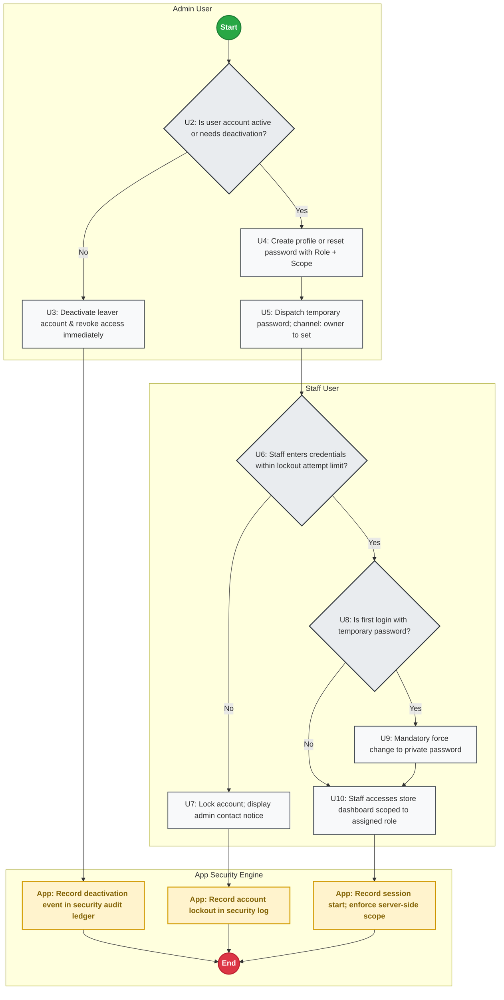
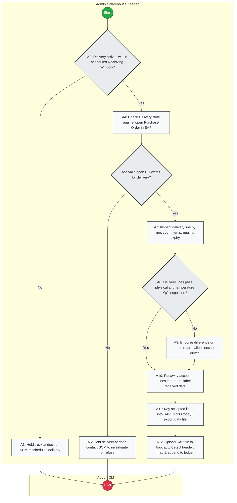
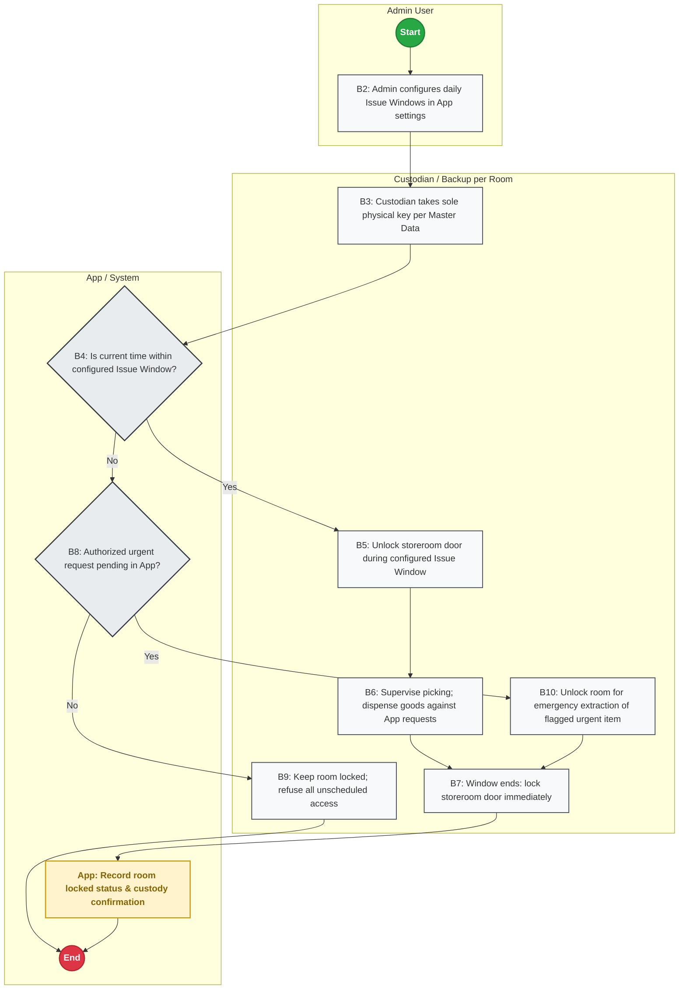
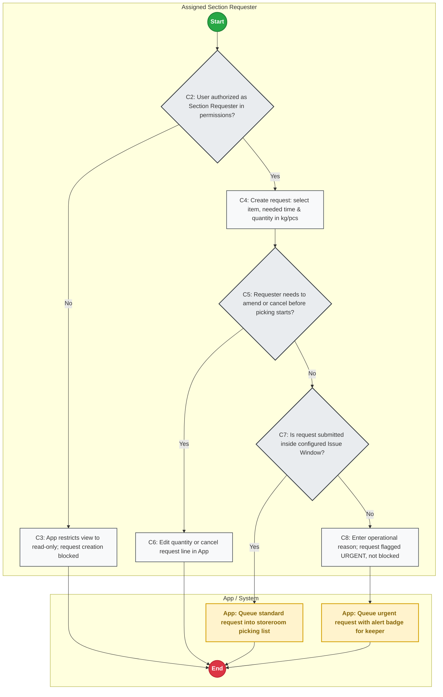
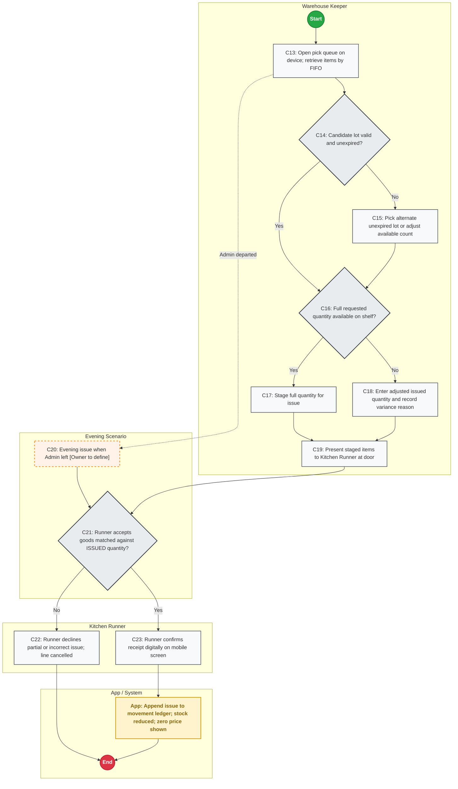
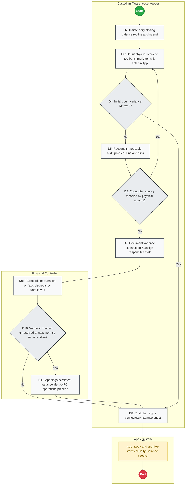
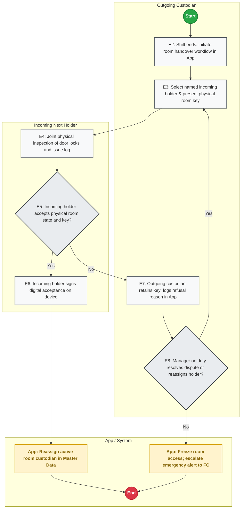
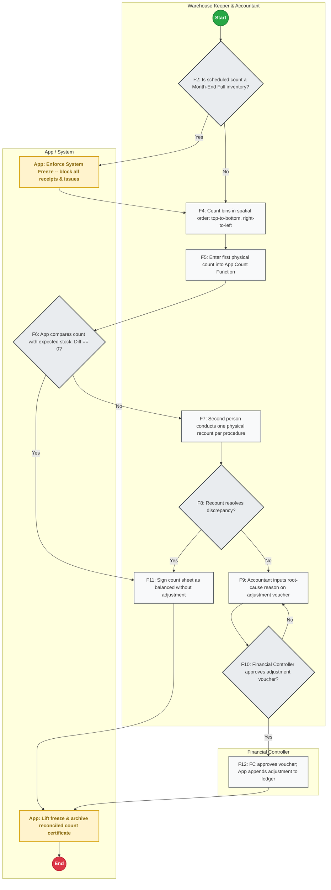
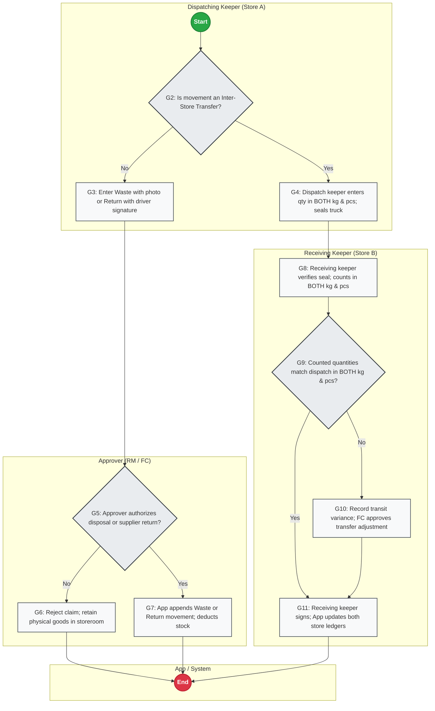
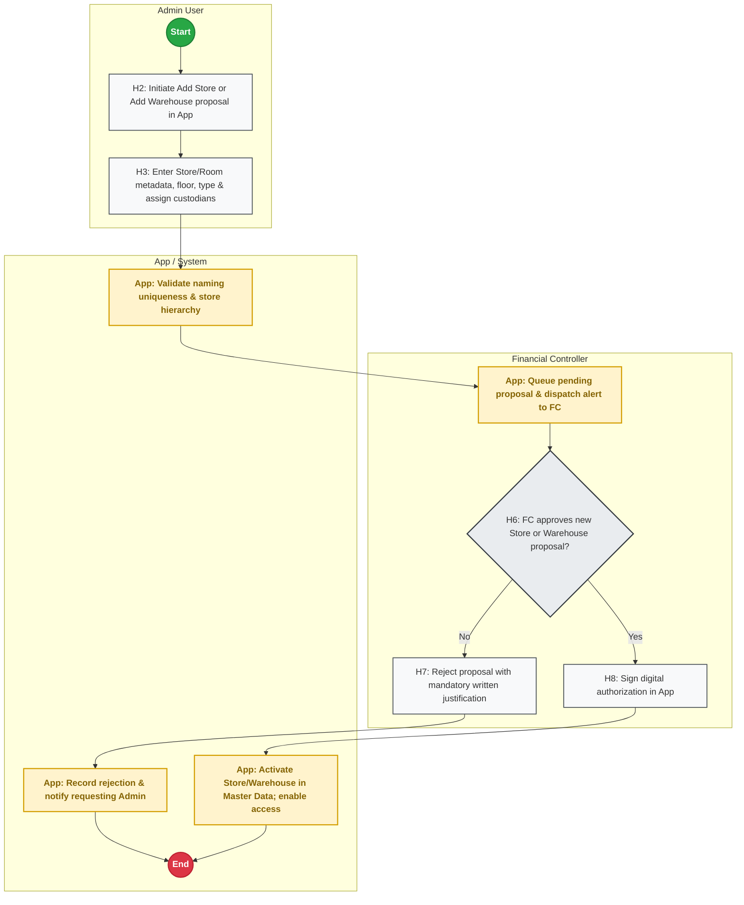

# INVENTORY CONTROL TOOL — OPERATIONAL SPECIFICATION & PROCESS FLOWS
**Pizza 4P's India Operations (Multi-Unit Rollout)**  
**Author:** Design Lead | **Owner:** Financial Controller  
**Scope:** 5 to 6 Stores · Central Storage Rooms (Ground-Floor Cold Room & Dry Store)  
**Document Version:** 1.2 (Updated per Owner Stage 1 Review Decisions & Bug Fixes)  
**Date:** November 2026  

---

## 0. PURPOSE, SCOPE & PLATFORM REQUIREMENTS

### 0.1 Purpose
The purpose of the Inventory Control Tool is to establish an uncompromised, platform-neutral back-of-house inventory control engine for Pizza 4P's India across 5 to 6 operating restaurants. The app acts as the sole operational ledger for all stock movements entering, dwelling within, and exiting the central storage facilities. It enforces strict individual custody, standardizes section requisitions (Kitchen, Bar, Cheese), automates daily variance reconciliation, and flags reorder needs and expiry risks.

### 0.2 Operational Scope & System Boundaries
1. **Target Scale:** 5 to 6 restaurant outlets, >30 concurrent users.
2. **Physical Facilities Under Scope:**
   - Central Store Rooms only: Ground-Floor Cold Room (`WH-01`) and Ground-Floor Dry Store (`WH-02`).
   - Scalability: Any additional store or warehouse requires formal Financial Controller approval via Flow H.
   - [ASSUMPTION]: Walk-in freezers are out of initial scope per owner directive; if individual stores require freezer tracking, they must be proposed under Flow H.
3. **Out of Scope:**
   - Kitchen line stock, cold inserts, prep table holdings, and bar speed rails.
   - Recipe BOM yield conversions (raw material to prep item batch processing).
   - Point of Sale (POS) guest billing and ordering.
4. **Version 1 Data Constraint:**
   - **Quantities ONLY:** Version 1 strictly records, tracks, and derives physical stock quantities (kg and pieces). It stores **NO cost, NO purchase price, and NO valuation data**. All financial inventory valuations remain in SAP / ERP.
   - **Absolute Price Concealment:** Staff in Kitchen, Bar, and Cheese sections have zero access to cost or price data at all layers.

### 0.3 Platform Requirements (Platform-Neutral Architecture)
The application logic and data model are strictly platform-neutral (compatible with Google Apps Script + Sheets/Cloud SQL, Firebase, Supabase, Node.js + PostgreSQL, or Retool). Whichever platform is chosen must provide:
1. **Append-Only Immutable Transaction Ledger:** Physical stock balances must **never be directly edited**. Current stock must be derived dynamically from an append-only transaction table (`t_stock_movements`).
2. **Strict Server-Side Session & Role Validation:** Every single read, write, and query must validate user identity, assigned role, and location scope (Store ID + Warehouse ID + Section ID) on the server.
3. **Concurrent Multi-User Transaction Handling:** Robust row-level concurrency locking or atomic appending to prevent race conditions during peak requisition windows across 30+ users.
4. **Tabular File Parsing Engine:** Ability to ingest client-uploaded CSV/Excel exports from SAP GRPO, auto-detect the header row, map dynamic columns to target fields, and log row-level parsing errors into a staging table.
5. **Offline Capability & IndexedDB Staging:** Client-side queueing for low-connectivity environments (underground cold rooms) with automatic background sync upon reconnection.
6. **Binary Attachment Storage:** Secure blob storage for delivery notes, waste photos, and count sheets with access control.

---

## 1. ROLES, SCOPE & ACCESS CONTROL MATRIX

### 1.1 Role Definitions & Permission Boundaries
Access control operates on a **Permission = Role + Scope** model. A user's scope restricts them to a specific `store_id`, `warehouse_id`, and `section_id`.

| Preset Role | Primary Responsibilities | Scope Restrictions | Price Visibility |
| :--- | :--- | :--- | :---: |
| **Admin** *(Warehouse Keeper / Storekeeper)* | - Manages warehouse intake, physical QC, and put-away.<br>- Imports SAP GRPO export files into App.<br>- Configures Issue Windows.<br>- Picks and issues stock against authorized requests.<br>- Conducts daily benchmark counts and initiates handovers. | Scoped to assigned Store and Warehouses. | No (V1 has no prices) |
| **Restaurant Manager (RM)** | - Operational oversight of store inventory.<br>- Reviews daily balance sheets and urgent issue logs.<br>- Acts as designated Evening Key Holder (pending Flow C owner decision). | Scoped to assigned Store. | No |
| **Room Custodian & Backup** | - Holds physical room key; responsible for room security and issue supervision.<br>- One primary and one backup assigned per room. | Scoped to assigned Room. | No |
| **Section Requester** *(Kitchen / Bar / Cheese)* | - Explicitly designated staff member who creates stock requisitions for their section.<br>- Specifies items, quantities, and needed time. | Scoped to Store + Section. | **STRICTLY HIDDEN** |
| **Kitchen Runner** | - Designated physical runner who collects goods at the storeroom door, inspects items against issued quantities, and signs digital confirmation. | Scoped to Store. | **STRICTLY HIDDEN** |
| **SCM Lead** | - Investigates vendor delivery issues, missing POs, and price/qty discrepancies reported by Admin on receiving dock. | Global or Multi-Store Scope. | Yes (in SAP) |
| **Store Accountant** | - Participates in weekly cycle counts and month-end freeze counts.<br>- Submits count reconciliation vouchers and post-cutoff adjustment requests. | Scoped to Store. | No (V1 has no prices) |
| **Approver (Financial Controller)** | - Formally approves new Stores and Warehouses (Flow H).<br>- Approves post-cutoff inventory count write-offs/adjustments (Flow F).<br>- Approves waste disposal claims (Flow G).<br>- Audits weekly urgent requisition logs and unexplained daily variances. | Global / Multi-Store Scope. | Full Executive Access |
| **Viewer** *(Internal Audit, GM)* | - Read-only access to ledger balances, movement history, and audit trails. | Global or Store Scoped. | No (V1 has no prices) |

### 1.2 Governance & Segregation of Duties Rules
1. **User Management Separation:** The person performing day-to-day stock work (Warehouse Keeper) must be separated from user administration.
2. **No Self-Elevation:** No user may create an Approver account or elevate their own role or scope.
3. **Counting vs Approval Segregation:** The staff member who counts inventory (Warehouse Keeper / Accountant) must **never** be the person who approves stock adjustments (Financial Controller).

### 1.3 Role-by-Action Matrix

| Operational Action | Admin | RM | Section Req | Runner | Custodian | SCM | Accountant | Approver (FC) | Viewer |
| :--- | :---: | :---: | :---: | :---: | :---: | :---: | :---: | :---: | :---: |
| **Create User Accounts & Reset PWD** | **YES** | No | No | No | No | No | No | **YES** | No |
| **Configure Store Issue Windows** | **YES** | No | No | No | No | No | No | **YES** | No |
| **Define Item Expiry Tracking Groups** | **YES** | No | No | No | No | No | No | **YES** | No |
| **Import SAP GRPO Export File** | **YES** | No | No | No | No | No | No | No | No |
| **Create Section Stock Request** | No | No | **YES** | No | No | No | No | No | No |
| **Amend / Cancel Pending Request** | No | No | **YES** | No | No | No | No | No | No |
| **Pick & Stage Stock from Storeroom** | **YES** | No | No | No | **YES** | No | No | No | No |
| **Confirm Receipt at Storeroom Door** | No | No | No | **YES** | No | No | No | No | No |
| **Perform Daily Benchmark Count** | **YES** | No | No | No | **YES** | No | No | No | No |
| **Sign Shift Handover (Key/Log)** | **YES** | **YES** | No | No | **YES** | No | No | No | No |
| **Conduct Periodic Stock Count** | **YES** | No | No | No | **YES** | No | **YES** | No | No |
| **Submit Post-Cutoff Adjustment** | No | No | No | No | No | No | **YES** | No | No |
| **Approve Stock Adjustment Voucher** | No | No | No | No | No | No | No | **YES** | No |
| **Log Waste Disposal Movement** | **YES** | **YES** | No | No | **YES** | No | No | No | No |
| **Approve Waste Disposal Claim** | No | **YES** | No | No | No | No | No | **YES** | No |
| **Dispatch / Receive Outlet Transfer**| **YES** | No | No | No | **YES** | No | No | No | No |
| **Approve Transfer Discrepancy** | No | No | No | No | No | No | No | **YES** | No |
| **Request New Store or Warehouse** | **YES** | **YES** | No | No | No | No | No | No | No |
| **Approve New Store or Warehouse** | No | No | No | No | No | No | No | **YES** | No |

---

## 2. MASTER DATA REQUIREMENTS

In strict compliance with owner directives, all threshold parameters, par levels, tolerances, and time windows are designated as **[Owner to set]** and are never fabricated.

### 2.1 Store & Warehouse Master
- `m_stores`: `store_id` (PK, e.g. `IND-DEL-01`), `store_name`, `city`, `status` (`ACTIVE`, `INACTIVE`).
- `m_warehouses`: `warehouse_id` (PK, e.g. `WH-DEL01-COLD`), `store_id` (FK), `warehouse_name`, `floor_level`, `storage_type` (`COLD_ROOM`, `DRY_STORE`), `status` (`ACTIVE`, `FROZEN_FOR_COUNT`, `INACTIVE`), `approval_id` (FK).

### 2.2 Go-Live Assignment Checklist (`m_go_live_assignments`)
*Mandatory baseline operational parameters assigned per store before go-live:*
- `store_id`: Store reference.
- `cold_room_custodian_id`: Primary user ID [Owner to set].
- `cold_room_backup_id`: Secondary user ID [Owner to set].
- `dry_store_custodian_id`: Primary user ID [Owner to set].
- `dry_store_backup_id`: Secondary user ID [Owner to set].
- `kitchen_runner_id`: Designated runner user ID [Owner to set].
- `evening_key_holder_id`: Named evening holder [Owner to set].
- `morning_receiving_window`: Start/End time [Owner to set].
- `afternoon_receiving_window`: Start/End time [Owner to set].
- `morning_issue_window`: Start/End time configured by Admin [Owner to set].
- `afternoon_issue_window`: Start/End time configured by Admin [Owner to set].

### 2.3 User, Role & Scope Master (`m_users`, `m_user_permissions`)
- `m_users`: `user_id` (PK), `username`, `full_name`, `password_hash`, `is_temp_password` (BOOLEAN: forced change on first login), `failed_login_count` (INTEGER), `lockout_until` (TIMESTAMP, nullable; attempt limit: [Owner to set]), `is_active` (BOOLEAN).
- `m_user_permissions`: `permission_id` (PK), `user_id` (FK), `role` (`ADMIN`, `RM`, `KITCHEN_REQ`, `BAR_REQ`, `CHEESE_REQ`, `RUNNER`, `CUSTODIAN`, `SCM`, `ACCOUNTANT`, `APPROVER`, `VIEWER`), `store_id` (FK), `warehouse_id` (FK, nullable), `section_id` (`KITCHEN`, `BAR`, `CHEESE`, `ALL`).

### 2.4 Item Master & Expiry Tracking Config (`m_items`, `m_expiry_tracking_config`)
- `m_items`: `item_code` (PK), `item_name`, `category_group` (Dairy, Meat, Seafood, Produce, Dry Grocery, Packaging, Chemicals), `base_uom` (`KG` or `PIECE`), `is_active`.
- `m_expiry_tracking_config`: `config_id` (PK), `category_group`, `requires_lot_expiry_tracking` (BOOLEAN, configured by Owner or Admin; **no default groups**), `expiry_warning_days` [Owner to set].

### 2.5 User-Defined Reorder Rules (`m_reorder_rules`)
*Note: Configured per item by each user/owner. No automated defaults.*
- `rule_id` (PK), `store_id` (FK), `warehouse_id` (FK), `item_code` (FK).
- `par_level`: Maximum target inventory [Owner to set].
- `reorder_point`: Replenishment trigger level [Owner to set].
- `min_order_qty`: Minimum purchase batch [Owner to set].

### 2.6 UOM & Conversions (`m_uom_conversions`)
- `item_code` (FK), `base_uom` (`KG` or `PIECE`), `secondary_uom` (Box, Wheel, Tin), `conversion_factor` [Owner to set].
- `dual_uom_required`: Mandatory `TRUE` for Inter-Outlet Transfers (Flow G) requiring both weight (kg) and pieces to eliminate cutting shrinkage.

---

## 3. OPERATIONAL PROCESS FLOWS (FLOWS 0 TO H)

Every flowchart adheres strictly to the following standards:
- Green circular Start node: `((Start))`
- Red circular End node: `((End))`
- Rectangular Action boxes with sequential step IDs (e.g. A1, A2, A3...)
- Rhombus Decision diamonds with exactly one `Yes` and one `No` edge
- Maximum 12 boxes per chart (Flow C split into C-1 and C-2)
- Database persistence markers: `[App: ...]`
- Every box reachable from Start; every path terminates at End
- Explicit "What this chart does" summary line and "Exceptions and what the app does" block per flow

```
Flowchart Index:
- Flow 0: Users, Roles, Access & Lifecycle -> flows/flow_0_access_control.svg | .png
- Flow A: Receive (Admin, SCM & SAP Import) -> flows/flow_a_receive.svg | .png
- Flow B: Keep (Custodian & Issue Windows) -> flows/flow_b_keep.svg | .png
- Flow C-1: Section Stock Request -> flows/flow_c1_request.svg | .png
- Flow C-2: Stock Issue and Confirmation -> flows/flow_c2_issue_confirm.svg | .png
- Flow D: Balance (Daily Close Reconciliation) -> flows/flow_d_balance.svg | .png
- Flow E: Handover (Custodian Shift Handover) -> flows/flow_e_handover.svg | .png
- Flow F: Count & Reconciliation -> flows/flow_f_count.svg | .png
- Flow G: Other Movements (Waste, Return, Transfer) -> flows/flow_g_other_movements.svg | .png
- Flow H: Add a New Store or Warehouse -> flows/flow_h_add_store_warehouse.svg | .png
```

---

### FLOW 0: USERS, ROLES, ACCESS & LIFECYCLE
*What this chart does: Provisions individual staff accounts, manages temporary passwords, forces first-login password updates, enforces lockout limits, and deactivates departing personnel.*



- **Trigger:** New staff onboarding, password reset request, failed login spike, or employee departure.
- **Actor:** Admin User, Staff User, App Security Engine.
- **Inputs:** Staff username, full name, role, store/warehouse/section scope, temporary credentials.
- **Outputs:** Authenticated user session, encrypted password update, revoked permissions, security audit entry.
- **Record Stored:** `m_users`, `m_user_permissions`, `t_security_logs`.
- **Decision Points & Branches:**
  - `U2: Account Active or Deactivation?`: If active staff, proceed to provisioning or password reset (`U4`). If employee leaves, Admin deactivates account immediately (`U3`); App records deactivation in audit ledger (`U11`) and terminates session (`U14`).
  - `U6: Credential Attempts within Limit?`: If consecutive failed logins reach limit [Owner to set], App locks account (`U7`), logs lockout event (`U12`), and halts login until Admin reset. If within limit, proceed (`U8`).
  - `U8: First Login with Temporary Password?`: If YES, user is forced to private password update screen (`U9`). User cannot access app features until password is changed. If NO, proceed to scoped store dashboard (`U10`).
- **The Control (Stops unauthorized access):**
  - No shared accounts. Every user has an individual login. Permissions checked strictly server-side on every request.
- **Exceptions and what the app does:**
  - *Account Lockout:* App displays lockout screen; alerts Admin; unlocks only via formal Admin reset.
  - *Delivery of Temporary Credential:* Handled via secure channel [ASSUMPTION: channel owner to set, see Section 6].

---

### FLOW A: RECEIVE (ADMIN, SCM & SAP GRPO IMPORT)
*What this chart does: Validates dock delivery arrival within fixed windows, inspects goods against open POs, logs physical receipts in SAP GRPO, exports the data file, and ingests it into the App's append-only ledger.*



- **Trigger:** Supplier delivery truck arrives at restaurant receiving dock.
- **Actor:** Admin / Warehouse Keeper, SCM Team, App Parser.
- **Inputs:** Delivery Note, Open PO in SAP, probe thermometer, exported SAP GRPO file (CSV/Excel).
- **Outputs:** Stored stock in Cold Room / Dry Store, signed delivery notes, SAP GRPO record, App immutable movement ledger.
- **Record Stored:** `t_grpo_imports`, `t_grpo_import_items`, `t_grpo_staging_errors`, `t_stock_movements`.
- **Decision Points & Branches:**
  - `A2: Arrival within Receiving Window?`: If arrival is outside scheduled receiving windows [Owner to set], truck is held at dock or SCM reschedules (`A3`); flow terminates (`A13`). If within window, proceed to PO check (`A4`).
  - `A5: Valid Open PO Exists?`: If NO open PO exists, delivery is held at dock (`A6`); Admin alerts SCM to investigate or refuse truck. If YES, proceed to physical QC (`A7`).
  - `A8: Lines Pass Physical & Temp QC?`: Evaluated line by line. If defective, warm, or expired lines are found, Admin notes difference on delivery note and returns rejected items to driver (`A9`). Accepted lines are put away into rooms and labeled with received date (`A10`). Both paths resolve cleanly.
  - `A11-A12: SAP Entry & App Import`: Receipts are entered into SAP GRPO today. Admin exports the GRPO file and uploads it into the App (`A12`). App detects header row, maps columns, and appends to movement ledger.
- **The Control (Stops unauthorized / bad stock):**
  - No PO, no receipt. Receiving allowed only within 2 fixed windows. Physical count verified before driver departs.
- **Exceptions and what the app does:**
  - *Price Difference vs PO:* Goods accepted if quality is sound; price variance flagged immediately to SCM Lead.
  - *Corrupted / Duplicate SAP File:* App rejects file hash duplicates via SHA-256; invalid rows quarantined into staging error table.

---

### FLOW B: KEEP (CUSTODIAN & ADMIN-CONFIGURED ISSUE WINDOWS)
*What this chart does: Restricts storeroom access to single named custodians per room, enforces physical locking outside Admin-configured issue windows, and audits urgent access.*



- **Trigger:** Start of daily operational shift.
- **Actor:** Admin User, Room Custodian (or Backup).
- **Inputs:** Issue window time settings, physical brass key, custodian master data.
- **Outputs:** Secure storeroom perimeter, lock/unlock timestamp audit trail.
- **Record Stored:** `t_custody_logs`.
- **Decision Points & Branches:**
  - `B2: Window Setting`: Admin defines Morning and Afternoon Issue Windows in App settings.
  - `B4: Current Time within Issue Window?`: If YES, custodian unlocks door (`B5`), supervises picking (`B6`), and locks door immediately when window expires (`B7`). If NO, evaluate urgent requests (`B8`).
  - `B8: Urgent Request Pending?`: If NO, room remains locked; unlogged entry is refused (`B9`). If YES, custodian unlocks door for single urgent extraction (`B10`), logs access (`B11`), and re-locks door (`B7`).
- **The Control (Stops pilferage & loitering):**
  - Storerooms remain locked outside scheduled windows. Only 1 named custodian and 1 backup hold physical keys per room.
- **Exceptions and what the app does:**
  - *Emergency Access:* Urgent requests logged with staff ID and timestamp; reviewed weekly by Financial Controller.

---

### FLOW C-1: SECTION STOCK REQUEST
*What this chart does: Validates that only assigned section requesters can create requisitions, permits amendment or cancellation before picking, and tags out-of-window requests as urgent without blocking.*



- **Trigger:** Kitchen, Bar, or Cheese section needs ingredients.
- **Actor:** Assigned Section Requester, App Engine.
- **Inputs:** Item code, requested quantity in kg or pieces, section, needed time.
- **Outputs:** Validated section requisition record in picking queue.
- **Record Stored:** `t_requests`, `t_request_items`.
- **Decision Points & Branches:**
  - `C2: User Authorized as Section Requester?`: Server checks `is_section_requester` flag for user. If NO, request creation is blocked (`C3`). If YES, user creates request (`C4`).
  - `C5: Amend or Cancel before Picking?`: If requester notices an error before keeper starts picking, user can amend quantity or cancel line in App (`C6`); App records change (`C10`). If NO, proceed to window check (`C7`).
  - `C7: Submitted within Issue Window?`: If YES, queued as standard request (`C10`). If NO, requester enters operational reason (`C8`); App flags request as URGENT and queues it (`C11`). Urgent requests are **never blocked**.
- **The Control (Stops unauthorized requisitions):**
  - Only authorized section requesters can submit. Server-side role validation blocks unassigned staff.
- **Exceptions and what the app does:**
  - *Submission Outside Window:* Mandatory reason required; alert dispatched to Admin pick list.

---

### FLOW C-2: STOCK ISSUE AND CONFIRMATION
*What this chart does: Manages FIFO picking, handles expired lots and partial availability, provides an evening issue placeholder, and reduces inventory upon runner digital confirmation with zero prices shown.*



- **Trigger:** Requisitions appear in storeroom picking queue.
- **Actor:** Warehouse Keeper, Kitchen Runner, App Engine.
- **Inputs:** Requisition list, physical storeroom stock, runner inspection.
- **Outputs:** Dispensed ingredients, updated movement ledger, runner receipt confirmation.
- **Record Stored:** `t_stock_movements`, `t_requests`, `t_request_items`.
- **Decision Points & Branches:**
  - `C14: Candidate Lot Valid & Unexpired?`: If lot is expired or locked, keeper picks alternate unexpired lot or adjusts available quantity (`C15`). If valid, proceed to stock check (`C16`).
  - `C16: Full Quantity Available?`: If YES, stage full quantity (`C17`). If NO, enter partial quantity and reason (`C18`). Both proceed to handoff (`C19`).
  - `C20: Evening Issue [Owner to define]`: Step explicitly reserved for owner decision. Re-joins handoff flow (`C21`) to reach End.
  - `C21: Runner Accepts Goods vs ISSUED Quantity?`: Runner inspects goods against issued quantity. If runner declines partial or wrong goods, line is cancelled (`C22`); App reverts reservation (`C23`). If accepted, runner confirms digitally on device (`C23`). App appends issue to ledger, reduces stock, and displays zero prices (`C25`).
- **The Control (Stops unlogged stock release):**
  - No request, no goods out. Ledger reduction requires runner confirmation. Kitchen screens display zero prices.
- **Exceptions and what the app does:**
  - *Declined Partial Issue:* Line cancelled; physical goods returned to shelf; inventory unreserved.

---

### FLOW D: BALANCE (DAILY CLOSE RECONCILIATION)
*What this chart does: Calculates daily expected closing balance, compares against physical benchmark counts, enforces recount investigation, and logs persistent variances before next morning.*



- **Trigger:** End of daily warehouse operations.
- **Actor:** Custodian / Warehouse Keeper, Financial Controller.
- **Inputs:** Cumulative ledger receipts, confirmed issues, physical benchmark count.
- **Outputs:** Verified daily balance sheet, discrepancy alerts.
- **Record Stored:** `t_daily_balances`, `t_daily_balance_items`.
- **Decision Points & Branches:**
  - `D4: Initial Count Diff == 0?`: If physical count equals expected stock ($Diff = Counted - Expected == 0$), custodian signs verified balance (`D8`); App locks and archives record (`D12`). If Diff != 0, custodian recounts immediately (`D5`).
  - `D6: Recount Resolves Discrepancy?`: If recount resolves difference, return to enter corrected count (`D3`). If true variance persists, document explanation and responsible staff (`D7`).
  - `D9-D10: FC Review & Next Morning Check`: FC records explanation or flags discrepancy unresolved (`D9`). If unresolved when next morning's issue window opens (`D10`), App flags persistent alert to FC [ASSUMPTION: flag only, not block; operations proceed] (`D11`), then archives balance (`D12`).
- **The Control (Stops shrinkage latency):**
  - Benchmark items counted daily; variances must have documented explanation before next morning.
- **Exceptions and what the app does:**
  - *Unresolved Discrepancy:* Flagged in red to FC dashboard; audited in weekly review.

---

### FLOW E: HANDOVER (CUSTODIAN SHIFT HANDOVER)
*What this chart does: Transfers room key and log custody between outgoing and incoming custodians with mutual digital sign-off and dispute recovery loops.*



- **Trigger:** Custodian shift ends or leaves premises.
- **Actor:** Outgoing Custodian, Incoming Next Holder, Manager on Duty.
- **Inputs:** Physical key, lock inspection, pending request queue.
- **Outputs:** Digital custody reassignment in Master Data.
- **Record Stored:** `t_handover_logs`.
- **Decision Points & Branches:**
  - `E5: Incoming Holder Accepts State & Key?`: Joint inspection conducted (`E4`). If accepted, incoming holder signs on device (`E6`); App reassigns active custodian in Master Data (`E9`). If disputed, outgoing custodian retains key and logs reason in App (`E7`).
  - `E8: Manager Resolves Dispute?`: If MOD resolves dispute or reassigns holder, loop back to select holder (`E3`). If unresolvable, App freezes room access and escalates emergency alert to FC (`E10`).
- **The Control (Stops unnamed key holding):**
  - Unbroken chain of human custody. Reassignment requires digital signature of incoming holder.
- **Exceptions and what the app does:**
  - *Disputed Handover:* Outgoing custodian retains key; room locked until MOD intervention.

---

### FLOW F: COUNT & RECONCILIATION
*What this chart does: Governs periodic and month-end counts under freeze, uses the App Count Function to compare physical vs book stock, mandates a single recount, and reconciles the ledger upon FC approval.*



- **Trigger:** Scheduled weekly cycle count or month-end cutoff.
- **Actor:** Warehouse Keeper, Store Accountant, Financial Controller.
- **Inputs:** Physical inventory, weighing scales, App Count Function.
- **Outputs:** Reconciled book stock, audit count certificate, approved adjustment voucher.
- **Record Stored:** `t_stock_counts`, `t_stock_count_items`, `t_stock_adjustments`, `t_stock_movements`.
- **Decision Points & Branches:**
  - `F2: Month-End Full Inventory?`: If YES, App enforces System Freeze (`F3`), blocking all receipts and issues. If NO (weekly cycle count), proceed without freeze (`F4`).
  - `F6: Initial Count Diff == 0?`: If physical count equals expected stock, proceed to sign balanced sheet (`F11`); App lifts freeze and archives (`F13`). If Diff != 0, second person conducts one recount per procedure (`F7`).
  - `F8: Recount Resolves Discrepancy?`: If recount resolves discrepancy, use recount and sign balanced sheet (`F11`). If recount confirms difference, Accountant enters root-cause reason on adjustment voucher (`F9`).
  - `F10: FC Approves Adjustment?`: If FC rejects voucher, return voucher for investigation and recounting (`F9` loop). If FC approves, FC signs authorization (`F12`); App appends adjustment to ledger, reconciles book stock, lifts freeze, and archives certificate (`F13`).
- **The Control (Stops unverified write-offs):**
  - Strict movement freeze during full count. Mandatory recount by second person. Ledger adjustments post only upon FC authorization.
- **Exceptions and what the app does:**
  - *Emergency Issue during Freeze:* Requires emergency break-glass authorization by FC.

---

### FLOW G: OTHER MOVEMENTS (WASTE, RETURNS, TRANSFERS)
*What this chart does: Controls non-standard stock movements (waste disposal, supplier returns, inter-store transfers in dual UOM) with split dispatch/receiving lanes and Approver gates (Quantities only).*



- **Trigger:** Spoilage identified, goods rejected to supplier, or inter-store transfer initiated.
- **Actor:** Dispatching Keeper (Store A), Approver (RM / FC), Receiving Keeper (Store B).
- **Inputs:** Defective items, delivery reference, vehicle seal number.
- **Outputs:** Waste disposal log, supplier return note, dual-confirmed store transfer record.
- **Record Stored:** `t_other_movements`, `t_stock_movements`.
- **Decision Points & Branches:**
  - `G2: Movement Type?`: If Disposal or Return, proceed to entry (`G3`). If Inter-Store Transfer, dispatch keeper enters quantity in BOTH kg and pieces and seals truck (`G4`).
  - `G5: Approver Authorizes Disposal or Return?`: If NO, reject claim (`G6`); physical items remain in storeroom. If YES, App appends Waste or Return movement to ledger and deducts stock (`G7`).
  - `G9: Transfer Quantities Match in BOTH Units?`: Receiving keeper verifies seal and counts in BOTH kg and pieces (`G8`). If match, receiving keeper signs; App updates both store ledgers (`G11`). If discrepancy detected, transit variance logged and approved by FC (`G10`) before completion.
- **The Control (Stops trimming & unverified loss):**
  - Dual UOM (both kg and pieces) prevents in-transit trimming. Waste claims require photo evidence. All movements require Approver authorization.
- **Exceptions and what the app does:**
  - *Broken Vehicle Seal:* Receiving keeper halts unloading immediately; escalates to FC.

---

### FLOW H: ADD A NEW STORE OR WAREHOUSE (APPROVAL)
*What this chart does: Manages multi-store expansion proposals, validates store/warehouse hierarchy, enforces FC approval, and activates master data.*



- **Trigger:** Business expansion requires new restaurant store (scale 5 to 6 stores) or controlled storage room.
- **Actor:** Admin User, Financial Controller (FC).
- **Inputs:** Store name, store code, room name, floor level, storage type, nominated custodians.
- **Outputs:** Activated Store / Warehouse master record, active transaction routing.
- **Record Stored:** `t_store_warehouse_approvals`, `m_stores`, `m_warehouses`.
- **Decision Points & Branches:**
  - `H6: FC Approves Proposal?`: If NO, FC rejects proposal with mandatory written justification (`H7`); App records rejection and notifies Admin (`H9`). If YES, FC signs authorization (`H8`); App activates Store/Warehouse in Master Data and enables user access (`H10`).
- **The Control (Stops unmonitored storage):**
  - Hard authorization gate. Local storekeepers cannot create unmonitored storage rooms.
- **Exceptions and what the app does:**
  - *Pop-Up Storage:* Pop-up locations must still go through Flow H with an explicit expiration date.

---

## 4. DAILY USAGE, REORDER VIEW & STOCK DERIVATION

### 4.1 Append-Only Stock Derivation Formula
Physical stock is **never an edited balance**. Current book stock for any item in any warehouse is derived dynamically from `t_stock_movements`:

```
Current Book Stock =
    + Sum(Quantity from Confirmed GRPO Imports)
    - Sum(Quantity from Confirmed Section Issues)
    - Sum(Quantity from Pending Issues [Proposed - Assumption])
    - Sum(Quantity from Approved Waste Movements)
    - Sum(Quantity from Approved Supplier Returns)
    - Sum(Quantity from Outward Store Transfers)
    + Sum(Quantity from Inward Store Transfers)
    +/- Sum(Quantity from Approved Count Adjustments)
```

### 4.2 Daily Usage Formula
```
Daily Actual Usage = Sum(Confirmed Section Issues for Calendar Day) + Sum(Approved Waste for Calendar Day)
```

### 4.3 Average Daily Usage (ADU)
```
Average Daily Usage = Total Actual Consumption over Rolling N Days / N Days [Owner to set]
```

### 4.4 User-Defined Reorder Trigger & Quantity
*Note: Configured per item by each user or owner. No automated defaults.*
When:
```
Current Book Stock <= Reorder Point [Owner to set]
```
Then:
```
Suggested Reorder Quantity = max(0, Par Level [Owner to set] - Current Book Stock - Open PO Quantity in Transit)
```

### 4.5 Group-Configured Expiry Radar
*Note: Evaluated only for item categories explicitly flagged in `m_expiry_tracking_config`.*
```
Days to Expiry = Batch Expiry Date - Current Date
```
- **EXPIRY WARNING:** Triggered when `Days to Expiry <= Expiry Warning Days [Owner to set]`. Batch highlighted in amber, prioritized on pick list (FIFO).
- **EXPIRED LOCK:** Triggered when `Days to Expiry <= 0`. App hard-locks batch; cannot be selected for kitchen issue.

---

## 5. PLATFORM-NEUTRAL DATA MODEL (19 TABLES)

### 5.1 Master Data Tables
1. `m_stores`: `store_id` (VARCHAR, PK), `store_name` (VARCHAR), `city` (VARCHAR), `is_active` (BOOLEAN).
2. `m_warehouses`: `warehouse_id` (VARCHAR, PK), `store_id` (VARCHAR, FK), `warehouse_name` (VARCHAR), `storage_type` (VARCHAR), `is_active` (BOOLEAN).
3. `m_go_live_assignments`: `store_id` (VARCHAR, PK/FK), `cold_room_custodian_id` (VARCHAR), `cold_room_backup_id` (VARCHAR), `dry_store_custodian_id` (VARCHAR), `dry_store_backup_id` (VARCHAR), `kitchen_runner_id` (VARCHAR), `evening_key_holder_id` (VARCHAR), `morning_issue_window` (VARCHAR), `afternoon_issue_window` (VARCHAR), `morning_receiving_window` (VARCHAR), `afternoon_receiving_window` (VARCHAR).
4. `m_users`: `user_id` (VARCHAR, PK), `username` (VARCHAR, UNIQUE), `full_name` (VARCHAR), `password_hash` (VARCHAR), `is_temp_password` (BOOLEAN), `failed_login_count` (INTEGER), `lockout_until` (TIMESTAMP, nullable), `is_active` (BOOLEAN).
5. `m_user_permissions`: `permission_id` (VARCHAR, PK), `user_id` (VARCHAR, FK), `role` (VARCHAR), `store_id` (VARCHAR, FK), `warehouse_id` (VARCHAR, FK, NULLABLE), `section_id` (VARCHAR), `is_section_requester` (BOOLEAN).
6. `m_items`: `item_code` (VARCHAR, PK), `item_name` (VARCHAR), `category_group` (VARCHAR), `base_uom` (VARCHAR), `is_active` (BOOLEAN).
7. `m_expiry_tracking_config`: `config_id` (VARCHAR, PK), `category_group` (VARCHAR, UNIQUE), `requires_lot_expiry_tracking` (BOOLEAN), `expiry_warning_days` (INTEGER).
8. `m_reorder_rules`: `rule_id` (VARCHAR, PK), `store_id` (VARCHAR, FK), `warehouse_id` (VARCHAR, FK), `item_code` (VARCHAR, FK), `par_level` (DECIMAL), `reorder_point` (DECIMAL), `min_order_qty` (DECIMAL).
9. `m_uom_conversions`: `conversion_id` (VARCHAR, PK), `item_code` (VARCHAR, FK), `base_uom` (VARCHAR), `secondary_uom` (VARCHAR), `conversion_factor` (DECIMAL), `dual_uom_required` (BOOLEAN).

### 5.2 Transactional Tables (Quantities Only — No Prices)
10. `t_stock_movements` (Immutable Append-Only Ledger):
    - `movement_id` (VARCHAR, PK)
    - `store_id` (VARCHAR, FK)
    - `warehouse_id` (VARCHAR, FK)
    - `item_code` (VARCHAR, FK)
    - `movement_type` (VARCHAR: `GRPO_IMPORT`, `ISSUE_CONFIRMED`, `ISSUE_PENDING_CONFIRMATION`, `WASTE_DISPOSAL`, `SUPPLIER_RETURN`, `TRANSFER_OUT`, `TRANSFER_IN`, `COUNT_ADJUSTMENT`)
    - `quantity` (DECIMAL, signed)
    - `uom` (VARCHAR)
    - `batch_number` (VARCHAR, nullable)
    - `expiry_date` (DATE, nullable)
    - `reference_doc_id` (VARCHAR)
    - `created_by_user_id` (VARCHAR, FK)
    - `created_at` (TIMESTAMP)
11. `t_grpo_imports` (Flow A File Upload Audit):
    - `import_id` (VARCHAR, PK), `store_id` (VARCHAR, FK), `file_name` (VARCHAR), `file_hash` (VARCHAR, UNIQUE), `detected_header_row` (INTEGER), `total_rows` (INTEGER), `imported_rows` (INTEGER), `error_count` (INTEGER), `uploaded_by_user_id` (VARCHAR, FK), `imported_at` (TIMESTAMP).
12. `t_grpo_import_items` (Flow A Parsed Lines):
    - `import_item_id` (VARCHAR, PK), `import_id` (VARCHAR, FK), `po_number` (VARCHAR), `item_code` (VARCHAR, FK), `counted_qty` (DECIMAL), `batch_number` (VARCHAR), `expiry_date` (DATE), `status` (`IMPORTED`, `REJECTED_MISMATCH`).
13. `t_grpo_staging_errors` (Flow A Quarantined Lines):
    - `error_id` (VARCHAR, PK), `import_id` (VARCHAR, FK), `row_number` (INTEGER), `raw_line_data` (TEXT), `error_reason` (VARCHAR: `MISSING_ITEM_CODE`, `INVALID_QTY`, `FORMAT_ERROR`), `quarantined_at` (TIMESTAMP).
14. `t_security_logs` (Flow 0 Security & Access Audit):
    - `log_id` (VARCHAR, PK), `user_id` (VARCHAR, FK), `event_type` (`LOGIN_SUCCESS`, `LOGIN_FAILED`, `ACCOUNT_LOCKED`, `PASSWORD_RESET`, `DEACTIVATION`, `UNAUTHORIZED_ACCESS_ATTEMPT`), `ip_address` (VARCHAR), `device_info` (VARCHAR), `timestamp` (TIMESTAMP).
15. `t_custody_logs` (Flow B & E Access Logs):
    - `log_id` (VARCHAR, PK), `store_id` (VARCHAR, FK), `warehouse_id` (VARCHAR, FK), `event_type` (`WINDOW_UNLOCK`, `WINDOW_LOCK`, `URGENT_ACCESS`, `HANDOVER`), `custodian_user_id` (VARCHAR, FK), `next_holder_user_id` (VARCHAR, FK, nullable), `urgent_reason` (VARCHAR, nullable), `timestamp` (TIMESTAMP).
16. `t_requests` & `t_request_items` (Flow C Section Requisitions):
    - `t_requests`: `request_id` (VARCHAR, PK), `store_id` (VARCHAR, FK), `section_id` (VARCHAR), `requester_user_id` (VARCHAR, FK), `is_urgent` (BOOLEAN), `urgent_reason` (VARCHAR), `status` (`QUEUED`, `PICKING`, `PARTIAL_ACCEPTED`, `PARTIAL_DECLINED`, `CANCELLED_BY_REQUESTER`, `URGENT_PENDING`, `CONFIRMED`), `runner_user_id` (VARCHAR, FK), `runner_confirmed_at` (TIMESTAMP).
    - `t_request_items`: `request_item_id` (VARCHAR, PK), `request_id` (VARCHAR, FK), `item_code` (VARCHAR, FK), `requested_qty` (DECIMAL), `issued_qty` (DECIMAL), `uom` (VARCHAR), `variance_reason` (VARCHAR).
17. `t_daily_balances` & `t_daily_balance_items` (Flow D Daily Balance):
    - `t_daily_balances`: `balance_id` (VARCHAR, PK), `store_id` (VARCHAR, FK), `warehouse_id` (VARCHAR, FK), `balance_date` (DATE), `custodian_user_id` (VARCHAR, FK), `status` (`BALANCED`, `VARIANCE_FLAGGED`), `fc_signoff_id` (VARCHAR, FK, nullable).
    - `t_daily_balance_items`: `item_code` (VARCHAR, FK), `opening_qty` (DECIMAL), `received_qty` (DECIMAL), `issued_qty` (DECIMAL), `expected_qty` (DECIMAL), `counted_qty` (DECIMAL), `variance_qty` (DECIMAL), `variance_reason` (VARCHAR), `responsible_person` (VARCHAR).
18. `t_stock_counts` & `t_stock_count_items` (Flow F Reconciliation Counts):
    - `t_stock_counts`: `count_id` (VARCHAR, PK), `store_id` (VARCHAR, FK), `warehouse_id` (VARCHAR, FK), `count_type` (`WEEKLY_CYCLE`, `MONTH_END_FULL`), `freeze_status` (`FROZEN`, `UNFROZEN`), `keeper_user_id` (VARCHAR, FK), `accountant_user_id` (VARCHAR, FK), `status` (`IN_PROGRESS`, `RECOUNT`, `COMPLETED`).
    - `t_stock_count_items`: `item_code` (VARCHAR, FK), `book_qty` (DECIMAL), `first_count_qty` (DECIMAL), `recount_qty` (DECIMAL), `final_counted_qty` (DECIMAL), `difference_qty` (DECIMAL).
19. `t_stock_adjustments` (Flow F Approved Write-Offs):
    - `adjustment_id` (VARCHAR, PK), `count_id` (VARCHAR, FK), `item_code` (VARCHAR, FK), `adjustment_qty` (DECIMAL), `root_cause_reason` (VARCHAR), `fc_approval_id` (VARCHAR, FK), `approved_at` (TIMESTAMP).
20. `t_other_movements` (Flow G Waste, Returns, Transfers):
    - `movement_id` (VARCHAR, PK), `movement_type` (`WASTE_DISPOSAL`, `SUPPLIER_RETURN`, `STORE_TRANSFER`), `source_store_id` (VARCHAR, FK), `source_warehouse_id` (VARCHAR, FK), `target_store_id` (VARCHAR, nullable), `item_code` (VARCHAR, FK), `dispatch_qty_kg` (DECIMAL), `dispatch_qty_pcs` (DECIMAL), `receive_qty_kg` (DECIMAL), `receive_qty_pcs` (DECIMAL), `vehicle_seal_no` (VARCHAR), `photo_url` (VARCHAR), `reason` (VARCHAR), `dispatcher_id` (VARCHAR), `receiver_id` (VARCHAR), `fc_approval_id` (VARCHAR).
21. `t_store_warehouse_approvals` (Flow H Store/Warehouse Proposals):
    - `approval_id` (VARCHAR, PK), `proposal_type` (`NEW_STORE`, `NEW_WAREHOUSE`), `proposed_name` (VARCHAR), `store_id` (VARCHAR, nullable), `storage_type` (VARCHAR), `nominated_custodian_id` (VARCHAR), `nominated_backup_id` (VARCHAR), `fc_decision` (`PENDING`, `APPROVED`, `REJECTED`), `fc_comment` (VARCHAR), `decided_at` (TIMESTAMP).

---

## 6. OPEN QUESTIONS FOR THE OWNER (ALL ASSUMPTIONS MARKED)

### Question 1: SAP GRPO Export Format & Dynamic Column Mapping Assumptions
- **Context:** Per Decision 3, goods receipts are entered in SAP first, exported, and imported into the app.
- **[ASSUMPTION]:** Export is standard UTF-8 CSV or `.xlsx` containing at least `PO Number`, `Vendor Code/Name`, `Item Code`, `Received Quantity`, `Unit`, and optionally `Batch Number`, `Expiry Date`.
- **[ASSUMPTION]:** Header row contains string keywords matching `["PO", "Doc", "Item", "Material", "Qty", "Quantity"]`. App scans first 20 rows [ASSUMPTION: scan limit owner to set] to detect this row.
- **[ASSUMPTION]:** Extra SAP columns (GL accounts, tax codes, currency, net price) are silently ignored and stripped by parser.
- **Question for Owner:** Does SAP India export as CSV or Excel (.xlsx)? Are column headers standardized across all 5–6 stores?
- **Recommended Answer:** Standardize SAP export layout across all store profiles as CSV; App stores a configurable column mapping template per store.

### Question 2: Duplicate Imports & Mismatch Quarantine Handling
- **Context:** An Admin may accidentally upload the same SAP export twice, or upload an export from another store.
- **[ASSUMPTION]:** App hashes file contents (SHA-256) and stores it in `t_grpo_imports`. Re-uploading exact same file is rejected.
- **[ASSUMPTION]:** If an item code in the SAP file does not exist in `m_items`, valid lines are imported immediately while invalid lines are quarantined into `t_grpo_staging_errors`.
- **Question for Owner:** Do you approve the quarantine staging approach so clean items are not blocked from kitchen issue?
- **Recommended Answer:** Yes, quarantine invalid lines into `t_grpo_staging_errors` and alert Admin, while allowing valid lines into stock.

### Question 3: Frequency of SAP GRPO Export/Import
- **Context:** If goods arrive at dock, but Admin delays entry into SAP and export to App, the App shows zero stock during issue windows.
- **Question for Owner:** What is the mandatory time limit for Admin to key into SAP and export to the App after dock put-away? [Owner to set limit].
- **Recommended Answer:** Mandate rule: *"Import SAP GRPO file into App within the deadline set by the owner, and strictly before the next Issue Window begins."*

### Question 4: Evening Issue Protocol when Admin has Left (Flow C-2 Step C20)
- **Context:** Step C20 is marked `[Owner to define]`. Kitchen service runs until late night, after Admin's shift ends.
- **Design Lead Proposed Options for Owner Decision:**
  - *Option A (Recommended):* Restaurant Manager (RM / Manager on Duty) holds evening key custody via Flow E Handover. Kitchen submits urgent request in App; RM dispenses and runner confirms receipt on RM device.
  - *Option B (PIN Safe Box):* Storeroom key stored in emergency PIN safe; runner accesses with emergency single-use code; App records entry.
- **Question for Owner:** Which evening access model do you approve for Step C20?

### Question 5: Section Scope Boundaries for Multi-Store Setup
- **Context:** In 5–6 stores, a staff member (e.g. Area Chef) might work across multiple stores.
- **Question for Owner:** Should a user account be restricted to exactly 1 store, or can a single login have multi-store switching permissions?
- **Recommended Answer:** Single login with a top-bar Store Switcher dropdown, restricted strictly to stores granted in `m_user_permissions`.

### Question 6: Delivery Channel for Temporary Passwords (Flow 0 Step U5)
- **Context:** When Admin creates an account or resets a password, a temporary password is generated.
- **Question for Owner:** How should the temporary password be delivered to the staff member? (SMS, WhatsApp, Email, or Printout by Admin)? [Owner to set].
- **Recommended Answer:** Direct in-person printout or WhatsApp message generated via secure one-time link.

### Question 7: Stock Reduction Timing — Proposed Change (Propose C1)
- **Context:** Currently, the ledger reduces stock only when the runner confirms (`C23`).
- **[ASSUMPTION]:** Proposed change: Reduce available stock immediately when Admin issues items (`C17/C18`), with movement type `ISSUE_PENDING_CONFIRMATION`. If runner declines, revert; if runner confirms, update to `ISSUE_CONFIRMED`.
- **Question for Owner:** Do you approve deducting available stock immediately at Admin picking to prevent double-picking?
- **Recommended Answer:** Yes, deduct available stock immediately with pending confirmation flag.

### Question 8: Section Requester vs. Kitchen Runner Distinction (Propose C2)
- **Context:** The original procedure specified ONE named runner who signs the issue log. The owner decided each section has an assigned requester.
- **[ASSUMPTION]:** Section Requester (creates request) and Kitchen Runner (physically collects and signs at storeroom door) are drawn as distinct roles in Flow C-1 and C-2.
- **Question for Owner:** Can the Section Requester and Kitchen Runner be the same person, or must they be separate staff members?
- **Recommended Answer:** They can be the same person on quiet shifts, but the runner who signs must belong to the requesting section.

### Question 9: Scope of Controlled Storerooms (Rule B4)
- **Context:** Core scope is Ground-Floor Cold Room and Dry Store.
- **[ASSUMPTION]:** Walk-in Freezer is excluded from core scope and may only be added via Flow H upon owner approval.
- **Question for Owner:** Confirm that Walk-in Freezer is excluded from Stage 1 core scope.
- **Recommended Answer:** Confirmed excluded from core; add via Flow H if needed.

### Question 10: Persistent Daily Variance Handling at Next Morning Opening (Logic A7)
- **Context:** In Flow D, if a variance is unresolved when the next morning's issue window arrives.
- **[ASSUMPTION]:** App flags persistent variance alert to FC and RM, but does NOT hard-lock the storeroom door, allowing restaurant operations to proceed.
- **Question for Owner:** Should an unresolved daily variance hard-lock the storeroom door, or flag an alert to FC while allowing service to continue?
- **Recommended Answer:** Flag alert only; hard-locking storeroom would stop restaurant guest service.

---

## 7. SYSTEM CHANGE LOG

| Version | Date | Author / Role | Summary of Changes & Modified Step IDs |
| :---: | :---: | :---: | :--- |
| **v1.0** | 2026-11-01 | Design Lead | Initial baseline specification (Flows A through H) based on initial brief and PDF SOP. |
| **v1.1** | 2026-11-01 | Design Lead | Owner Review Decisions applied: SAP GRPO export/import refactor, 2 receiving windows, SCM swimlane, section requesters, evening placeholder, count reconciliation, multi-store scale (5-6 stores), append-only relational model. |
| **v1.2** | 2026-11-01 | Design Lead | **Stage 1 Verification & Strict Rule Fixes:**<br>1. **Flow F Bug Fix (`F6-F14`):** Fixed infinite recount loop. Rewrote flow: first count -> compare -> Diff = 0 balanced (`F11`); Diff != 0 one recount by second person (`F7`) -> resolves difference use recount (`F11`); confirms difference accountant enters reason (`F9`) -> FC approval (`F10`) with reject loop to `F9` and approve path to `F12/F13`. All paths reach End.<br>2. **Flow C Split & Bug Fixes:** Split Flow C into **Flow C-1** (`flow_c1_request`, 8 boxes) and **Flow C-2** (`flow_c2_issue_confirm`, 11 boxes). In C-2, runner compares goods against ISSUED quantity (`C21`), not request. Added branch for runner accepting/declining partial issue (`C22`). Added amend/cancel branch before picking (`C5/C6`). Added expired/locked lot branch at picking (`C14/C15`). Connected evening step `C20` to rejoin issue confirmation and reach End.<br>3. **Flow A Decision & Line QC (`A2-A10`):** Converted `A2` to decision diamond for Receiving Window with reschedule loop. Handled partial rejection line-by-line: accepted lines proceed to put-away and SAP export (`A10-A12`), rejected lines go to SCM (`A9`), both reach End. Separated "no PO" (`A5/A6`) from "QC fail" (`A8/A9`).<br>4. **Flow E Recovery Loop (`E7-E8`):** Added dispute recovery loop: outgoing custodian retains key, logs reason (`E7`), MOD resolves/reassigns (`E8` loops to `E3`) or emergency lockdown (`E10`).<br>5. **Flow D Resolution (`D9-D11`):** Added FC records explanation or flags unresolved (`D9`); added morning window check with alert flag (`D10/D11`). Marked ASSUMPTION.<br>6. **Flow G Approval & Split Lanes (`G1-G14`):** Split Dispatching Store A lane from Receiving Store B lane. Added Approver rejection branch for waste/returns (`G6`). Added FC transfer discrepancy approval (`G10`). Removed "Debit Note".<br>7. **Flow 0 Lifecycle (`U2-U13`):** Added account deactivation for leavers (`U3`), password reset (`U4`), lockout limit check (`U6/U7`). Removed U12 (strip price fields). Added temporary password delivery to Section 6.<br>8. **Rule Violations Removals:** Removed invented numbers ("20+ hours", "within 12 hours", "60 mins", "5 mins", "3 retries", "first 20 rows" marked ASSUMPTION). Rewrote Section 8.4 anti-loop rule. Removed "storage bin QR codes" and "legally binding". Excluded Walk-in Freezer from core scope (marked ASSUMPTION). Fixed formula corruption. Corrected contrast calculations with exact mathematical derivation.<br>9. **Data Model Updates:** Added `t_security_logs`, `t_grpo_staging_errors`, movement types `SUPPLIER_RETURN` and `ISSUE_PENDING_CONFIRMATION`, aligned request statuses. Added Section Requester, Runner, Custodian roles. |

---

## 8. ARCHITECTURAL SAFEGUARDS & TECHNICAL PITFALLS

1. **Google Apps Script String Escaping Bug:**  
   Never write URLs with `//` inline in client-side script tags (GAS `HtmlService` truncates strings after `//`). Pass endpoints via server properties or base64.
2. **Backend Communication Protocol:**  
   Use `google.script.run` with standardized asynchronous promise wrappers; do not rely on standard browser `fetch` for internal script communication.
3. **Storage Architecture & iOS Safari Quotas:**  
   Do not store photos or large caches in `localStorage` (~5MB cap on iOS Safari). All client-side offline queues and photo blobs must use `IndexedDB`.
4. **Resilient Network Queueing & Anti-Looping (Strict Rule):**  
   Never auto-retry a failed queued action in a loop. Log the failure once to telemetry; display a clear manual retry button for staff.
5. **Zero-Price Enforcement:**  
   Version 1 stores physical quantities only. The server data model contains no price or cost columns, guaranteeing that kitchen staff cannot intercept financial costs via browser inspection.
