# INVENTORY CONTROL TOOL — OPERATIONAL SPECIFICATION & PROCESS FLOWS
**Pizza 4P's India Operations (Multi-Unit Rollout)**  
**Author:** Design Lead | **Owner:** Financial Controller  
**Scope:** 5 to 6 Stores · Central Storage Rooms (Ground-Floor Cold Room & Dry Store)  
**Document Version:** 1.3 (Updated per Owner Round 2 Directives & Architectural Decisions)  
**Date:** November 2026  

---

## 0. PURPOSE, SCOPE & PLATFORM ARCHITECTURE

### 0.1 Purpose
The purpose of the Inventory Control Tool is to establish an uncompromised, platform-neutral back-of-house inventory control engine for Pizza 4P's India across 5 to 6 operating restaurants. The app acts as the sole operational ledger for all stock movements entering, dwelling within, and exiting the central storage facilities. It enforces strict individual custody, standardizes section requisitions (Kitchen, Bar, Cheese), automates daily variance reconciliation, and flags reorder needs and expiry risks.

### 0.2 Operational Scope & System Boundaries
1. **Target Scale:** 5 to 6 restaurant outlets, >30 concurrent users.
2. **Physical Facilities Under Scope:**
   - Central Store Rooms only: Ground-Floor Cold Room (`WH-01`) and Ground-Floor Dry Store (`WH-02`).
   - Scalability: Any additional store or warehouse requires formal Financial Controller approval via Flow H.
   - **Exclusion confirmed by Owner (Q9):** Walk-in Freezers are strictly excluded from core Stage 1 scope.
3. **Out of Scope:**
   - Kitchen line stock, cold inserts, prep table holdings, and bar speed rails.
   - Recipe BOM yield conversions (raw material to prep item batch processing).
   - Point of Sale (POS) guest billing and ordering.
4. **Version 1 Data Constraint:**
   - **Quantities ONLY:** Version 1 strictly records, tracks, and derives physical stock quantities (kg and pieces). It stores **NO cost, NO purchase price, and NO valuation data**. All financial inventory valuations remain in SAP / ERP.
   - **Absolute Price Concealment:** Staff in Kitchen, Bar, and Cheese sections have zero access to cost or price data at all layers.

### 0.3 Platform Requirements & Split Architecture (Owner Decisions 2 to 5)
The application architecture is explicitly partitioned to protect kitchen operations from cloud latency or cold starts:
1. **Direct Mobile-to-Database Path for Daily Actions (Decision 3):**
   - High-frequency daily frontline actions (**Request, Issue, Confirm, Count, Balance**) go directly from the mobile phone (PWA) to the managed database (e.g., Supabase / PostgREST / Firebase) over HTTPS / WebSocket.
   - The database engine evaluates Row-Level Security (RLS) policies for **every single read and write**, enforcing Role + Scope (Store ID, Warehouse ID, Section ID).
   - These actions **do not route through the Node server**, guaranteeing that kitchen picking is never blocked if the application server is sleeping, rebooting, or under heavy background load.
2. **Node Application Server Responsibilities:**
   - The Node server is reserved strictly for non-critical, compute-intensive, or background administrative operations:
     - Dispatching user email invitations and password reset links via transactional email.
     - Parsing and validating client-uploaded SAP GRPO export files (detecting header rows, mapping columns, isolating bad lines into quarantine staging).
     - Executing scheduled cron jobs and automated database backup exports.
   - *Cold Start Defense:* If the Node server is waking up from idle on a free/shared plan, the UI displays a clear wait notice (`"Server waking up, please wait a moment..."`) rather than failing silently.
3. **Offline Resilience & Failure Handling (Decision 4):**
   - Frontline transactions are staged in mobile browser `IndexedDB` when network signal in underground storage rooms drops.
   - When connection restores, actions are dispatched once.
   - **Strict Anti-Looping Rule:** Never auto-retry failed actions in an infinite background loop. Log the error once to `t_security_logs`; display a persistent manual retry button for staff.
4. **Automated Scheduled Backups & Free-Tier Monitoring (Decision 5):**
   - Because free-tier managed databases do not provide automated backup snapshots, a daily scheduled cron job exports all primary database tables to company-owned cloud storage (frequency: [Owner to set]).
   - **Go-Live Checklist Requirement:** Free-tier database projects automatically pause after approximately one week of low activity. Operations must maintain an active automated ping or upgrade prior to store launch.
5. **Append-Only Immutable Ledger (Decision 6):**
   - Stock balances must **never be directly edited or updated**. Current inventory is always derived dynamically from `t_stock_movements`.

---

## 1. ROLES, SCOPE & ACCESS CONTROL MATRIX

### 1.1 Role Definitions & Permission Boundaries
Access control operates on a **Permission = Role + Scope** model. A user's scope restricts them to a specific `store_id`, `warehouse_id`, and `section_id`.

| Preset Role | Primary Responsibilities | Scope Restrictions | Price Visibility |
| :--- | :--- | :--- | :---: |
| **System Admin** | - Invites new users by email; initiates password resets.<br>- Manages user activation lifecycle, permissions, and deactivations.<br>- Monitors scheduled database backup jobs and system logs. | Global System Scope. | No (V1 has no prices) |
| **Admin** *(Warehouse Keeper / Storekeeper)* | - Manages warehouse intake, physical QC, and put-away.<br>- Imports SAP GRPO export files into App.<br>- Configures Issue Windows.<br>- Picks and issues stock against authorized requests.<br>- Conducts daily benchmark counts and initiates handovers. | Scoped to assigned Store and Warehouses. | No |
| **Restaurant Manager (RM)** | - Operational oversight of store inventory.<br>- Reviews daily balance sheets, unconfirmed issue alerts, and urgent requisition logs.<br>- Acts as designated Evening Key Holder (pending Flow C-2 owner decision). | Scoped to assigned Store. | No |
| **Room Custodian & Backup** | - Permanent named keeper assigned to a specific storeroom in Master Data.<br>- Responsible for physical room security and supervising issue windows. | Scoped to assigned Room. | No |
| **Section Requester** *(Kitchen / Bar / Cheese)* | - Designated staff member who creates stock requisitions for their section.<br>- Specifies items, quantities, and needed time. May amend/cancel before picking. | Scoped to Store + Section. | **STRICTLY HIDDEN** |
| **Kitchen Runner** | - Physical runner who collects goods at the storeroom door, inspects items against issued quantities, and signs digital confirmation. (May be same person as Requester per Decision Q8). | Scoped to Store + Section. | **STRICTLY HIDDEN** |
| **SCM Lead** | - Investigates dock delivery issues, missing POs, and supplier invoice price variances reported by Admin on receiving dock. | Global or Multi-Store Scope. | Yes (in SAP) |
| **Store Accountant** | - Conducts weekly cycle counts and month-end freeze counts alongside keeper.<br>- Submits count reconciliation vouchers and post-cutoff adjustment requests. | Scoped to Store. | No |
| **Approver (Financial Controller)** | - Formally approves new Stores and Warehouses (Flow H).<br>- Approves post-cutoff inventory count adjustments (Flow F).<br>- Approves waste disposal claims and inter-store transfer variances (Flow G).<br>- Audits weekly urgent requisition logs and persistent daily variances. | Global / Multi-Store Scope. | Full Executive Access |
| **Viewer** *(Internal Audit, GM)* | - Read-only access to ledger balances, movement history, and audit trails. | Global or Store Scoped. | No |

### 1.2 Governance & Segregation of Duties Rules
1. **Separation of User Admin from Stock Work:** The user administration role (`System Admin`) is strictly separated from operational stock keeping (`Warehouse Keeper / Admin`).
2. **No Self-Elevation:** No user may create an Approver account or elevate their own role or scope.
3. **Counting vs Approval Segregation:** The staff member who counts inventory (Warehouse Keeper / Accountant) must **never** be the person who approves stock adjustments (Financial Controller).

### 1.3 Role-by-Action Matrix

| Operational Action | Sys Admin | Admin (Keeper) | RM | Section Req | Runner | Custodian | SCM | Accountant | Approver (FC) | Viewer |
| :--- | :---: | :---: | :---: | :---: | :---: | :---: | :---: | :---: | :---: | :---: |
| **Invite Users & Reset Password** | **YES** | No | No | No | No | No | No | No | **YES** | No |
| **Configure Store Issue Windows** | No | **YES** | No | No | No | No | No | No | **YES** | No |
| **Define Expiry Tracking Groups** | No | **YES** | No | No | No | No | No | No | **YES** | No |
| **Import SAP GRPO Export File** | No | **YES** | No | No | No | No | No | No | No | No |
| **Create Section Stock Request** | No | No | No | **YES** | No | No | No | No | No | No |
| **Amend / Cancel Pending Request** | No | No | No | **YES** | No | No | No | No | No | No |
| **Pick & Stage Stock from Storeroom** | No | **YES** | No | No | No | **YES** | No | No | No | No |
| **Confirm Receipt at Storeroom Door** | No | No | No | No | **YES\*** | No | No | No | No | No |
| **Perform Daily Benchmark Count** | No | **YES** | No | No | No | **YES** | No | No | No | No |
| **Sign Shift Handover (Key/Log)** | No | **YES** | **YES** | No | No | **YES** | No | No | No | No |
| **Conduct Periodic Stock Count** | No | **YES** | No | No | No | **YES** | No | **YES** | No | No |
| **Submit Post-Cutoff Adjustment** | No | No | No | No | No | No | No | **YES** | No | No |
| **Approve Stock Adjustment Voucher** | No | No | No | No | No | No | No | No | **YES** | No |
| **Log Waste Disposal Movement** | No | **YES** | **YES** | No | No | **YES** | No | No | No | No |
| **Approve Waste Disposal Claim** | No | No | **YES** | No | No | No | No | No | **YES** | No |
| **Dispatch / Receive Store Transfer**| No | **YES** | No | No | No | **YES** | No | No | No | No |
| **Approve Transfer Discrepancy** | No | No | No | No | No | No | No | No | **YES** | No |
| **Request New Store or Warehouse** | No | **YES** | **YES** | No | No | No | No | No | No | No |
| **Approve New Store or Warehouse** | No | No | No | No | No | No | No | No | **YES** | No |

*\*Per Decision Q8, the Section Requester and Kitchen Runner may be the same person on quiet shifts, provided the signing runner belongs to the requesting section.*

---

## 2. MASTER DATA REQUIREMENTS

In strict compliance with owner directives, all threshold parameters, par levels, tolerances, and time windows are designated as **[Owner to set]** and are never fabricated.

### 2.1 Store & Warehouse Master
- `m_stores`: `store_id` (PK, e.g. `IND-DEL-01`), `store_name`, `city`, `status` (`ACTIVE`, `INACTIVE`).
- `m_warehouses`: `warehouse_id` (PK, e.g. `WH-DEL01-COLD`), `store_id` (FK), `warehouse_name`, `floor_level`, `storage_type` (`COLD_ROOM`, `DRY_STORE`), `status` (`ACTIVE`, `FROZEN_FOR_COUNT`, `INACTIVE`), `approval_id` (FK).

### 2.2 Go-Live Assignment Checklist (`m_go_live_assignments`)
*Mandatory baseline operational parameters assigned per store before go-live:*
- `store_id`: Store reference.
- `cold_room_custodian_id`: Primary user ID [Owner to set].
- `cold_room_backup_id`: Secondary user ID [Owner to set].
- `dry_store_custodian_id`: Primary user ID [Owner to set].
- `dry_store_backup_id`: Secondary user ID [Owner to set].
- `kitchen_runner_id`: Designated runner user ID [Owner to set].
- `evening_key_holder_id`: Named evening holder [Owner to set].
- `morning_receiving_window`: Start/End time [Owner to set].
- `afternoon_receiving_window`: Start/End time [Owner to set].
- `morning_issue_window`: Start/End time configured by Admin [Owner to set].
- `afternoon_issue_window`: Start/End time configured by Admin [Owner to set].
- `db_pause_prevention_ping_enabled`: Boolean confirmation that database inactivity pause is mitigated.

### 2.3 User, Auth & Scope Master (`m_users`, `m_user_invitations`, `m_user_permissions`)
- `m_users`: `user_id` (PK), `email` (VARCHAR, UNIQUE - primary login ID), `full_name` (VARCHAR), `password_hash` (VARCHAR), `failed_login_count` (INTEGER), `lockout_until` (TIMESTAMP, nullable; lockout limit: [Owner to set]), `is_active` (BOOLEAN).
- `m_user_invitations`: `invitation_id` (PK), `email` (VARCHAR), `role` (VARCHAR), `store_id` (VARCHAR), `activation_token` (VARCHAR, UNIQUE), `expires_at` (TIMESTAMP; expiry duration: [Owner to set]), `status` (`PENDING`, `ACTIVATED`, `EXPIRED`).
- `m_user_permissions`: `permission_id` (PK), `user_id` (FK), `role` (`SYSTEM_ADMIN`, `ADMIN`, `RM`, `KITCHEN_REQ`, `BAR_REQ`, `CHEESE_REQ`, `RUNNER`, `CUSTODIAN`, `SCM`, `ACCOUNTANT`, `APPROVER`, `VIEWER`), `store_id` (FK), `warehouse_id` (FK, nullable), `section_id` (`KITCHEN`, `BAR`, `CHEESE`, `ALL`).

### 2.4 Item Master & Expiry Tracking Config (`m_items`, `m_expiry_tracking_config`)
- `m_items`: `item_code` (PK), `item_name`, `category_group` (Dairy, Meat, Seafood, Produce, Dry Grocery, Packaging, Chemicals), `base_uom` (`KG` or `PIECE`), `is_active`.
- `m_expiry_tracking_config`: `config_id` (PK), `category_group`, `requires_lot_expiry_tracking` (BOOLEAN, configured by Owner or Admin; **no default groups**), `expiry_warning_days` [Owner to set].

### 2.5 User-Defined Reorder Rules (`m_reorder_rules`)
*Note: Configured per item by each user/owner. No automated defaults.*
- `rule_id` (PK), `store_id` (FK), `warehouse_id` (FK), `item_code` (FK).
- `par_level`: Maximum target inventory [Owner to set].
- `reorder_point`: Replenishment trigger level [Owner to set].
- `min_order_qty`: Minimum purchase batch [Owner to set].

### 2.6 UOM & Conversions (`m_uom_conversions`)
- `item_code` (FK), `base_uom` (`KG` or `PIECE`), `secondary_uom` (Box, Wheel, Tin), `conversion_factor` [Owner to set].
- `dual_uom_required`: Mandatory `TRUE` for Inter-Store Transfers (Flow G) requiring both weight (kg) and pieces to eliminate cutting shrinkage.

---

## 3. OPERATIONAL PROCESS FLOWS (FLOWS 0 TO H)

Every flowchart adheres strictly to the following standards:
- Green circular Start node: `((Start))`
- Red circular End node: `((End))`
- Rectangular Action boxes with sequential step IDs (e.g. A1, A2, A3...)
- Rhombus Decision diamonds with exactly one `Yes` and one `No` edge
- Maximum 12 boxes per chart (Flow A split into A-1 and A-2; Flow C split into C-1 and C-2)
- Database persistence markers: `[App: ...]`
- Every box reachable from Start; every path terminates at End
- Explicit "What this chart does" summary line and "Exceptions and what the app does" block per flow

```
Flowchart Index:
- Flow 0: Users, Roles, Access & Lifecycle -> flows/flow_0_access_control.svg | .png
- Flow A-1: Physical Receiving & QC -> flows/flow_a1_physical_receiving.svg | .png
- Flow A-2: SAP GRPO Entry, File Export & Import -> flows/flow_a2_sap_import.svg | .png
- Flow B: Keep (Custodian & Issue Windows) -> flows/flow_b_keep.svg | .png
- Flow C-1: Section Stock Request -> flows/flow_c1_request.svg | .png
- Flow C-2: Stock Issue and Confirmation -> flows/flow_c2_issue_confirm.svg | .png
- Flow D: Balance (Daily Close Reconciliation) -> flows/flow_d_balance.svg | .png
- Flow E: Handover (Custodian Shift Handover) -> flows/flow_e_handover.svg | .png
- Flow F: Count & Reconciliation -> flows/flow_f_count.svg | .png
- Flow G: Other Movements (Waste, Return, Transfer) -> flows/flow_g_other_movements.svg | .png
- Flow H: Add a New Store or Warehouse -> flows/flow_h_add_store_warehouse.svg | .png
```

---

### FLOW 0: USERS, ROLES, ACCESS & LIFECYCLE
*What this chart does: Provisions individual staff via email invitation links, handles password creation, processes logins with lockout defense, executes password resets, and deactivates departing personnel.*

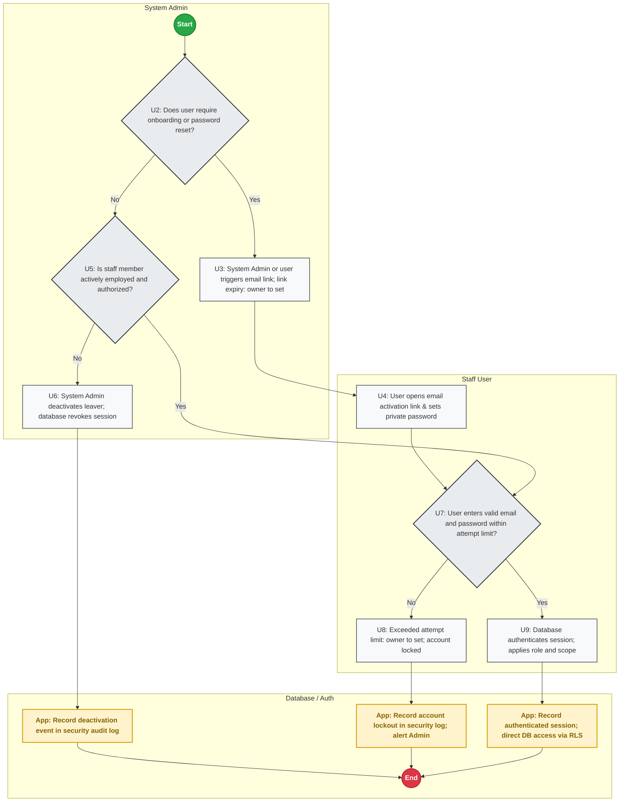

- **Trigger:** Staff onboarding, password reset request, consecutive failed logins, or employee resignation.
- **Actor:** System Admin, Staff User, Database Auth Layer.
- **Inputs:** Staff email, invitation token, private password, login credentials.
- **Outputs:** Verified user account, encrypted session, audit log.
- **Record Stored:** `m_users`, `m_user_invitations`, `t_security_logs`.
- **Decision Points & Branches:**
  - `U2: Onboarding / Password Reset Needed?`: If YES, System Admin sends invitation email or user triggers reset (`U3`); user opens link and sets private password (`U4`); proceeds to login (`U7`). If NO, evaluate employment status (`U5`).
  - `U5: Staff Actively Employed?`: If employee has left, System Admin deactivates account immediately (`U6`); database terminates active session and logs event (`U10`); ends (`U13`). If active, proceed to login check (`U7`).
  - `U7: Valid Credentials within Attempt Limit?`: If consecutive failed logins exceed attempt limit [Owner to set], account locks (`U8`); App logs lockout event (`U11`); requires System Admin manual reset. If valid, database authenticates session and enforces role + scope directly (`U9`).
- **The Control (Stops unauthorized access):**
  - No temporary passwords. Every user sets their own private password via expiring email link. Zero shared logins.
- **Exceptions and what the app does:**
  - *Staff without an email:* [ASSUMPTION: Listed as open Question 1 in Section 6 for owner decision].

---

### FLOW A-1: PHYSICAL RECEIVING & QC
*What this chart does: Enforces arrival within receiving windows, inspects physical goods against open SAP POs, performs temperature and QC checks line by line, verifies invoice price against PO, and routes discrepancies to SCM the same day.*

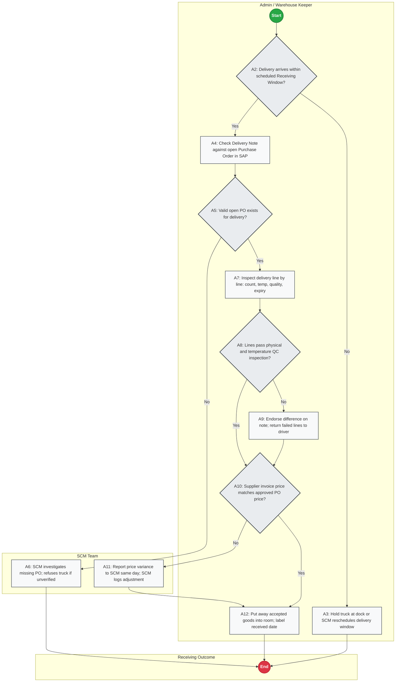

- **Trigger:** Supplier delivery truck arrives at store loading dock.
- **Actor:** Admin / Warehouse Keeper, SCM Team.
- **Inputs:** Physical delivery, supplier Delivery Note, SAP open PO, probe thermometer, supplier invoice.
- **Outputs:** Accepted stock put away and labeled; endorsed delivery note; SCM price discrepancy log.
- **Record Stored:** Delivery note endorsement, SCM price alert log.
- **Decision Points & Branches:**
  - `A2: Arrival within Receiving Window?`: If arrival is outside scheduled receiving windows [Owner to set], truck is held at dock or SCM reschedules (`A3`); flow terminates (`A13`). If within window, proceed to PO match (`A4`).
  - `A5: Valid Open PO Exists?`: If NO open PO exists in SAP, delivery is held at dock (`A6`); SCM investigates missing PO and orders turnback if unverified (`A6`); ends (`A13`). If YES, proceed to physical QC (`A7`).
  - `A8: Lines Pass Physical & Temp QC?`: Evaluated line by line. If defective or warm lines are found, Admin notes difference on delivery note and returns rejected items to driver (`A9`). Accepted lines continue to price check (`A10`).
  - `A10: Invoice Price Matches PO Price?`: If invoice price differs from approved PO price, Admin reports price variance to SCM the same day (`A11`); SCM logs price adjustment or vendor debit (`A11`). Accepted goods are put away into Cold Room or Dry Store and labeled with received date (`A12`).
- **The Control (Stops unauthorized / bad stock):**
  - No PO, no receipt. Receiving allowed only within 2 fixed windows. Physical count and temperature verified before driver departs. Invoice price differences reported to SCM same day.
- **Exceptions and what the app does:**
  - *Sub-temperature chilled goods:* Immediate rejection at dock. Driver signs delivery note deduction.

---

### FLOW A-2: SAP GRPO ENTRY, FILE EXPORT & IMPORT
*What this chart does: Ingests the exported SAP GRPO data file into the App, automatically detects header rows, dynamically maps columns, validates lines, quarantines errors into staging, and appends receipts to the movement ledger.*

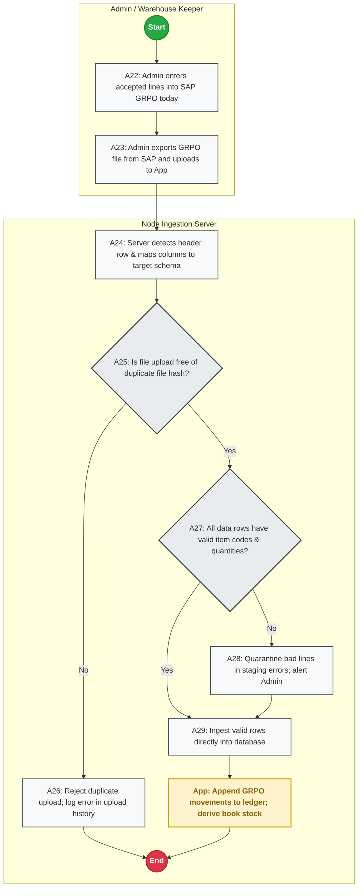

- **Trigger:** Admin completes physical put-away and keys receipt into SAP.
- **Actor:** Admin / Warehouse Keeper, Node Ingestion Server.
- **Inputs:** Exported SAP GRPO file (CSV/Excel).
- **Outputs:** Ingested stock movements in App database, quarantined error rows in staging.
- **Record Stored:** `t_grpo_imports`, `t_grpo_import_items`, `t_grpo_staging_errors`, `t_stock_movements`.
- **Decision Points & Branches:**
  - `A22-A23: SAP Entry & Export`: Receipts are entered into SAP GRPO today. Admin exports the file from SAP and uploads it into the App (`A23`).
  - `A24: Header Detection`: Node server scans rows to auto-detect header row and map target columns (`PO Number`, `Item Code`, `Counted Qty`, `Batch/Expiry`).
  - `A25: Duplicate Hash Check?`: Node server computes SHA-256 file hash. If duplicate upload detected, reject file (`A26`) and alert Admin; ends (`A31`). If clean, proceed to row validation (`A27`).
  - `A27: Data Rows Valid?`: If missing item codes or bad quantities are found, server quarantines bad lines into `t_grpo_staging_errors` and alerts Admin (`A28`). Valid rows are ingested directly into database (`A29`); App appends GRPO movements to ledger (`A30`).
- **The Control (Stops duplicate / corrupted data):**
  - SHA-256 hash blocks accidental re-imports. Staging error quarantine prevents bad rows from blocking clean stock.
- **Exceptions and what the app does:**
  - *Missing Item Code in Master Data:* Bad line quarantined in `t_grpo_staging_errors`; valid lines imported immediately.

---

### FLOW B: KEEP (CUSTODIAN & ADMIN-CONFIGURED ISSUE WINDOWS)
*What this chart does: Restricts storeroom access to single named custodians per room, enforces physical locking outside Admin-configured issue windows, and audits urgent access.*

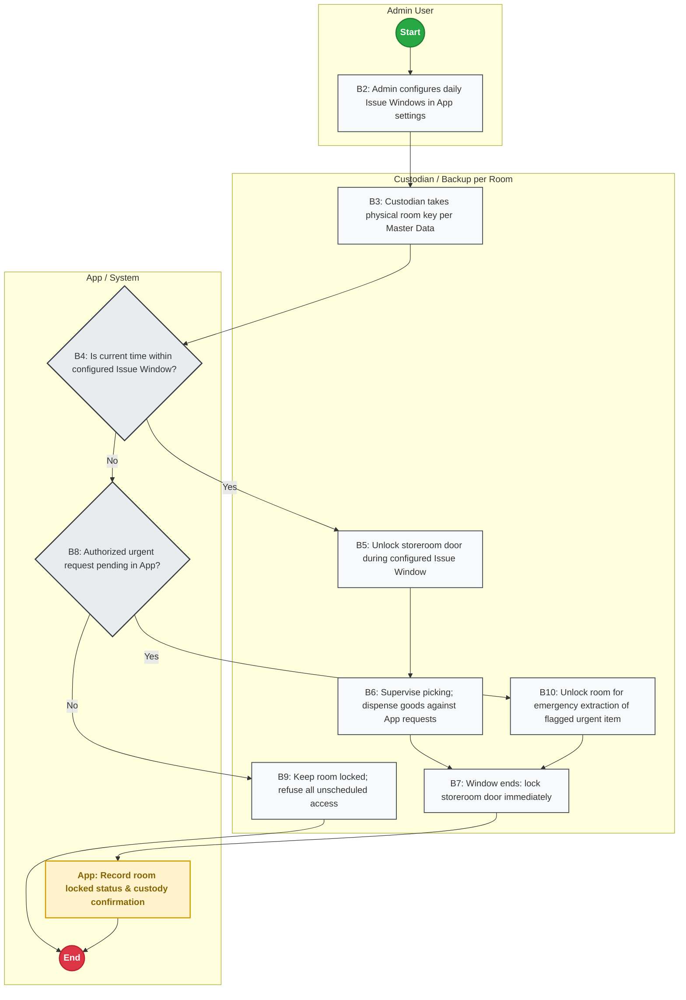

- **Trigger:** Start of daily operational shift.
- **Actor:** Admin User, Room Custodian (or Backup).
- **Inputs:** Issue window time settings, physical brass key, custodian master data.
- **Outputs:** Secure storeroom perimeter, lock/unlock timestamp audit trail.
- **Record Stored:** `t_custody_logs`.
- **Decision Points & Branches:**
  - `B2: Window Setting`: Admin defines Morning and Afternoon Issue Windows in App settings.
  - `B4: Current Time within Issue Window?`: If YES, custodian unlocks door (`B5`), supervises picking (`B6`), and locks door immediately when window expires (`B7`). If NO, evaluate urgent requests (`B8`).
  - `B8: Urgent Request Pending?`: If NO, room remains locked; unlogged entry is refused (`B9`). If YES, custodian unlocks door for single urgent extraction (`B10`), logs access (`B11`), and re-locks door (`B7`).
- **The Control (Stops pilferage & loitering):**
  - Storerooms remain locked outside scheduled windows. Only 1 named custodian and 1 backup hold physical keys per room.
- **Exceptions and what the app does:**
  - *Emergency Access:* Urgent requests logged with staff ID and timestamp; reviewed weekly by Financial Controller.

---

### FLOW C-1: SECTION STOCK REQUEST
*What this chart does: Validates that only assigned section requesters can create requisitions, permits amendment (returning to submission) or cancellation before picking, and tags out-of-window requests as urgent without blocking.*

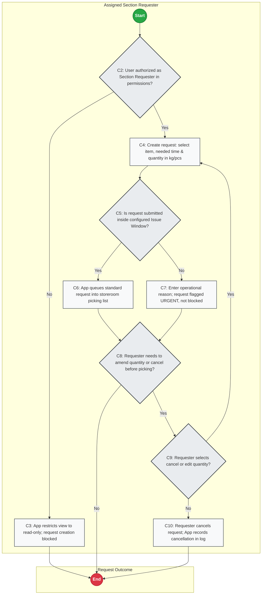

- **Trigger:** Kitchen, Bar, or Cheese section needs ingredients.
- **Actor:** Assigned Section Requester, App Database Layer.
- **Inputs:** Item code, requested quantity in kg or pieces, section, needed time.
- **Outputs:** Staged section requisition record in picking queue.
- **Record Stored:** `t_requests`, `t_request_items`.
- **Decision Points & Branches:**
  - `C2: Authorized Section Requester?`: Database RLS checks user permissions. If NO, request creation is blocked (`C3`); ends (`C11`). If YES, user creates request (`C4`).
  - `C5: Submitted within Issue Window?`: If YES, queued as standard request (`C6`). If NO, requester enters operational reason (`C7`); App flags request as URGENT and queues it (`C7`). Urgent requests are **never blocked**.
  - `C8-C9: Amend or Cancel before Picking?`: Requester may adjust pending request while in queue. If user edits quantity (`C9` Yes), flow loops back to re-enter quantity (`C4`). If user cancels request (`C9` No), request is marked cancelled (`C10`); ends (`C11`).
- **The Control (Stops unauthorized requisitions):**
  - Only authorized section requesters can submit. Database RLS blocks unassigned staff.
- **Exceptions and what the app does:**
  - *Submission Outside Window:* Mandatory reason required; alert dispatched to Admin pick list.

---

### FLOW C-2: STOCK ISSUE AND CONFIRMATION
*What this chart does: Manages FIFO picking, diverts expired lots to quarantine, deducts stock immediately at issue as pending confirmation, handles runner acceptance/declines with reversal entries, and alerts RM to unconfirmed issues at close.*

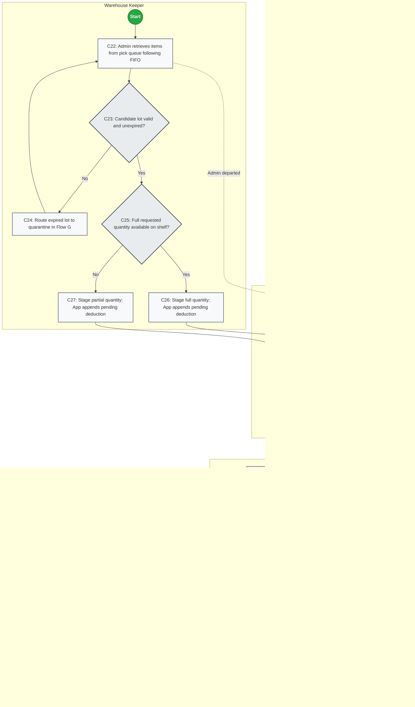

- **Trigger:** Requisitions appear in storeroom picking queue.
- **Actor:** Warehouse Keeper, Kitchen Runner, Restaurant Manager.
- **Inputs:** Requisition list, physical storeroom stock, runner inspection.
- **Outputs:** Dispensed ingredients, immediate pending stock deduction, confirmed issue or reversal entry.
- **Record Stored:** `t_stock_movements`, `t_requests`, `t_request_items`.
- **Decision Points & Branches:**
  - `C23: Candidate Lot Valid & Unexpired?`: If lot is expired or locked, keeper routes expired lot to quarantine in Flow G (`C24`) and loops back to retrieve a valid lot (`C22`). If valid, proceed to stock check (`C25`).
  - `C25: Full Quantity Available?`: If full quantity available, stage full quantity (`C26`). If partial, stage partial quantity and record variance reason (`C27`). In both cases, App appends `ISSUE_PENDING_CONFIRMATION` movement to ledger (`C26/C27`).
  - `C29: Evening Issue [Owner to define]`: Step reserved for owner decision; rejoins runner handoff (`C28`).
  - `C28: Runner Accepts Goods vs ISSUED Quantity?`: Runner inspects goods against issued quantity. If runner declines, goods return to shelf and App appends `ISSUE_REVERSAL` movement to ledger (`C30`); ends (`C33`). If runner accepts, runner confirms receipt digitally on mobile screen (`C31`); App appends `ISSUE_CONFIRMED` movement to ledger.
  - `C32: Confirmed before End of Day?`: If confirmation is not received by store closing, App dispatches unconfirmed issue alert to Restaurant Manager (`C33`).
- **The Control (Stops unlogged stock release & double picking):**
  - Stock deducted immediately at issue as pending confirmation (Decision Q7). If declined, an immutable reversal entry is appended (no row editing). Zero prices displayed to kitchen.
- **Exceptions and what the app does:**
  - *Declined Issue:* Reversal entry appended; inventory unreserved; keeper and requester notified.

---

### FLOW D: BALANCE (DAILY CLOSE RECONCILIATION)
*What this chart does: Executes end-of-day mathematical balance, records custodian closing signature, alerts Finance Lead to variances, and flags persistent unresolved variances at the next morning issue window without blocking service.*

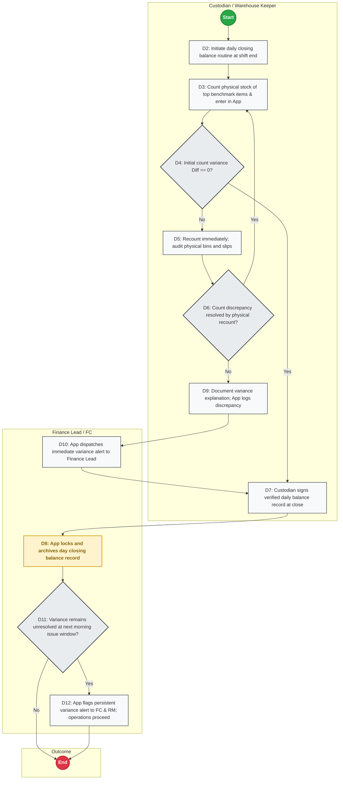

- **Trigger:** End of daily warehouse operations.
- **Actor:** Custodian / Warehouse Keeper, Finance Lead, Restaurant Manager, FC.
- **Inputs:** Cumulative ledger receipts, confirmed issues, physical benchmark count.
- **Outputs:** Signed daily balance record, Finance Lead variance alert.
- **Record Stored:** `t_daily_balances`, `t_daily_balance_items`.
- **Decision Points & Branches:**
  - `D4: Initial Count Diff == 0?`: If physical count equals expected stock ($Diff = Counted - Expected == 0$), custodian signs verified balance sheet at close (`D7`); App locks and archives record (`D8`). If Diff != 0, custodian recounts immediately (`D5`).
  - `D6: Recount Resolves Discrepancy?`: If recount resolves difference, return to enter corrected count (`D3`). If true variance persists, document explanation and responsible staff (`D9`).
  - `D10: Immediate Alert to Finance Lead`: App dispatches immediate variance alert to the Finance Lead (`D10`). Custodian signs the day record at close (`D7`), and App archives the closing balance (`D8`).
  - `D11: Unresolved at Next Morning Window?`: As a separate step, when the next morning's issue window opens, App checks if the variance is still unresolved. If YES, App flags a persistent alert to FC and RM (`D12`) [Decision Q10: flag only, no door lock; operations proceed].
- **The Control (Stops shrinkage latency):**
  - Benchmark items counted daily; custodian signs day record at close; separate morning alert notifies leadership without blocking store prep.
- **Exceptions and what the app does:**
  - *Unresolved Discrepancy:* Flagged in red to FC and RM dashboards; operations continue.

---

### FLOW E: HANDOVER (CUSTODIAN SHIFT HANDOVER)
*What this chart does: Transfers room key and log custody between shift holders, logs temporary key possession in a dedicated shift log without altering permanent master data, and manages dispute recovery.*

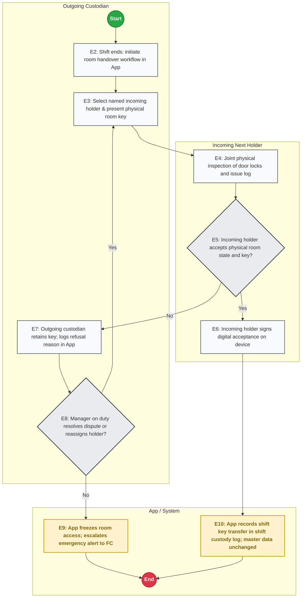

- **Trigger:** Custodian shift ends or leaves premises.
- **Actor:** Outgoing Custodian, Incoming Next Holder, Manager on Duty.
- **Inputs:** Physical key, lock inspection, pending request queue.
- **Outputs:** Shift key custody transfer record.
- **Record Stored:** `t_shift_custody_logs`.
- **Decision Points & Branches:**
  - `E5: Incoming Holder Accepts State & Key?`: Joint inspection conducted (`E4`). If accepted, incoming holder signs on device (`E6`); App records shift key transfer in `t_shift_custody_logs` (`E10`), leaving permanent master data assignments untouched. If disputed, outgoing custodian retains key and logs reason in App (`E7`).
  - `E8: Manager Resolves Dispute?`: If MOD resolves dispute or reassigns holder, loop back to select holder (`E3`). If unresolvable, App freezes room access and escalates emergency alert to FC (`E9`).
- **The Control (Stops unnamed key holding):**
  - Unbroken chain of human custody. Reassignment requires digital signature of incoming holder. Permanent master data remains stable.
- **Exceptions and what the app does:**
  - *Disputed Handover:* Outgoing custodian retains key; room locked until MOD intervention.

---

### FLOW F: COUNT & RECONCILIATION
*What this chart does: Governs periodic and month-end counts under freeze, uses the App Count Function to compare physical vs book stock, mandates a single recount, and reconciles the ledger upon FC approval.*

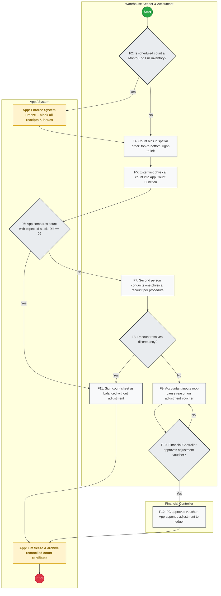

- **Trigger:** Scheduled weekly cycle count or month-end cutoff.
- **Actor:** Warehouse Keeper, Store Accountant, Financial Controller.
- **Inputs:** Physical inventory, weighing scales, App Count Function.
- **Outputs:** Reconciled book stock, audit count certificate, approved adjustment voucher.
- **Record Stored:** `t_stock_counts`, `t_stock_count_items`, `t_stock_adjustments`, `t_stock_movements`.
- **Decision Points & Branches:**
  - `F2: Month-End Full Inventory?`: If YES, App enforces System Freeze (`F3`), blocking all receipts and issues. If NO (weekly cycle count), proceed without freeze (`F4`).
  - `F6: Initial Count Diff == 0?`: If physical count equals expected stock, proceed to sign balanced sheet (`F11`); App lifts freeze and archives (`F13`). If Diff != 0, second person conducts one recount per procedure (`F7`).
  - `F8: Recount Resolves Discrepancy?`: If recount resolves discrepancy, use recount and sign balanced sheet (`F11`). If recount confirms difference, Accountant enters root-cause reason on adjustment voucher (`F9`).
  - `F10: FC Approves Adjustment?`: If FC rejects voucher, return voucher for investigation and recounting (`F9` loop). If FC approves, FC signs authorization (`F12`); App appends adjustment to ledger, reconciles book stock, lifts freeze, and archives certificate (`F13`).
- **The Control (Stops unverified write-offs):**
  - Strict movement freeze during full count. Mandatory recount by second person. Ledger adjustments post only upon FC authorization.
- **Exceptions and what the app does:**
  - *Emergency Issue during Freeze:* Requires emergency break-glass authorization by FC.

---

### FLOW G: OTHER MOVEMENTS (WASTE, RETURNS, TRANSFERS)
*What this chart does: Controls non-standard stock movements with split dispatch/receiving lanes, dedicated supplier return verification, in-transit transfer status with dual signatures, and FC variance approvals (Quantities only).*

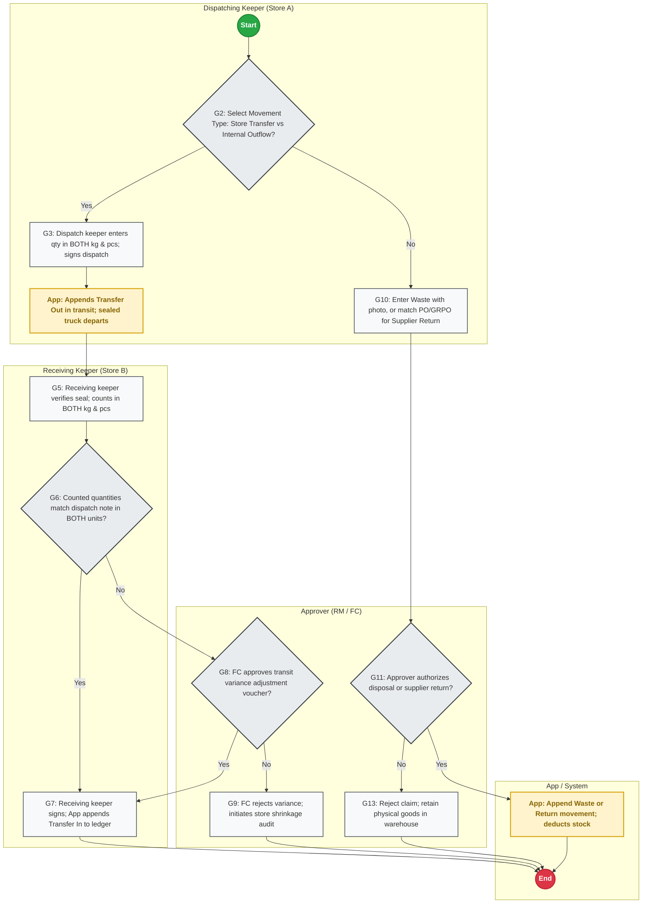

- **Trigger:** Spoilage identified, goods rejected to supplier, or inter-store transfer initiated.
- **Actor:** Dispatching Keeper (Store A), Approver (RM / FC), Receiving Keeper (Store B).
- **Inputs:** Defective items, delivery reference, vehicle seal number.
- **Outputs:** Waste disposal log, supplier return note, in-transit transfer record, dual-signed receipt.
- **Record Stored:** `t_other_movements`, `t_transfer_intransit`, `t_stock_movements`.
- **Decision Points & Branches:**
  - `G2: Movement Type?`: If Store Transfer (`G2` Yes), dispatch keeper enters quantity in BOTH kg and pieces and signs dispatch (`G3`); App appends `TRANSFER_OUT_INTRANSIT` movement (`G4`); truck departs sealed. If Internal Outflow (`G2` No), keeper enters waste with photo or matches PO/GRPO for supplier return (`G10`).
  - `G11: Approver Authorizes Disposal or Return?`: If NO, reject claim (`G13`); physical items remain in storeroom. If YES, App appends `WASTE_DISPOSAL` or `SUPPLIER_RETURN` movement to ledger and deducts stock (`G15`).
  - `G6: Transfer Quantities Match in BOTH Units?`: Receiving keeper verifies seal and counts in BOTH kg and pieces (`G5`). If match (`G6` Yes), receiving keeper signs; App appends `TRANSFER_IN_RECEIVED` to ledger (`G7`). If discrepancy detected (`G6` No), FC approves transit variance adjustment voucher (`G8`); if FC rejects (`G8` No), FC initiates shrinkage audit (`G9`).
- **The Control (Stops trimming & unverified loss):**
  - Dual UOM (both kg and pieces) prevents in-transit trimming. Waste claims require photo evidence. All movements require Approver authorization.
- **Exceptions and what the app does:**
  - *Broken Vehicle Seal:* Receiving keeper halts unloading immediately; escalates to FC.

---

### FLOW H: ADD A NEW STORE OR WAREHOUSE (APPROVAL)
*What this chart does: Manages multi-store expansion proposals, validates store/warehouse hierarchy, enforces FC approval, and activates master data.*

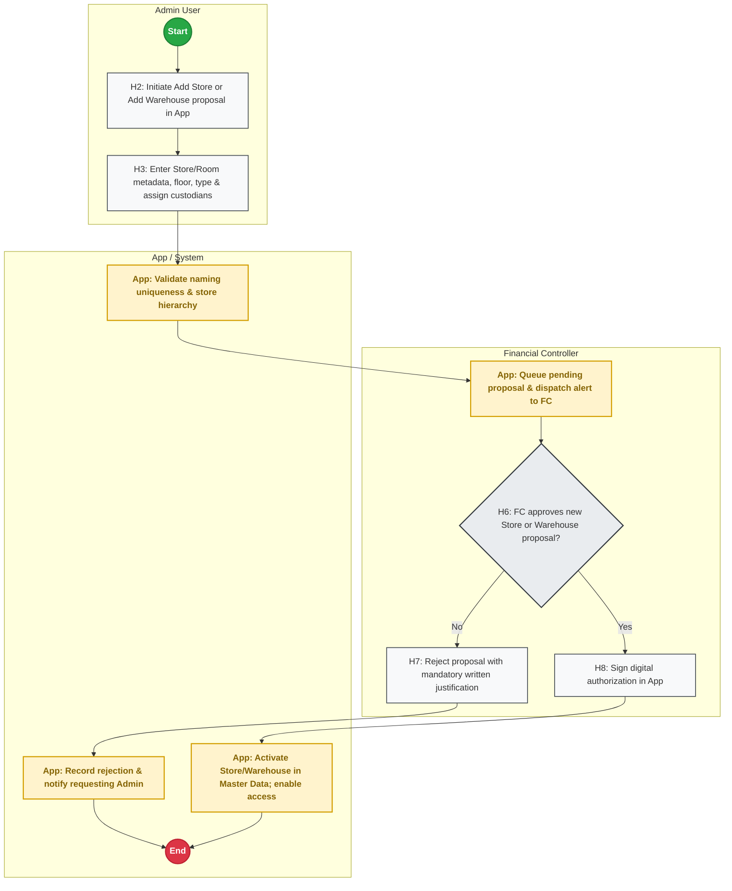

- **Trigger:** Business expansion requires new restaurant store (scale 5 to 6 stores) or controlled storage room.
- **Actor:** Admin User, Financial Controller (FC).
- **Inputs:** Store name, store code, room name, floor level, storage type, nominated custodians.
- **Outputs:** Activated Store / Warehouse master record, active transaction routing.
- **Record Stored:** `t_store_warehouse_approvals`, `m_stores`, `m_warehouses`.
- **Decision Points & Branches:**
  - `H6: FC Approves Proposal?`: If NO, FC rejects proposal with mandatory written justification (`H7`); App records rejection and notifies Admin (`H9`). If YES, FC signs authorization (`H8`); App activates Store/Warehouse in Master Data and enables user access (`H10`).
- **The Control (Stops unmonitored storage):**
  - Hard authorization gate. Local storekeepers cannot create unmonitored storage rooms.
- **Exceptions and what the app does:**
  - *Pop-Up Storage:* Pop-up locations must still go through Flow H with an explicit expiration date.

---

## 4. DAILY USAGE, REORDER VIEW & STOCK DERIVATION

### 4.1 Append-Only Stock Derivation Formula
Physical stock is **never an edited balance**. Current book stock for any item in any warehouse is derived dynamically from `t_stock_movements`. To prevent double-counting across the issue lifecycle (Decision Q7), movement types are strictly categorized into positive additions, pending deductions, confirmed deductions, and reversal additions:

```
Current Book Stock =
    + Sum(Quantity from GRPO_IMPORT)
    - Sum(Quantity from ISSUE_CONFIRMED)
    - Sum(Quantity from ISSUE_PENDING)
    + Sum(Quantity from ISSUE_REVERSAL)
    - Sum(Quantity from WASTE_DISPOSAL)
    - Sum(Quantity from SUPPLIER_RETURN)
    - Sum(Quantity from TRANSFER_OUT_INTRANSIT)
    + Sum(Quantity from TRANSFER_IN_RECEIVED)
    +/- Sum(Quantity from COUNT_ADJUSTMENT)
```

*Note on Pending Issues & Reversals:*
- When Admin stages stock for picking, an `ISSUE_PENDING` record reduces available book stock immediately.
- If the runner confirms receipt, the transaction converts to `ISSUE_CONFIRMED`.
- If the runner declines, an `ISSUE_REVERSAL` entry is appended to restore available inventory without modifying past rows.

### 4.2 Daily Usage Formula
```
Daily Actual Usage = Sum(ISSUE_CONFIRMED for Calendar Day) + Sum(WASTE_DISPOSAL for Calendar Day)
```

### 4.3 Average Daily Usage (ADU)
```
Average Daily Usage = Total Actual Consumption over Rolling N Days / N Days [Owner to set]
```

### 4.4 User-Defined Reorder Trigger & Quantity
*Note: Configured per item by each user or owner. No automated defaults.*
When:
```
Current Book Stock <= Reorder Point [Owner to set]
```
Then:
```
Suggested Reorder Quantity = max(0, Par Level [Owner to set] - Current Book Stock - Open PO Quantity in Transit)
```

### 4.5 Group-Configured Expiry Radar
*Note: Evaluated only for item categories explicitly flagged in `m_expiry_tracking_config`.*
```
Days to Expiry = Batch Expiry Date - Current Date
```
- **EXPIRY WARNING:** Triggered when `Days to Expiry <= Expiry Warning Days [Owner to set]`. Batch highlighted in amber, prioritized on pick list (FIFO).
- **EXPIRED LOCK:** Triggered when `Days to Expiry <= 0`. App hard-locks batch; cannot be selected for kitchen issue.

---

## 5. PLATFORM-NEUTRAL DATA MODEL (23 TABLES)

The relational schema is organized into Master Data (10 tables) and Transactional Data (13 tables):

### 5.1 Master Data Tables (10 Tables)
1. `m_stores`: `store_id` (VARCHAR, PK), `store_name` (VARCHAR), `city` (VARCHAR), `is_active` (BOOLEAN).
2. `m_warehouses`: `warehouse_id` (VARCHAR, PK), `store_id` (VARCHAR, FK), `warehouse_name` (VARCHAR), `storage_type` (VARCHAR), `is_active` (BOOLEAN).
3. `m_go_live_assignments`: `store_id` (VARCHAR, PK/FK), `cold_room_custodian_id` (VARCHAR), `cold_room_backup_id` (VARCHAR), `dry_store_custodian_id` (VARCHAR), `dry_store_backup_id` (VARCHAR), `kitchen_runner_id` (VARCHAR), `evening_key_holder_id` (VARCHAR), `morning_issue_window` (VARCHAR), `afternoon_issue_window` (VARCHAR), `morning_receiving_window` (VARCHAR), `afternoon_receiving_window` (VARCHAR), `db_pause_prevention_ping_enabled` (BOOLEAN).
4. `m_users`: `user_id` (VARCHAR, PK), `email` (VARCHAR, UNIQUE - primary login ID), `full_name` (VARCHAR), `password_hash` (VARCHAR), `failed_login_count` (INTEGER), `lockout_until` (TIMESTAMP, nullable), `is_active` (BOOLEAN).
5. `m_user_invitations`: `invitation_id` (VARCHAR, PK), `email` (VARCHAR), `role` (VARCHAR), `store_id` (VARCHAR), `activation_token` (VARCHAR, UNIQUE), `expires_at` (TIMESTAMP), `status` (`PENDING`, `ACTIVATED`, `EXPIRED`).
6. `m_user_permissions`: `permission_id` (VARCHAR, PK), `user_id` (VARCHAR, FK), `role` (VARCHAR), `store_id` (VARCHAR, FK), `warehouse_id` (VARCHAR, FK, NULLABLE), `section_id` (VARCHAR).
7. `m_items`: `item_code` (VARCHAR, PK), `item_name` (VARCHAR), `category_group` (VARCHAR), `base_uom` (VARCHAR), `is_active` (BOOLEAN).
8. `m_expiry_tracking_config`: `config_id` (VARCHAR, PK), `category_group` (VARCHAR, UNIQUE), `requires_lot_expiry_tracking` (BOOLEAN), `expiry_warning_days` (INTEGER).
9. `m_reorder_rules`: `rule_id` (VARCHAR, PK), `store_id` (VARCHAR, FK), `warehouse_id` (VARCHAR, FK), `item_code` (VARCHAR, FK), `par_level` (DECIMAL), `reorder_point` (DECIMAL), `min_order_qty` (DECIMAL).
10. `m_uom_conversions`: `conversion_id` (VARCHAR, PK), `item_code` (VARCHAR, FK), `base_uom` (VARCHAR), `secondary_uom` (VARCHAR), `conversion_factor` (DECIMAL), `dual_uom_required` (BOOLEAN).

### 5.2 Transactional Tables (13 Tables — Quantities Only, No Prices)
11. `t_stock_movements` (Immutable Append-Only Ledger):
    - `movement_id` (VARCHAR, PK), `store_id` (VARCHAR, FK), `warehouse_id` (VARCHAR, FK), `item_code` (VARCHAR, FK), `movement_type` (VARCHAR: `GRPO_IMPORT`, `ISSUE_PENDING`, `ISSUE_CONFIRMED`, `ISSUE_REVERSAL`, `WASTE_DISPOSAL`, `SUPPLIER_RETURN`, `TRANSFER_OUT_INTRANSIT`, `TRANSFER_IN_RECEIVED`, `COUNT_ADJUSTMENT`), `quantity` (DECIMAL, signed), `uom` (VARCHAR), `batch_number` (VARCHAR, nullable), `expiry_date` (DATE, nullable), `reference_doc_id` (VARCHAR), `created_by_user_id` (VARCHAR, FK), `created_at` (TIMESTAMP).
12. `t_transfer_intransit` (Flow G Inter-Store Transfer State):
    - `transfer_id` (VARCHAR, PK), `source_store_id` (VARCHAR, FK), `target_store_id` (VARCHAR, FK), `item_code` (VARCHAR, FK), `dispatch_qty_kg` (DECIMAL), `dispatch_qty_pcs` (DECIMAL), `vehicle_seal_no` (VARCHAR), `dispatcher_user_id` (VARCHAR, FK), `dispatched_at` (TIMESTAMP), `receive_qty_kg` (DECIMAL, nullable), `receive_qty_pcs` (DECIMAL, nullable), `receiver_user_id` (VARCHAR, FK, nullable), `received_at` (TIMESTAMP, nullable), `variance_qty` (DECIMAL, nullable), `fc_approval_id` (VARCHAR, FK, nullable), `status` (`IN_TRANSIT`, `RECEIVED_MATCH`, `RECEIVED_VARIANCE_APPROVED`, `REJECTED`).
13. `t_grpo_imports` (Flow A-2 File Upload Audit):
    - `import_id` (VARCHAR, PK), `store_id` (VARCHAR, FK), `file_name` (VARCHAR), `file_hash` (VARCHAR, UNIQUE), `detected_header_row` (INTEGER), `total_rows` (INTEGER), `imported_rows` (INTEGER), `error_count` (INTEGER), `uploaded_by_user_id` (VARCHAR, FK), `imported_at` (TIMESTAMP).
14. `t_grpo_import_items` (Flow A-2 Parsed Lines):
    - `import_item_id` (VARCHAR, PK), `import_id` (VARCHAR, FK), `po_number` (VARCHAR), `item_code` (VARCHAR, FK), `counted_qty` (DECIMAL), `batch_number` (VARCHAR), `expiry_date` (DATE), `status` (`IMPORTED`, `REJECTED_MISMATCH`).
15. `t_grpo_staging_errors` (Flow A-2 Quarantined Lines):
    - `error_id` (VARCHAR, PK), `import_id` (VARCHAR, FK), `row_number` (INTEGER), `raw_line_data` (TEXT), `error_reason` (VARCHAR: `MISSING_ITEM_CODE`, `INVALID_QTY`, `FORMAT_ERROR`), `quarantined_at` (TIMESTAMP).
16. `t_security_logs` (Flow 0 Security & Access Audit):
    - `log_id` (VARCHAR, PK), `user_id` (VARCHAR, FK), `event_type` (`INVITATION_SENT`, `PASSWORD_SET`, `LOGIN_SUCCESS`, `LOGIN_FAILED`, `ACCOUNT_LOCKED`, `PASSWORD_RESET`, `DEACTIVATION`), `ip_address` (VARCHAR), `device_info` (VARCHAR), `timestamp` (TIMESTAMP).
17. `t_custody_logs` (Flow B Room Access Logs):
    - `log_id` (VARCHAR, PK), `store_id` (VARCHAR, FK), `warehouse_id` (VARCHAR, FK), `event_type` (`WINDOW_UNLOCK`, `WINDOW_LOCK`, `URGENT_ACCESS`), `custodian_user_id` (VARCHAR, FK), `urgent_reason` (VARCHAR, nullable), `timestamp` (TIMESTAMP).
18. `t_shift_custody_logs` (Flow E Temporary Shift Key Transfer):
    - `shift_log_id` (VARCHAR, PK), `store_id` (VARCHAR, FK), `warehouse_id` (VARCHAR, FK), `outgoing_custodian_id` (VARCHAR, FK), `incoming_holder_id` (VARCHAR, FK), `shift_type` (`DAY_TO_EVENING`, `EVENING_TO_MORNING`), `signature_blob` (TEXT), `transferred_at` (TIMESTAMP).
19. `t_requests` & `t_request_items` (Flow C-1 & C-2 Section Requisitions):
    - `t_requests`: `request_id` (VARCHAR, PK), `store_id` (VARCHAR, FK), `section_id` (VARCHAR), `requester_user_id` (VARCHAR, FK), `is_urgent` (BOOLEAN), `urgent_reason` (VARCHAR), `status` (`QUEUED`, `PICKING`, `PARTIAL_ACCEPTED`, `PARTIAL_DECLINED`, `CANCELLED_BY_REQUESTER`, `URGENT_PENDING`, `CONFIRMED`), `runner_user_id` (VARCHAR, FK), `runner_confirmed_at` (TIMESTAMP).
    - `t_request_items`: `request_item_id` (VARCHAR, PK), `request_id` (VARCHAR, FK), `item_code` (VARCHAR, FK), `requested_qty` (DECIMAL), `issued_qty` (DECIMAL), `uom` (VARCHAR), `variance_reason` (VARCHAR).
20. `t_daily_balances` & `t_daily_balance_items` (Flow D Daily Balance):
    - `t_daily_balances`: `balance_id` (VARCHAR, PK), `store_id` (VARCHAR, FK), `warehouse_id` (VARCHAR, FK), `balance_date` (DATE), `custodian_user_id` (VARCHAR, FK), `status` (`BALANCED`, `VARIANCE_FLAGGED`), `finance_lead_signoff_id` (VARCHAR, FK, nullable).
    - `t_daily_balance_items`: `item_code` (VARCHAR, FK), `opening_qty` (DECIMAL), `received_qty` (DECIMAL), `issued_qty` (DECIMAL), `expected_qty` (DECIMAL), `counted_qty` (DECIMAL), `variance_qty` (DECIMAL), `variance_reason` (VARCHAR), `responsible_person` (VARCHAR).
21. `t_stock_counts` & `t_stock_count_items` (Flow F Reconciliation Counts):
    - `t_stock_counts`: `count_id` (VARCHAR, PK), `store_id` (VARCHAR, FK), `warehouse_id` (VARCHAR, FK), `count_type` (`WEEKLY_CYCLE`, `MONTH_END_FULL`), `freeze_status` (`FROZEN`, `UNFROZEN`), `keeper_user_id` (VARCHAR, FK), `accountant_user_id` (VARCHAR, FK), `status` (`IN_PROGRESS`, `RECOUNT`, `COMPLETED`).
    - `t_stock_count_items`: `item_code` (VARCHAR, FK), `book_qty` (DECIMAL), `first_count_qty` (DECIMAL), `recount_qty` (DECIMAL), `final_counted_qty` (DECIMAL), `difference_qty` (DECIMAL).
22. `t_stock_adjustments` (Flow F Approved Write-Offs):
    - `adjustment_id` (VARCHAR, PK), `count_id` (VARCHAR, FK), `item_code` (VARCHAR, FK), `adjustment_qty` (DECIMAL), `root_cause_reason` (VARCHAR), `fc_approval_id` (VARCHAR, FK), `approved_at` (TIMESTAMP).
23. `t_store_warehouse_approvals` (Flow H Store/Warehouse Proposals):
    - `approval_id` (VARCHAR, PK), `proposal_type` (`NEW_STORE`, `NEW_WAREHOUSE`), `proposed_name` (VARCHAR), `store_id` (VARCHAR, nullable), `storage_type` (VARCHAR), `nominated_custodian_id` (VARCHAR), `nominated_backup_id` (VARCHAR), `fc_decision` (`PENDING`, `APPROVED`, `REJECTED`), `fc_comment` (VARCHAR), `decided_at` (TIMESTAMP).

---

## 6. OPEN QUESTIONS FOR THE OWNER (ALL ASSUMPTIONS MARKED)

### Question 1: Staff Without Company Email Addresses (Decision 1)
- **Context:** The login ID is the email address; accounts are activated via an email link. In restaurant operations, some frontline kitchen or steward runners may not have a company email account.
- **[ASSUMPTION]:** Frontline staff who lack individual email addresses cannot activate an account under the standard flow.
- **Question for Owner:** How should staff without an email address be onboarded? (Option A: Assign a lightweight internal username + Admin generated activation code; Option B: Require an individual personal email; Option C: Only Section Heads have accounts, runners do not create logins).
- **Recommended Answer:** Option C for kitchen runners (they only sign receipt on the keeper's or section head's terminal); Section Requesters are provided lightweight internal emails.

### Question 2: Daily Variance Escalation — Store-Level Finance Lead vs. Central FC (Flow D)
- **Context:** Flow D sends an immediate alert when an evening benchmark count shows an unexplained discrepancy. Across 5 to 6 stores, receiving daily alerts for every store may flood the central Financial Controller.
- **[ASSUMPTION]:** Store-level Finance Leads or Restaurant Managers review daily variances first; only unresolved variances exceeding tolerance escalate to the central FC before morning opening.
- **Question for Owner:** Should evening daily variance alerts route to a store-level Finance Lead / RM first, or directly to the central Financial Controller?
- **Recommended Answer:** Route to store-level Finance Lead / RM immediately at evening close; escalate to central FC only if unresolved by morning opening.

### Question 3: SAP GRPO Export Format & Header Row Detection (Decision 3)
- **Context:** Per Decision 3, goods receipts are entered in SAP first, exported, and imported into the app.
- **[ASSUMPTION]:** Export is standard UTF-8 CSV or `.xlsx` containing at least `PO Number`, `Vendor Code/Name`, `Item Code`, `Received Quantity`, `Unit`, and optionally `Batch Number`, `Expiry Date`.
- **[ASSUMPTION]:** Header row contains string keywords matching `["PO", "Doc", "Item", "Material", "Qty", "Quantity"]`. App scans first rows [ASSUMPTION: scan limit owner to set] to detect this row.
- **Question for Owner:** Does SAP India export as CSV or Excel (.xlsx)? Are column headers standardized across all 5–6 stores?
- **Recommended Answer:** Standardize SAP export layout across all store profiles as CSV; App stores a configurable column mapping template per store.

### Question 4: Duplicate Imports & Mismatch Quarantine Handling (Flow A-2)
- **Context:** An Admin may accidentally upload the same SAP export twice, or upload an export with an unmapped item code.
- **[ASSUMPTION]:** App hashes file contents (SHA-256) and rejects duplicate files. Valid rows are ingested immediately; rows with missing item codes are quarantined in `t_grpo_staging_errors`.
- **Question for Owner:** Do you approve the quarantine staging approach so clean items are not blocked from kitchen issue?
- **Recommended Answer:** Yes, quarantine invalid lines into `t_grpo_staging_errors` and alert Admin, while allowing valid lines into stock immediately.

### Question 5: Frequency and Deadline for SAP GRPO Export/Import (Flow A-2)
- **Context:** If goods arrive at dock, but Admin delays entry into SAP and export to App, the App shows zero stock during issue windows.
- **Question for Owner:** What is the mandatory time limit for Admin to key into SAP and export to the App after dock put-away? [Owner to set limit].
- **Recommended Answer:** Mandate rule: *"Import SAP GRPO file into App within the deadline set by the owner, and strictly before the next Issue Window begins."*

### Question 6: Evening Issue Protocol when Admin has Left (Flow C-2 Step C29)
- **Context:** Step C29 is marked `[Owner to define]`. Kitchen service runs until late night, after Admin's shift ends.
- **Design Lead Proposed Options for Owner Decision:**
  - *Option A (Recommended):* Restaurant Manager (RM / Manager on Duty) holds evening key custody via Flow E Handover. Kitchen submits urgent request in App; RM dispenses and runner confirms receipt on RM device.
  - *Option B (PIN Safe Box):* Storeroom key stored in emergency PIN safe; runner accesses with emergency single-use code; App records entry.
- **Question for Owner:** Which evening access protocol do you approve for Step C29?

### Question 7: User Scope Boundaries across 5–6 Stores (Flow 0)
- **Context:** In 5–6 stores, an Area Chef or Operations Executive may oversee multiple locations.
- **Question for Owner:** Should a user account be locked to exactly 1 store, or can regional staff switch between stores?
- **Recommended Answer:** Single login with a top-bar Store Switcher dropdown, restricted strictly to stores granted in `m_user_permissions`.

---

## 7. SYSTEM CHANGE LOG

| Version | Date | Author / Role | Summary of Changes & Modified Step IDs |
| :---: | :---: | :---: | :--- |
| **v1.0** | 2026-11-01 | Design Lead | Initial baseline specification (Flows A through H) based on initial brief and PDF SOP. |
| **v1.1** | 2026-11-01 | Design Lead | Owner Review Decisions applied: SAP GRPO export/import refactor, 2 receiving windows, SCM swimlane, section requesters, evening placeholder, count reconciliation, multi-store scale (5-6 stores), append-only relational model. |
| **v1.2** | 2026-11-01 | Design Lead | Stage 1 verification & strict rule fixes: Flow F loop fix, Flow C split into C-1/C-2, Flow A window decision, Flow E dispute recovery, Flow D resolution, Flow G split lanes, Flow 0 lifecycle, formula LaTeX cleanup. |
| **v1.3** | 2026-11-01 | Design Lead | **Round 2 Directives & Architectural Partitioning Applied:**<br>1. **Auth & Lifecycle (Decision 1 & Flow 0):** Replaced temporary passwords with email invitations and activation links (`U3/U4`). Login ID standardized to email. Removed `is_temp_password`. Added Q1 for staff without emails.<br>2. **Architecture & Database Direct Path (Decisions 2 to 5):** Updated Section 0.3. Daily frontline mobile actions (request, issue, confirm, count, balance) go direct to managed database via Row-Level Security (RLS), bypassing the Node server so sleeping servers never block the kitchen. Node server handles SAP import, user invites, and scheduled backups. Added daily backup export job and free-tier database pause checklist warning.<br>3. **Flow A Split & Reconnection (Flow A-1 & A-2):** Split Flow A into **Flow A-1** (Physical Receiving & QC, 11 boxes) and **Flow A-2** (SAP GRPO Entry & Import, 9 boxes). Restored supplier invoice price vs PO check (`A10`) and SCM same-day reporting (`A11`). Dedicated SCM swimlane. In A-2, implemented file upload hash validation (`A25`), dynamic column mapping (`A24`), and error quarantine staging (`A28`).<br>4. **Flow C-1 Amendment Loop:** Moved amend/cancel check out of creation path (`C8/C9`). Editing quantity returns directly to submission step (`C4`); only cancellation ends flow (`C10`).<br>5. **Flow C-2 Ledger Deduction & Decline Reversal (Decision Q7):** Implemented immediate stock deduction upon Admin issue as `ISSUE_PENDING` (`C26/C27`). If runner declines (`C28`), physical items return to shelf and an `ISSUE_REVERSAL` movement is appended (`C30`) without editing rows. Replaced lot adjustment with quarantine routing to Flow G (`C24`). Added unconfirmed issue alert to RM at end of day (`C33`).<br>6. **Flow G Transfers & Discrepancies:** Added `TRANSFER_OUT_INTRANSIT` movement with dispatch signature (`G4`). Added FC approval/rejection diamond for transit variance (`G8`). Split supplier return from waste disposal with PO/GRPO matching (`G10`).<br>7. **Flow D Sign-Off Order & Finance Lead Alert:** Re-sequenced Flow D: custodian signs day closing record at close (`D7`); morning check is a separate step (`D11`) flagging FC and RM without blocking operations (Decision Q10). Added explicit alert to Finance Lead (`D10`) and open Question 2.<br>8. **Flow E Shift Custody vs Master Data:** Replaced master data overwrite with temporary shift key holder recording in `t_shift_custody_logs` (`E10`), keeping permanent master data stable.<br>9. **Role Matrix & Data Model Expansion:** Removed user administration from Warehouse Keeper; added `System Admin` role. Expanded Data Model to 23 tables (10 Master, 13 Transactional). Defined movement types to eliminate double-counting in Section 4.1. |

---

## 8. ARCHITECTURAL SAFEGUARDS & TECHNICAL PITFALLS

1. **Google Apps Script String Escaping Bug:**  
   Never write URLs with `//` inline in client-side script tags (GAS `HtmlService` truncates strings after `//`). Pass endpoints via server properties or base64.
2. **Backend Communication Protocol:**  
   Use `google.script.run` with standardized asynchronous promise wrappers; do not rely on standard browser `fetch` for internal script communication.
3. **Storage Architecture & iOS Safari Quotas:**  
   Do not store photos or large caches in `localStorage` (~5MB cap on iOS Safari). All client-side offline queues and photo blobs must use `IndexedDB`.
4. **Resilient Network Queueing & Anti-Looping (Strict Rule):**  
   Never auto-retry a failed queued action in an automated loop. Log the failure once to telemetry; display a clear manual retry button for staff.
5. **Sleeping Server Protection:**  
   Because the Node application server on free/shared tiers may take 15–30 seconds to wake from idle, all time-critical storeroom operations (requisitioning, picking, confirming, counting) connect directly to the database via authenticated client SDKs with Row-Level Security. If a background server operation is required (SAP import), the UI displays a clear waking notice.
6. **Zero-Price Enforcement:**  
   Version 1 stores physical quantities only. The server data model contains no price or cost columns, guaranteeing that kitchen staff cannot intercept financial costs via browser inspection.
