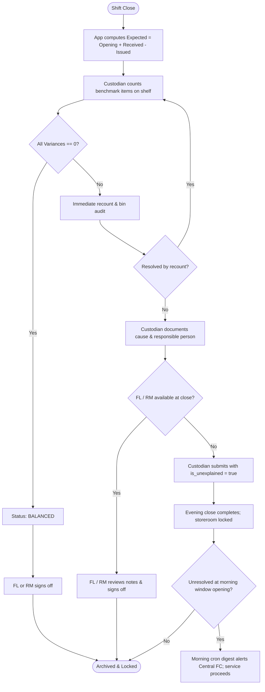

# Database Domain: Daily Benchmark Balance, Reconciliation & Flow D Sign-Off (D8)

## 1. Domain Overview
The Daily Balance domain governs the daily closing inventory reconciliation and physical benchmark verification for Pizza 4P's India Inventory Control Tool. It implements:
- **Flow D (Daily Closing Balance & Top Benchmark Count):** Executes mathematical closing balance calculation at shift end, captures physical counts for critical benchmark items, enforces recount investigation on discrepancies, and secures sign-offs.
- **Evening Unexplained Escalation Protocol:** When store-level Finance Lead (FL) or Restaurant Manager (RM) is unavailable at evening close, allows the Custodian to submit an unexplained variance flagged balance (`is_unexplained = true`).
- **Morning Escalation Digest:** Exposes unresolved and unexplained variances via an optimized view (`v_daily_balance_escalations`) ready for the automated morning cron alert to the central Financial Controller (FC) before the morning issue window opens, without blocking frontline storeroom doors.

All schemas, views, and functions strictly adhere to **quantities only**: zero commercial, valuation, financial, or purchasing data exist in any table, procedure, or policy.

---

## 2. Relational Schema & Tables

### 2.1 `t_daily_balances`
Header table recording the daily closing reconciliation state for a specific store warehouse on a given date.

| Column | Type | Constraints | Description |
| :--- | :--- | :--- | :--- |
| `balance_id` | `uuid` | `PRIMARY KEY DEFAULT gen_random_uuid()` | Unique daily balance session identifier. |
| `store_id` | `text` | `NOT NULL REFERENCES m_stores(store_id)` | Store branch identifier. |
| `warehouse_id` | `text` | `NOT NULL REFERENCES m_warehouses(warehouse_id)` | Warehouse/storeroom identifier (Cold Room or Dry Store). |
| `balance_date` | `date` | `NOT NULL DEFAULT current_date` | Operational closing date. |
| `custodian_user_id` | `uuid` | `NOT NULL REFERENCES auth.users(id)` | Authenticated custodian who counted and submitted benchmark stock. |
| `status` | `text` | `NOT NULL CHECK (status IN ('BALANCED', 'VARIANCE_FLAGGED'))` | Reconciliation status derived from item variances. |
| `is_unexplained` | `boolean` | `NOT NULL DEFAULT false` | Flag indicating evening closure without immediate FL explanation. |
| `finance_lead_signoff_id` | `uuid` | `NULL REFERENCES auth.users(id)` | User ID of the Finance Lead or RM reviewing and signing off. |
| `signoff_notes` | `text` | `NULL` | Managerial explanation, investigation notes, or recount observations. |
| `signed_off_at` | `timestamptz` | `NULL` | Timestamp when the balance was formally signed off. |
| `created_at` | `timestamptz` | `NOT NULL DEFAULT now()` | Record creation timestamp. |

- **Table Constraints:**
  - `uq_daily_balance_store_wh_date`: `UNIQUE (store_id, warehouse_id, balance_date)`. Prevents duplicate daily balance submissions for the same storeroom on the same date.
- **Indexes:**
  - `idx_daily_balances_store_wh_date` on `(store_id, warehouse_id, balance_date DESC)`
  - `idx_daily_balances_status` on `status`
  - `idx_daily_balances_custodian` on `custodian_user_id`
  - `idx_daily_balances_signoff` on `finance_lead_signoff_id`
  - `idx_daily_balances_escalation` (Partial index) on `(balance_date, status, is_unexplained)` `WHERE status = 'VARIANCE_FLAGGED' AND (finance_lead_signoff_id IS NULL OR is_unexplained = true)`.

---

### 2.2 `t_daily_balance_items`
Append-only line items recording opening stock, receipts, issues, counted physical quantities, and mathematical variances for each benchmark item.

| Column | Type | Constraints | Description |
| :--- | :--- | :--- | :--- |
| `balance_item_id` | `uuid` | `PRIMARY KEY DEFAULT gen_random_uuid()` | Unique line item identifier. |
| `balance_id` | `uuid` | `NOT NULL REFERENCES t_daily_balances(balance_id) ON DELETE CASCADE` | Parent daily balance header. |
| `item_code` | `text` | `NOT NULL REFERENCES m_items(item_code)` | Benchmark ingredient/item code. |
| `opening_qty` | `numeric(12,3)` | `NOT NULL` | Opening physical quantity at start of day. |
| `received_qty` | `numeric(12,3)` | `NOT NULL DEFAULT 0` | Cumulative confirmed receipts during the day. |
| `issued_qty` | `numeric(12,3)` | `NOT NULL DEFAULT 0` | Cumulative confirmed issues to kitchen/bar during the day. |
| `expected_qty` | `numeric(12,3)` | `NOT NULL` | Calculated expected closing stock. |
| `counted_qty` | `numeric(12,3)` | `NOT NULL` | Actual physical shelf count entered by custodian. |
| `variance_qty` | `numeric(12,3)` | `NOT NULL` | Mathematical difference (`counted_qty - expected_qty`). |
| `variance_reason` | `text` | `NULL` | Operational cause code or explanation if variance != 0. |
| `responsible_person` | `text` | `NULL` | Named section lead or handler associated with discrepancy. |
| `created_at` | `timestamptz` | `NOT NULL DEFAULT now()` | Entry timestamp. |

- **Table Constraints:**
  - `uq_balance_item`: `UNIQUE (balance_id, item_code)`. Guarantees each benchmark item is recorded exactly once per closing balance.
  - `chk_expected_qty`: `CHECK (expected_qty = opening_qty + received_qty - issued_qty)`. Enforces strict mathematical closing formula at database engine level.
  - `chk_variance_qty`: `CHECK (variance_qty = counted_qty - expected_qty)`. Enforces exact variance definition at database engine level.
- **Indexes:**
  - `idx_daily_balance_items_balance` on `balance_id`
  - `idx_daily_balance_items_item` on `item_code`

---

### 2.3 `v_daily_balance_escalations`
Derived security-invoker view aggregating unresolved and unexplained daily balances for the morning automated cron digest to Central Financial Controllers.

```sql
CREATE OR REPLACE VIEW public.v_daily_balance_escalations
WITH (security_invoker = true)
AS
SELECT
  b.balance_id,
  b.store_id,
  b.warehouse_id,
  b.balance_date,
  b.custodian_user_id,
  b.status,
  b.is_unexplained,
  b.finance_lead_signoff_id,
  b.signoff_notes,
  b.signed_off_at,
  b.created_at,
  COUNT(i.balance_item_id) AS total_items_count,
  COUNT(CASE WHEN i.variance_qty != 0 THEN 1 END) AS variance_items_count
FROM public.t_daily_balances b
LEFT JOIN public.t_daily_balance_items i ON i.balance_id = b.balance_id
WHERE b.status = 'VARIANCE_FLAGGED'
  AND (b.finance_lead_signoff_id IS NULL OR b.is_unexplained = true)
GROUP BY
  b.balance_id,
  b.store_id,
  b.warehouse_id,
  b.balance_date,
  b.custodian_user_id,
  b.status,
  b.is_unexplained,
  b.finance_lead_signoff_id,
  b.signoff_notes,
  b.signed_off_at,
  b.created_at;
```

---

## 3. Daily Close Reconciliation Formulas & Status Logic

### 3.1 Reconciliation Formulas
1. **Closing Expected Stock Formula:**
   $$\text{expected\_qty} = \text{opening\_qty} + \text{received\_qty} - \text{issued\_qty}$$
2. **Variance Calculation:**
   $$\text{variance\_qty} = \text{counted\_qty} - \text{expected\_qty}$$
   - When $\text{variance\_qty} = 0$: Count matches book expectation exactly.
   - When $\text{variance\_qty} < 0$: Physical shortage (shelf count lower than book).
   - When $\text{variance\_qty} > 0$: Physical overage (shelf count higher than book).

### 3.2 Header Status Derivation
- **`BALANCED`:** All benchmark line items have $\text{variance\_qty} = 0$.
- **`VARIANCE_FLAGGED`:** At least one benchmark line item has $\text{variance\_qty} \ne 0$.

### 3.3 Evening Close & Morning Escalation Protocol (Flow D)


---

## 4. Immutability & Audit Trail Architecture

The Daily Balance domain adheres strictly to tamper-proof audit trail guarantees:

1. **Line Item Immutability (`t_daily_balance_items`):**
   - Trigger `tg_prevent_daily_balance_item_mutation()` intercepts all `BEFORE UPDATE OR DELETE` attempts and raises exception:
     `'Daily balance items are append-only and cannot be updated or deleted.'`
2. **Header Immutability & Sign-Off Lock (`t_daily_balances`):**
   - `DELETE` is permanently forbidden: raises exception `'Daily balances cannot be deleted.'`
   - `UPDATE` is restricted:
     - Core submission attributes (`balance_id`, `store_id`, `warehouse_id`, `balance_date`, `custodian_user_id`, `status`, `is_unexplained`, `created_at`) cannot be altered.
     - Once `signed_off_at` is populated, the row is permanently locked against further updates:
       `'Daily balance is already signed off and locked from further modification.'`
3. **Privilege Revocation:**
   - `REVOKE DELETE ON public.t_daily_balances FROM PUBLIC, authenticated;`
   - `REVOKE UPDATE, DELETE ON public.t_daily_balance_items FROM PUBLIC, authenticated;`

---

## 5. Stored Procedures (RPCs)

### 5.1 `submit_daily_balance`
Atomic submission of daily benchmark count and line items.

- **Signature:**
  ```sql
  public.submit_daily_balance(
    p_store_id text,
    p_warehouse_id text,
    p_items jsonb,
    p_is_unexplained boolean DEFAULT false
  ) RETURNS uuid
  ```
- **Execution Mode:** `SECURITY DEFINER SET search_path = public, auth`.
- **Authorization & Guards:**
  1. **Role Check:** Caller must have role `ADMIN` (Warehouse Keeper), `CUSTODIAN`, or `SYSTEM_ADMIN`.
  2. **Store Scope Check:** If session setting `current_store_id()` is populated, it must equal `p_store_id` (unless `SYSTEM_ADMIN`).
  3. **Caller Context:** Resolves caller user ID via `app.current_user_id`, `request.jwt.claim.sub`, or `auth.uid()`.
  4. **Warehouse Validation:** Ensures `p_warehouse_id` belongs to `p_store_id`.
  5. **Daily Uniqueness:** Blocks duplicate submission for the same `(store_id, warehouse_id, current_date)`.
  6. **Payload Validation:** `p_items` must be a non-empty JSON array. Each element must contain a valid `item_code` in `m_items`, without intra-payload duplicates.
  7. **Mathematical Consistency:** Validates non-negative physical quantities (`opening_qty`, `received_qty`, `issued_qty`, `counted_qty`). Verifies that `expected_qty` and `variance_qty` match formulas if passed by client.
  8. **Status Derivation:** Sets status to `VARIANCE_FLAGGED` if any item has `variance_qty != 0`, otherwise `BALANCED`. Sets `is_unexplained = p_is_unexplained` only when variance exists.
  9. **Atomic Insert:** Inserts `t_daily_balances` header and all `t_daily_balance_items` within a single transaction.

---

### 5.2 `sign_off_daily_balance`
Formal review and sign-off of daily balance by store management.

- **Signature:**
  ```sql
  public.sign_off_daily_balance(
    p_balance_id uuid,
    p_notes text DEFAULT NULL
  ) RETURNS void
  ```
- **Execution Mode:** `SECURITY DEFINER SET search_path = public, auth`.
- **Authorization & Guards:**
  1. **Role Check:** Caller must have role `RM` (Restaurant Manager), `ACCOUNTANT` (Store Finance Lead), `APPROVER` (Central FC), or `SYSTEM_ADMIN`. Frontline custodians and runners cannot sign off.
  2. **Caller Context:** Resolves caller user ID.
  3. **Store Scope Check:** Caller's store scope must match the balance record's `store_id` (unless `SYSTEM_ADMIN` or `APPROVER`).
  4. **Single Sign-Off Guard:** Verifies `signed_off_at` is NULL; throws exception if already signed.
  5. **Segregation of Duties Enforcement:**
     $$\text{If } (\text{status} = \text{'VARIANCE\_FLAGGED'} \lor \text{variance\_qty} \ne 0) \implies \text{caller\_id} \ne \text{custodian\_user\_id}$$
     If any variance exists, the custodian who performed the count is strictly barred from signing off the discrepancy. An independent FL or RM must review and sign.
  6. **Locking Update:** Sets `finance_lead_signoff_id = caller_id`, `signoff_notes = p_notes`, and `signed_off_at = now()`.

---

## 6. Row-Level Security (RLS) Matrix & Policies

### 6.1 Role Access Matrix

| Role | `t_daily_balances` Read | `t_daily_balances` Write | `t_daily_balances` Sign-Off | `t_daily_balance_items` Read | `t_daily_balance_items` Insert |
| :--- | :---: | :---: | :---: | :---: | :---: |
| **SYSTEM_ADMIN** | All stores | All stores | All stores | All stores | All stores |
| **ADMIN** *(Keeper)* | Assigned store | Assigned store | No | Assigned store | Assigned store |
| **CUSTODIAN** | Assigned store | Assigned store | No | Assigned store | Assigned store |
| **RM** *(Restaurant Mgr)* | Assigned store | No | Assigned store | Assigned store | No |
| **ACCOUNTANT** *(Store FL)* | Assigned store | No | Assigned store | Assigned store | No |
| **APPROVER** *(Central FC)* | All stores | No | All stores | All stores | No |
| **VIEWER** *(Audit)* | All stores | No | No | All stores | No |
| **RUNNER / Requester** | No | No | No | No | No |

---

### 6.2 Policy Definitions

#### `t_daily_balances`
```sql
-- Read: Assigned store for frontline & FL/RM; global for Approver/Viewer/SysAdmin
CREATE POLICY t_daily_balances_select ON public.t_daily_balances
  FOR SELECT TO authenticated
  USING (
    (
      (has_role('ADMIN') OR has_role('CUSTODIAN') OR has_role('RM') OR has_role('ACCOUNTANT'))
      AND (current_store_id() IS NULL OR store_id = current_store_id())
    )
    OR has_role('APPROVER') OR has_role('VIEWER') OR has_role('SYSTEM_ADMIN')
  );

-- Insert: Custodians and Keepers within store scope
CREATE POLICY t_daily_balances_insert ON public.t_daily_balances
  FOR INSERT TO authenticated
  WITH CHECK (
    (has_role('ADMIN') OR has_role('CUSTODIAN') OR has_role('SYSTEM_ADMIN'))
    AND (current_store_id() IS NULL OR store_id = current_store_id() OR has_role('SYSTEM_ADMIN'))
  );

-- Update: FL / RM for sign-off transition within store scope
CREATE POLICY t_daily_balances_update ON public.t_daily_balances
  FOR UPDATE TO authenticated
  USING (
    ((has_role('RM') OR has_role('ACCOUNTANT')) AND (current_store_id() IS NULL OR store_id = current_store_id()))
    OR has_role('APPROVER') OR has_role('SYSTEM_ADMIN')
  )
  WITH CHECK (
    ((has_role('RM') OR has_role('ACCOUNTANT')) AND (current_store_id() IS NULL OR store_id = current_store_id()))
    OR has_role('APPROVER') OR has_role('SYSTEM_ADMIN')
  );

-- Delete: Forbidden for all
CREATE POLICY t_daily_balances_delete ON public.t_daily_balances
  FOR DELETE TO authenticated USING (false);
```

#### `t_daily_balance_items`
```sql
-- Read: Inherits access of parent balance
CREATE POLICY t_daily_balance_items_select ON public.t_daily_balance_items
  FOR SELECT TO authenticated
  USING (
    EXISTS (
      SELECT 1 FROM public.t_daily_balances b
      WHERE b.balance_id = t_daily_balance_items.balance_id
      AND (
        ((has_role('ADMIN') OR has_role('CUSTODIAN') OR has_role('RM') OR has_role('ACCOUNTANT'))
         AND (current_store_id() IS NULL OR b.store_id = current_store_id()))
        OR has_role('APPROVER') OR has_role('VIEWER') OR has_role('SYSTEM_ADMIN')
      )
    )
  );

-- Insert: Custodians and Keepers for assigned store
CREATE POLICY t_daily_balance_items_insert ON public.t_daily_balance_items
  FOR INSERT TO authenticated
  WITH CHECK (
    (has_role('ADMIN') OR has_role('CUSTODIAN') OR has_role('SYSTEM_ADMIN'))
    AND EXISTS (
      SELECT 1 FROM public.t_daily_balances b
      WHERE b.balance_id = t_daily_balance_items.balance_id
      AND (current_store_id() IS NULL OR b.store_id = current_store_id() OR has_role('SYSTEM_ADMIN'))
    )
  );

-- Update & Delete: Append-only enforcement
CREATE POLICY t_daily_balance_items_update ON public.t_daily_balance_items FOR UPDATE TO authenticated USING (false);
CREATE POLICY t_daily_balance_items_delete ON public.t_daily_balance_items FOR DELETE TO authenticated USING (false);
```

---

## 7. Verification & pgTAP Test Coverage
The suite in `supabase/tests/0080_balance.sql` provides 66 automated assertions verifying:
1. Exact table and view existence (`t_daily_balances`, `t_daily_balance_items`, `v_daily_balance_escalations`).
2. Primary keys, exact column schema, and data types.
3. Foreign key constraints linking stores, warehouses, items, and auth users.
4. Row Level Security enablement on both tables.
5. Mathematical constraints enforcing expected and variance formulas.
6. Immutability triggers preventing unauthorized row mutation and deletion.
7. RPC `submit_daily_balance` execution across balanced, variance-flagged, and unexplained modes.
8. RPC `sign_off_daily_balance` execution, dual-party segregation checks, and immutability lock.
9. RLS multi-tenant store isolation and role-based read/write restrictions.
